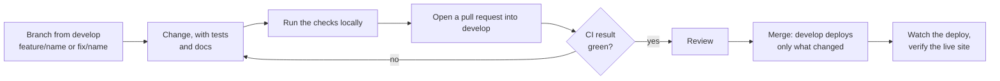

# Contributing

How to change PropertyOS safely. The short version: small branches, tests with the change, documents with the change, and let CI be the judge.

## 1. The workflow



1. Branch from `develop`: `feature/<short-name>` or `fix/<short-name>`.
2. Keep changes small and focused; one concern per pull request.
3. Open a pull request into `develop`. The **CI result** check must be green: backend `mvn verify` with the coverage gate, frontend tests and builds, migration numbering, the API reference and every diagram.
4. Use [Conventional Commits](https://www.conventionalcommits.org): `feat:`, `fix:`, `docs:`, `test:`, `refactor:`, `chore:`.
5. **Merging to `develop` deploys to AWS** ([CI/CD](docs/CI-CD.md)). Say in the pull request description anything the merger must know: a migration, a new variable, a manual step. Take an RDS snapshot first when a migration is involved ([Operations](docs/OPERATIONS.md#6-the-database)).
6. A change that only touches `docs/`, `infra/` or `performance/` does not deploy.

## 2. Definition of done

A change is done when:

- [ ] It works, and a test proves it (a fixed bug has a test that failed first).
- [ ] The whole backend `mvn verify` passes, including the 90% line and 72% branch gate.
- [ ] If a screen changed, the browser spec for it passes and the page works at phone width.
- [ ] Tenant data is still isolated: a new table has `org_id`, forced row-level security and a policy; a new endpoint has `@RequiresPermission` (or lives under `/public/` deliberately).
- [ ] The documents that describe it say what is now true ([section 6](#6-documentation-is-part-of-the-change)).
- [ ] The pull request says how it was tested and how to deploy it.

## 3. Backend conventions

* Java 21, constructor injection, final fields. No field injection.
* Controllers only translate HTTP; business rules live in `service` classes; SQL lives behind `Db`.
* One class, one responsibility. If a class passes roughly 500 lines or you need "and" to describe it, split it (see `DocumentService`, `DocumentClassifier`, `DocumentRequirements`).
* Throw `ApiException` factories (`badRequest`, `forbidden`, `notFound`, `conflict`) with a message a person can act on. Do not catch `Exception` unless the code is a deliberate resilience boundary, and say so in a comment.
* Every endpoint carries `@RequiresPermission` unless it is under `/public/`.
* Every query on tenant data runs inside a transaction so row-level security applies (`Db` refuses otherwise).
* Public (visitor) reads go through `PublicCatalog`/`PublicService` only, with explicit predicates ([ADR 9](docs/adr/0009-public-catalogue-reads-as-system.md)).
* SQL is parameterised. If you must build a fragment (a sort column), whitelist it.
* **Schema changes:** a new Flyway migration `V<n>__<name>.sql` in the owning service; never edit an applied one; keep it additive so the previous version of the service still runs. See [DATABASE-MIGRATIONS](docs/DATABASE-MIGRATIONS.md).
* Javadoc on every public class and any method whose behaviour is not obvious from its name: the first sentence becomes the summary in the generated API reference.
* Add or update tests with the change: `*Test` for logic, `*IT` for anything crossing HTTP and the database.

## 4. Frontend conventions

* TypeScript strict; no `any` without a reason in a comment.
* Shared components, formatters and the API client belong in `packages/ui`.
* Errors shown to people come from `friendlyMessage`, never raw server text.
* Menus are defined once in `apps/shell/src/layout/nav.ts`; pages never draw their own.
* Lists that can grow use server paging (`usePagedApi` and `DataTable`); pickers search the server (`EntityPicker`).
* Format with Prettier (`.prettierrc.json`) and follow `.editorconfig`.
* Colours come from the `federal` palette (CSS variables), so a company's branding applies everywhere.

## 5. Running the checks locally

```bash
cd backend  && mvn verify                      # all backend tests and the coverage gate (about 10 minutes)
cd frontend && npm test && npm run build
node scripts/check-migrations.js               # migration numbering
node scripts/check-endpoints.js                # front-end calls match real endpoints
node scripts/generate-api-docs.js --check      # API reference matches the controllers
cd e2e && npm run docs:check                   # every diagram draws
```

After changing a service, build it with `mvn clean package -DskipTests` before running system tests (they launch the prebuilt jars; a plain `package` can keep a stale shared-kernel jar inside).

The browser suite is run before a release: see [Testing](docs/TESTING.md#5-browser-end-to-end-playwright).

## 6. Documentation is part of the change

A change that alters what a document says is not finished until that document says it. Use this map:

| You changed | Update |
| --- | --- |
| A controller or endpoint | Run `node scripts/generate-api-docs.js` and commit the pages (CI checks) |
| A table, column or migration | [DATA-MODEL](docs/DATA-MODEL.md), [DATABASE-MIGRATIONS](docs/DATABASE-MIGRATIONS.md) |
| A permission, role or security rule | [SECURITY](docs/SECURITY.md) |
| A setting or environment variable | [CONFIGURATION](docs/CONFIGURATION.md) |
| A lifecycle (listing, lease, work order ...) | [LLD](docs/architecture/LLD.md#4-state-machines) |
| A scheduled job | [LLD](docs/architecture/LLD.md#5-scheduled-jobs), [OPERATIONS](docs/OPERATIONS.md) |
| An event | [LLD](docs/architecture/LLD.md#3-events-the-transactional-outbox) |
| A screen or capability users see | [PRODUCT](docs/PRODUCT.md) and a [CHANGELOG](docs/CHANGELOG.md) entry |
| AWS resources | [DEPLOYMENT](docs/architecture/DEPLOYMENT.md), [AWS-DEPLOY](docs/AWS-DEPLOY.md) |
| A decision that is expensive to reverse | A new [ADR](docs/adr/README.md) |

Diagrams are Mermaid in the Markdown. CI parses every one. Remember: a semicolon inside a sequence-diagram message ends the statement in Mermaid, so use a comma; keep colons out of state-diagram transition labels except the one that separates the label.

## 7. Security

Never commit secrets. Report a vulnerability privately to the maintainers instead of opening a public issue. Treat anything that could cross a company boundary as severe: add a test that drives it as a second company.
