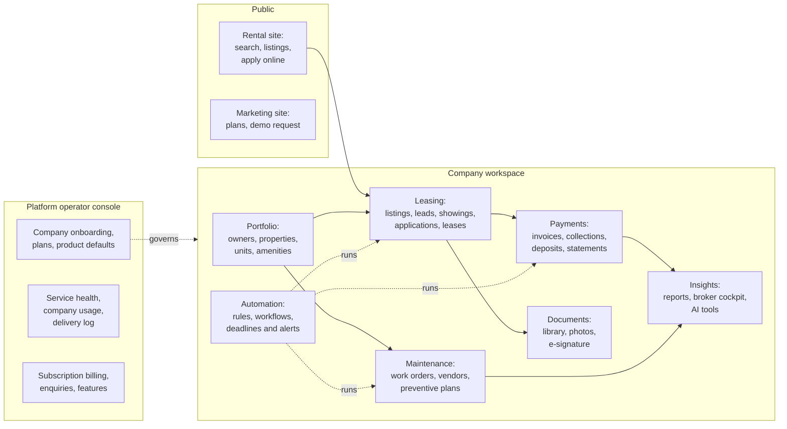
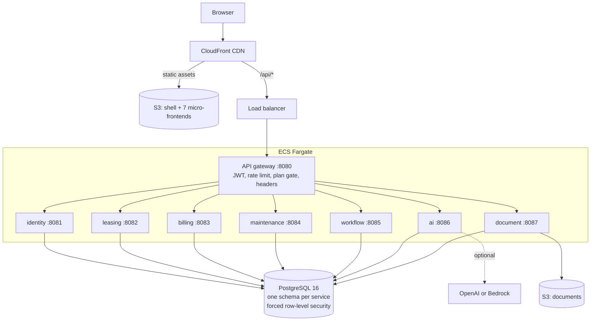

<div align="center">

# PropertyOS

**The operating system for residential property management.**
Leasing, rent and payments, maintenance, documents and e-signature, owner reporting and AI assistance, on one multi-tenant platform that a company can be running on within a day.

[](https://github.com/lucky1ravi/property/actions/workflows/ci.yml)
[](https://github.com/lucky1ravi/property/actions/workflows/deploy.yml)

[Documentation hub](docs/README.md) · [Product guide](docs/PRODUCT.md) · [Architecture](docs/architecture/HLD.md) · [API reference](docs/api/README.md) · [Run it locally](docs/LOCAL-RUN.md) · [Live demo](https://dtqbmyulhq2jl.cloudfront.net)

</div>

---

## Why PropertyOS

A property manager's day is a queue: an enquiry to answer, an application to screen, a repair to approve, rent that did not arrive, an owner who wants a statement. PropertyOS turns a large portfolio into a short, prioritised list, and makes each item one click.

| Principle | What it means in the product |
| --- | --- |
| **One system of record** | Properties, units, leases, residents, money, repairs and documents share one database and one audit trail. Nothing is copied between tools. |
| **Safe by construction** | A company can never see another company's data, even if application code has a bug: PostgreSQL row-level security is the last line of defence ([Security](docs/SECURITY.md)). |
| **Configuration is data** | Fees, approval limits, screening rules, notifications, branding and state-law rules are settings, not code releases ([Configuration](docs/CONFIGURATION.md)). |
| **AI that asks first** | The assistant drafts, explains and suggests. It never writes without a person confirming, and the product works fully with no model at all ([AI](docs/AI.md)). |
| **Operable** | Health probes, correlation ids on every log line, alarms, a delivery log, service-health and usage consoles for the platform team ([Operations](docs/OPERATIONS.md)). |

## What is in it



| Area | Highlights |
| --- | --- |
| **Portfolio** | Owners, properties, units, photo galleries with AI review, a searchable amenity catalogue with icons (platform list plus each company's own), resident ratings of properties and units. |
| **Leasing** | AI-assisted listings with fair-housing screening, a public homes search with filters, paging, by-property and by-home views, enquiry and tour requests, online applications, automated screening, lease generation, e-signature, renewals. |
| **Payments** | Monthly rent cycle on a nightly timer, invoices with a professional PDF, card and bank payments, late fees with state caps, deposits, owner statements, 1099 data. |
| **Maintenance** | Residents report with photos, AI triage, approval limits per role, vendor assignment and scheduling, completion and verification, vendor ratings, preventive plans. |
| **Documents** | Library with versions and requirement checklists, applicant upload links that expire, signature requests with reminders. |
| **Insights** | Fourteen drill-down reports (rent roll, occupancy, receivables, income, repair costs, vendor scorecard and more), the broker cockpit, AI studio tools. |
| **Platform console** | Company onboarding and suspension, plans and feature entitlements, product defaults, subscription invoices and payments, service health, company usage, a masked delivery log with audited full-detail access. |
| **Every company is its own brand** | Primary colour, logo and contact details flow through the menu, top bar, buttons, invoice PDF and the public listing page. |

## Architecture at a glance



Seven business services behind one gateway, each owning a database schema, talking over REST for questions and a transactional event log for facts. The front end is a shell plus seven independently deployable micro-frontends. Read the [high-level design](docs/architecture/HLD.md) next.

| Layer | Technology |
| --- | --- |
| Backend | Java 21, Spring Boot 3.4, Spring Cloud Gateway, seven services plus the gateway |
| Data | PostgreSQL 16, schema per service, Flyway (31 forward-only migrations), forced row-level security |
| Frontend | React 18, TypeScript, Vite Module Federation (shell plus seven micro-frontends), Tailwind |
| AI | OpenAI or AWS Bedrock behind one interface, offline rule-based fallback, guardrails and audit |
| Delivery | GitHub Actions CI and CD, OIDC to AWS (no stored keys), Terraform, ECS Fargate, RDS, S3, CloudFront |
| Quality | JUnit 5 and Testcontainers, an eight-process system test, 360 Playwright tests, Gatling load tests, a 90% line and 72% branch coverage gate |

## Quick start

Prerequisites: Docker, JDK 21 or newer, Maven 3.9+, Node 20+.

```powershell
.\scripts\start-local.ps1        # PostgreSQL in Docker plus all eight services (stop: .\scripts\stop-local.ps1)
cd frontend; npm install; npm run build; npm run preview      # http://localhost:4173
```

Open <http://localhost:4173> and choose a demo persona on the sign-in page. The public rental site is at `/homes`. Swagger UI is at <http://localhost:8080/swagger-ui.html>.

The full walkthrough, with troubleshooting, is in [Run it locally](docs/LOCAL-RUN.md).

## Quality you can verify

| Gate | What it proves | Where |
| --- | --- | --- |
| Unit and integration tests | Rules in isolation; each service against a real PostgreSQL | [Testing](docs/TESTING.md) |
| System tests | All eight services started as real processes and driven over HTTP as every persona; merged coverage must stay at or above 90% lines and 72% branches | `backend/platform-system-tests` |
| Tenant isolation | A second company gets "not found" for the first company's records | `TenantIsolationIT` |
| Browser end-to-end | 360 Playwright tests: screens, long journeys, sad paths, two-company isolation, phone layouts, AI with a stand-in model | [e2e/README.md](e2e/README.md), [JOURNEYS](e2e/JOURNEYS.md) |
| Migrations | Numbered without gaps, and a released migration is never edited | `scripts/check-migrations.js` |
| Documentation | Every diagram parses; the API reference matches the controllers | `npm run docs:check`, `scripts/generate-api-docs.js --check` |
| Performance | Smoke, load, stress, spike and soak runs with pass or fail service levels | [performance/README.md](performance/README.md) |

## Repository layout

```text
backend/        platform-common (shared kernel), platform-test-support, api-gateway, seven *-service modules,
                platform-system-tests (eight-process end-to-end test with merged coverage)
frontend/       apps/ (shell + 7 micro-frontends), packages/ui (design system, API client, formatters)
e2e/            Playwright suite, journey documentation, requirement traceability
performance/    Gatling simulations
infra/          aws/ (Terraform), k8s/ (manifests), docker compose files
scripts/        local start and stop, migration, endpoint and documentation checks
docs/           everything you are about to read
.github/        CI, deploy and performance workflows, pull request template
```

## Documentation

New here? Start at the **[documentation hub](docs/README.md)**, which has a reading path for every role. The essentials:

| I want to... | Read |
| --- | --- |
| Understand the product and who uses it | [Product guide](docs/PRODUCT.md) |
| Understand how it is built | [HLD](docs/architecture/HLD.md), [LLD](docs/architecture/LLD.md), [Data model](docs/DATA-MODEL.md) |
| Judge security and tenant isolation | [Security](docs/SECURITY.md) |
| Run, deploy and operate it | [Local run](docs/LOCAL-RUN.md), [AWS deploy](docs/AWS-DEPLOY.md), [CI/CD](docs/CI-CD.md), [Operations](docs/OPERATIONS.md) |
| Integrate with it | [API guide](docs/API.md), [API reference](docs/api/README.md) |
| Contribute | [CONTRIBUTING](CONTRIBUTING.md), [Testing](docs/TESTING.md), [ADRs](docs/adr/README.md) |
| See what changed | [Changelog](docs/CHANGELOG.md) |
