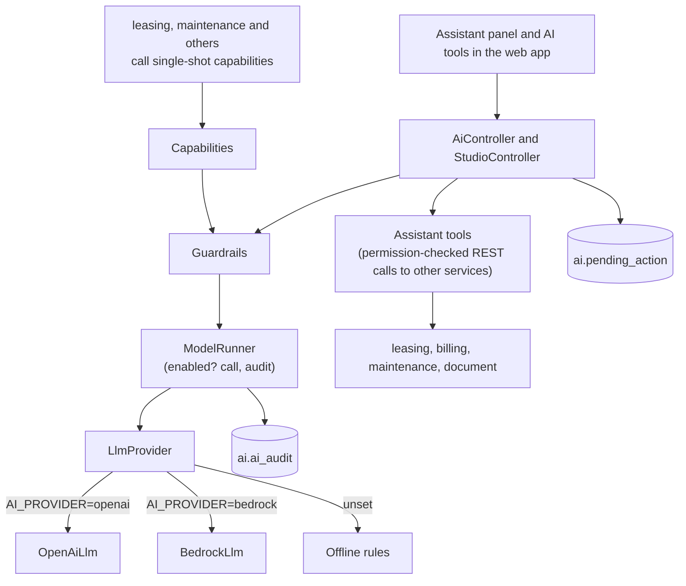
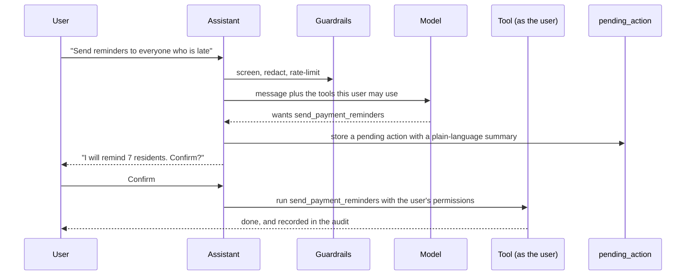
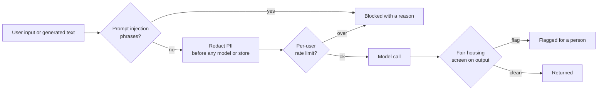

# AI

PropertyOS uses AI to **draft, explain and suggest**. It never acts alone, it never sees more than the person asking can see, and the product keeps working with no model at all. This document explains how, for engineers, security reviewers and buyers.

## 1. Design promises

| Promise | How it is kept |
| --- | --- |
| **Optional** | With no provider configured, every feature answers from deterministic rules and says so. No workflow depends on a model. |
| **Permission-bound** | The assistant's tools run **as the asking user**, so they can never read or do more than that person can. |
| **Confirm before write** | Any change is proposed first (`pending_action`) and runs only after the user confirms. |
| **Guarded in code** | Prompt-injection screening, PII redaction, fair-housing screening and rate limits run in the service, outside the model, so they cannot be talked around. |
| **Audited** | Every interaction writes a row to `ai.ai_audit`. |
| **Per company control** | Each AI feature is a switch in the company's configuration (`ai.*`). |

## 2. Architecture

* `Llm` is the interface; `OpenAiLlm` and `BedrockLlm` implement it; `LlmProvider` picks one from `AI_PROVIDER`. Callers cannot tell them apart (Liskov substitution), and the offline path is a first-class provider.
* `ModelRunner` is the single choke point: checks that a model is enabled, makes the call, and writes the audit row. Every tool and capability goes through it.
* **Graceful degradation:** a caller that gets an error from `Capabilities` (model off, guardrail tripped, provider down) uses its own rule-based fallback.

## 3. Providers

`AI_PROVIDER` selects `openai`, `bedrock` or nothing.

| Provider | Configure | Notes |
| --- | --- | --- |
| OpenAI | `OPENAI_API_KEY`, `OPENAI_MODEL`, `OPENAI_REASONING_EFFORT` | The default hosted option |
| AWS Bedrock | `AWS_REGION` and `AWS_BEARER_TOKEN_BEDROCK` or an access key pair, `BEDROCK_MODEL_ID`, `BEDROCK_VISION_MODEL_ID` | Implemented; not wired in the AWS demo (needs the task role and model ids) |
| None | nothing | Deterministic rules. Fully functional, no external call |

For tests, `E2E_FAKE_AI=1` points the service at a local stand-in model (`e2e/tools/fake-openai.mjs`) so AI features can be tested with real-looking answers and no key.

## 4. The assistant

Ask in plain language ("who is overdue on rent", "how many doors does each broker have"). The model chooses among **tools**, each a permission-checked call:

| Tool | Needs permission | Answers |
| --- | --- | --- |
| `portfolio_overview` | `DASHBOARD:VIEW` | Occupancy, rent roll, collections, open maintenance, automation totals |
| `list_properties`, `list_vacant_units` | `PROPERTY:VIEW` | Properties with units and occupancy; vacant units with market rent and days vacant |
| `list_applications` | `APPLICATION:VIEW` | Applications by status |
| `list_overdue_tenants` | `INVOICE:VIEW` | Residents with overdue balances, ranked by payment risk |
| `list_recent_payments` | `PAYMENT:VIEW` | Latest payments |
| `list_work_orders`, `list_sla_breaches` | `WORK_ORDER:VIEW` | Repairs by status or priority; those breaching their service level |
| `list_expiring_leases` | `LEASE:VIEW` | Active leases ending soon |
| `list_vendors` | `VENDOR:VIEW` | Vendors with trades, rating, open jobs, response time |
| `search_documents`, `list_missing_documents` | document permissions | The library; what is missing from applications, leases, vendors and owners |
| `list_signature_requests` | `ESIGN:VIEW` | Who still has to sign |
| `broker_workload` | `DASHBOARD:VIEW` | Doors, occupied, vacant and open work orders per broker |
| `find_opportunities` | `OPPORTUNITY:VIEW` | Ways to raise profit: renewals toward market, vacancy cost, price tests, collections, repair hotspots |
| `my_account` | `PAYMENT:CREATE` | A resident's own balance and next payment |
| `create_work_order` | `WORK_ORDER:CREATE` | **Write, needs confirmation** |
| `send_payment_reminders` | `INVOICE:EDIT` | **Write, needs confirmation** |

Answers render as markdown, including tables, charts and images.

## 5. AI studio tools

Each tool is one class and shares `ModelRunner`.

| Tool | Purpose |
| --- | --- |
| `LeaseAbstractTool` | Key terms, dates and obligations from lease text |
| `AnomalyScanTool` | Unusual charges and payments |
| `StatementNarrativeTool` | A plain-language summary of an owner statement |
| `ResidentOutlookTool` | Renewal and risk outlook for a resident |
| `PhotoTriageTool` | Vision check of maintenance photos |
| `FairHousingTool` | Screens listing and message text for fair-housing risk |

## 6. Single-shot capabilities used by other services

Other services call `Capabilities` for one validated JSON answer: listing copy and a rent suggestion (`LISTING_WRITER`, `RENT_SUGGESTION`), listing integrity, lead replies, application screening summaries (`SCREENING`), maintenance triage (`MAINTENANCE_TRIAGE`), lease summary, payment risk, and conversation assist. Each has a switch in the company's `ai` configuration. `ImageModeration` reviews uploaded photos for relevance and quality, with auto-approve and auto-reject confidence thresholds from the `moderation` settings.

## 7. Guardrails (`Guardrails`)

* **Prompt-injection screening** on user input.
* **PII redaction** before text is sent to a model or stored in the audit.
* **Fair-housing screening** of generated and user-supplied text; a flagged listing cannot go live without an authorised override.
* **Per-user rate limits.**
* **Confirm-before-write** for any change.

## 8. Audit

Every call writes `ai.ai_audit`: the kind (`CHAT`, `CAPABILITY`, `ACTION`), the capability, the redacted prompt, tools used, provider, input and output tokens, whether it was blocked and why, whether the offline fallback answered, and latency. Fields are length-limited before insert.  Token counts make cost visible.

## 9. Testing

`AiScenarioIT` drives the assistant, every studio tool and the offline fallbacks over HTTP; unit tests cover guardrails and each tool with a fake `ModelRunner`; the browser suite runs the AI screens against the stand-in model (`ai.model.*` specs).
