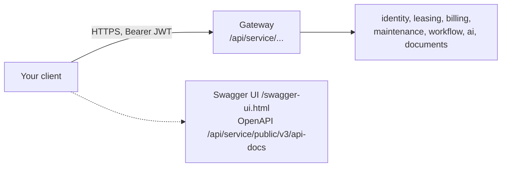

# API guide

How to talk to PropertyOS programmatically. The [API reference](api/README.md) lists all 266 endpoints with the permission each needs; this page explains the conventions that apply to all of them.

## 1. The shape of the API



* **JSON in, JSON out.** ISO-8601 dates (`2026-12-01`) and timestamps (UTC), amounts in USD as decimals.
* **Paths:** `/api/<service>/<resource>[/{id}[/<action>]]`. Actions on a record are `POST .../{id}/actions/{ACTION}`.
* **One front door:** every call goes through the gateway; `/internal/**` is never reachable from outside.
* **Live contract:** each service publishes OpenAPI 3 at `/api/<service>/public/v3/api-docs`, aggregated in Swagger UI at `/swagger-ui.html` on the gateway. Set `API_DOCS_ENABLED=false` to hide both in production.

## 2. Get a token and call something

```bash
# 1. Sign in. The response contains a JWT valid for 12 hours.
curl -s -X POST https://<host>/api/identity/public/login \
  -H 'content-type: application/json' \
  -d '{"email":"sarah.mitchell@summitridgepg.com","password":"<password>"}'

# 2. Use it.
curl -s https://<host>/api/leasing/properties?page=1\&size=20 -H "Authorization: Bearer $TOKEN"
```

A brand-new user's first sign-in returns `403 PASSWORD_CHANGE_REQUIRED` until `POST /api/identity/public/change-password` succeeds. Paths containing `/public/` need no token (the rental site, applicant links, OpenAPI JSON).

## 3. Lists: paging, sorting, searching, filtering

Any list endpoint can be paged without changing its URL. **Without `page` you get the plain array** (so dropdowns and older callers keep working); **with `page` you get a wrapper**:

```json
{ "rows": [ ... ], "total": 137, "page": 1, "size": 20 }
```

| Parameter | Meaning |
| --- | --- |
| `page` | Page number from 1 |
| `size` | Rows per page, default 20, at most 100 (`export=1` raises the limit to 5,000) |
| `sort`, `dir` | Column to sort by (it must be a column the query returns) and `asc` or `desc` |
| `q` | Text to find in any column |
| `f.<column>` | Column contains this text |
| `from.<column>`, `to.<column>` | Date range, inclusive |
| `num.<column>` | Number comparison, `op:a` or `between:a:b` (ops: `eq`, `ne`, `gt`, `ge`, `lt`, `le`) |

Sorting and filtering are done in the database, and a column the query does not return is ignored rather than trusted.

### The public search

The open endpoints under `/api/leasing/public/` use named filters instead, validated with a reason on error:

`keyword`, `city`, `state`, `type`, `beds`, `baths`, `minRent`, `maxRent`, `minSqft`, `maxSqft`, `availableBy`, `amenities` (comma separated, **all** required), plus the paging parameters above. Endpoints: `/properties` (grouped by property with the available units inside), `/listings` (one per home), `/facets` (the choices for the filters), `/listings/{id}` (one home with its company, other homes and amenity icons). See [LLD section 7](architecture/LLD.md#7-public-homes-search).

## 4. Errors

Every error is `application/problem+json` (RFC 7807):

```json
{ "type": "about:blank", "title": "Forbidden", "status": 403, "code": "FEATURE_OFF",
  "detail": "Automations are not included in your plan.", "correlationId": "3f2a9c1e-...", "timestamp": "..." }
```

| Status | Meaning |
| --- | --- |
| 400 | The request is wrong; `detail` says how (for example "The lowest rent is above the highest rent.") |
| 401 | Not signed in, or the token expired |
| 403 | Not allowed: `FEATURE_OFF`, `ORG_SUSPENDED`, `PLATFORM_NO_COMPANY_DATA`, `PASSWORD_CHANGE_REQUIRED`, or a missing permission |
| 404 | Not found. Also returned for **another company's record**, so existence is never revealed |
| 405 | Wrong method |
| 409 | Conflicts with the current state (a duplicate name, a second invoice for a period) |
| 429 | Rate limited; honour `Retry-After` |
| 503 | A downstream service is unavailable; honour `Retry-After` |
| 500 | A fault on our side; quote the `correlationId` to support |

## 5. Headers worth knowing

| Header | Direction | Use |
| --- | --- | --- |
| `Authorization: Bearer <jwt>` | request | Authenticates the call |
| `X-Correlation-Id` | both | Send your own (8 to 64 safe characters) or accept the one we assign; it appears on every log line, so quote it in a support request |
| `X-RateLimit-Remaining` | response | Requests left in the current window |
| `Retry-After` | response | Seconds to wait after 429 or 503 |
| `Cache-Control: no-store` | response | API responses are never cached |

## 6. Limits and good behaviour

* **Rate limits:** 600 requests a minute per user, 120 a minute per client on public endpoints (configurable). Back off on 429.
* **Retries:** `GET` is safe to retry. **Do not blindly retry a `POST`, `PUT` or `DELETE`**: writes are never retried by the platform, and idempotency keys are not built yet ([SAD gaps](SAD.md#9-known-gaps-and-next-steps)), so check the state before repeating a payment or a create.
* **Timeouts:** the gateway allows about 95 seconds; AI calls can be slow, and the CDN in front limits a call to 60 seconds.
* **Uploads:** size and type are enforced; applicant uploads use a signed, expiring link.

## 7. Documentation is generated

* `OperationDocumenter` fills in, for every endpoint, a summary, a tag, the required permission (read from `@RequiresPermission`), the standard error responses and the security requirement, so the Swagger UI cannot drift from the code.
* The static pages in [api/](api/README.md) are generated from the controllers by `node scripts/generate-api-docs.js`, and CI fails when they are out of date.
* `node scripts/check-endpoints.js` checks that every API call in the front end matches a real endpoint.

## 8. Known limitation

Many request bodies are `Map<String, Object>`, so Swagger shows a generic object for them, and validation is written by hand with messages a person can act on. Moving each to a typed record gives full schemas and bean validation; it is the planned cleanup.
