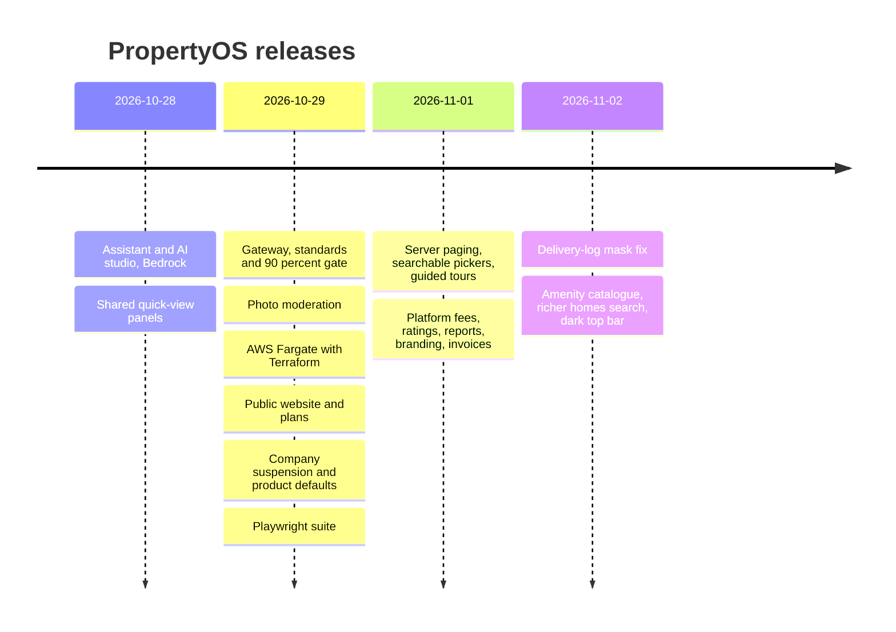

# Changelog

What shipped, in plain language, newest first. Each release says what changed for people, what changed in the database, and how to roll back. The pull request numbers link the code. Releases are continuous (every merge to `develop` deploys), so entries group the pull requests that matter rather than every commit.

## 2026-11-02

### Amenity catalogue, a much richer homes search, and a dark top bar ([#3](https://github.com/lucky1ravi/property/pull/3))

**For people**

* **Amenities are picked, not typed.** The property form has a searchable list with icons. PropertyOS keeps 26 shared amenities (the platform administrator maintains them under *Admin, Amenities*), and each company can add its own under *Leasing, Amenities* or straight from the property form.
* **Homes search.** Filters for words, city, property type, bedrooms, bathrooms, rent range, size range, available-by date and amenities; sorting; 12 per page; the choices live in the address so a search can be shared. View **by property** (each building once, with its available units inside) or **all homes**. Every card has a photo carousel and names the company.
* **Home page.** A *Listed by* box shows the company's logo, phone, email and website (set under *Configuration, Branding*), and the other available homes in the same building appear on the page. Amenities show with their icons.
* **Look.** The top bar is dark in the company's menu colour. Stat strips on every page show uniform figures. Page headers are more compact.

**Database:** leasing `V5__amenities.sql` (new `amenity` table with row-level security and 26 seeded rows). Additive. No existing row changes.

**Configuration:** new branding keys `contactPhone`, `contactEmail`, `website` (validated on save).

**Quality:** a new system test class (`PublicCatalogIT`) and four browser specs. The full browser run gave 302 passed, 9 skipped by design and one timing flake that passes when run alone; the full backend verify was green.

**Roll back:** redeploy the previous images; the new table is unused.

### Delivery-log recipient mask fixed ([#2](https://github.com/lucky1ravi/property/pull/2))

The operator delivery log masked an email so that its first letter disappeared (`***@example.com`) and an SMS number showed only one digit. It now shows `r***@example.com` and keeps the last two digits of a phone number. A test now asserts the shape of every masked recipient.

**Database:** none. **Roll back:** previous workflow-service image.

## 2026-11-01

### Platform fees, ratings, reports, branding and invoices ([#1](https://github.com/lucky1ravi/property/pull/1))

**Platform operator**

* *Subscription payments*: monthly invoices per company (units times plan price, never below the plan minimum), payments, credits, one-off charges, overdue and failed-payment alerts. A company sees and pays only its own.
* *Service health*, *Company usage*, and an operational *Delivery log* with an audited full-detail view (the reason is written to the company's own audit log).
* *Enquiries* and *Features* are separate pages; enquiry notifications for demo requests, website enquiries and applications.

**Product**

* **Ratings**: residents rate their property and unit; staff, owners and residents rate vendors within their limits.
* **Report centre**: fourteen reports with drill-down (rent roll, occupancy, vacancies, expirations, funnel, ratings, receivables, income, transactions, payments, fees, repair costs, jobs, vendor scorecard).
* **Branding**: a company's primary colour and logo colour the whole product; a professional invoice PDF with logo, tax line and payments.
* **Listing page**: facts and amenities with icons, costs, and the resident rating.

**Fixes found on the way:** the rent cycle had no timer (it now runs nightly with a per-company lock), upload links never expired, settings changes took up to 15 seconds to reach other services (now seconds), several phone layout problems, and links to missing records showed a blank page.

**Database (all additive):** identity V13 (platform billing tables) and V14 (removes a placeholder brand colour); leasing V4 (`review`); maintenance V2 (`vendor_review`). See [DATABASE-MIGRATIONS](DATABASE-MIGRATIONS.md).

**Configuration:** `PROPERTYOS_PLATFORM_BILLING_AUTO` (off by default outside demo), `PROPERTYOS_PLATFORM_BILLING_CRON`, `PROPERTYOS_BILLING_CYCLE_CRON`, `PROPERTYOS_LINKS_TTL_DAYS`.

### Server paging, searchable pickers, guided tours, clearer messages and motion

Lists page on the server (so thousands of rows never load at once); pickers for owners, properties and people search as you type; first-run guided tours and a help and shortcuts panel; clearer error messages; subtle motion. A full-lifecycle end-to-end journey ("a company's whole life") and the defects it found were fixed in the same release.

## 2026-10-30

### Defect fixes

A round of fixes found by the browser suite across access, billing and documents.

## 2026-10-29

A large day that took the product from a working application to a deployable, tested, governed platform.

* **Browser end-to-end suite** (Playwright) with requirement traceability, and the product fixes it found.
* **Company suspension, archive, product defaults, profiles**: an operator can suspend a company (reason required, audited, effective in about ten seconds); owners, properties and units archive instead of delete; operator-set defaults apply to every company; every user has a profile.
* **Public website, plan management, temporary passwords, per-service CI/CD.**
* **Cross-company data leak on RDS fixed** and files moved to S3 behind a storage interface ([ADR 4](adr/0004-file-storage-in-s3.md)).
* **AWS**: ECS Fargate, RDS, CloudFront, ECR and Secrets Manager, all in Terraform, deployed by GitHub Actions over OIDC ([AWS-DEPLOY](AWS-DEPLOY.md)).
* **Gatling performance project** with service levels.
* **Microservice standards and the 90% coverage gate** ([MICROSERVICES](MICROSERVICES.md)).
* **Photo moderation, plan entitlements, friendly errors, more AI tools, Bedrock support.**

## 2026-10-28

Initial product: portfolio, leasing, billing, maintenance, workflow, documents and the AI assistant with markdown tables, charts and images in answers; shared quick-view panels for residents, vendors, units, work orders, invoices, payments and applicants; Bedrock API-key support.

---

**Keeping this file honest.** Add an entry in the pull request that ships the change. Say what changed for people first, then the database, configuration and rollback. A change with a migration must link [DATABASE-MIGRATIONS](DATABASE-MIGRATIONS.md).
