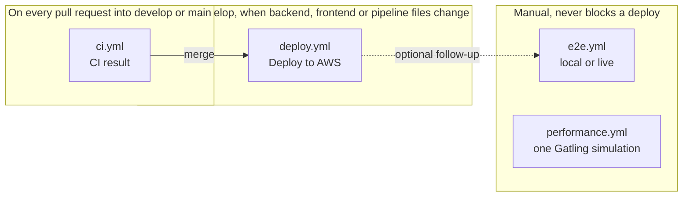
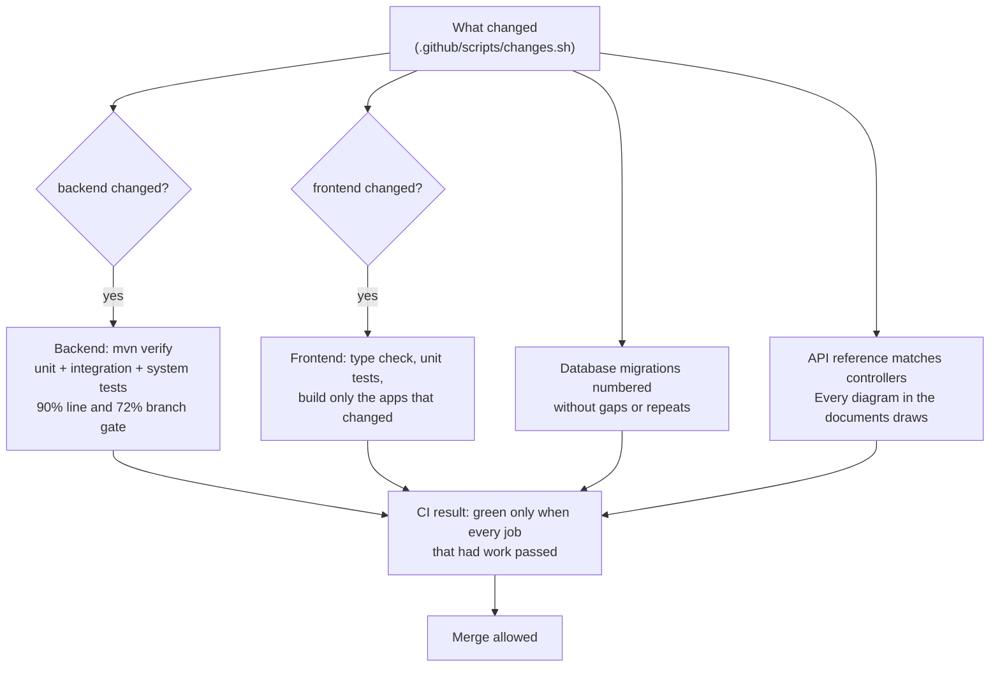
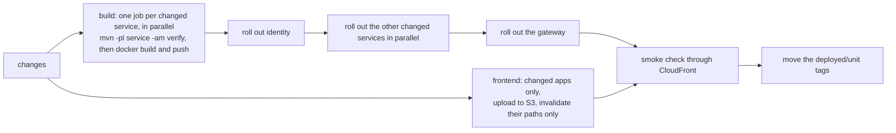
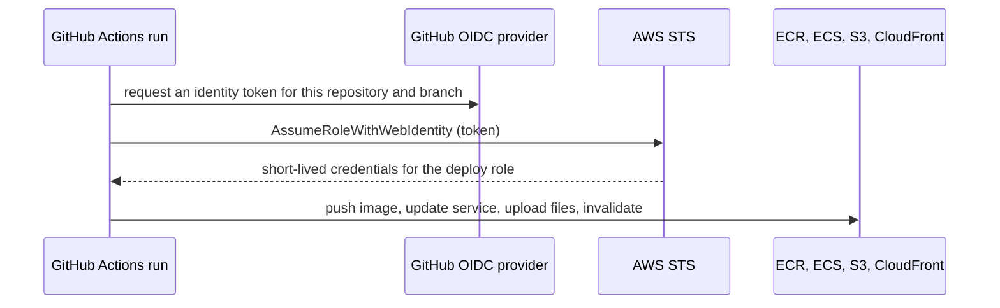

# Continuous integration and delivery

Push to `develop` and GitHub Actions deploys **only what changed**. A change to one service rebuilds and restarts that service alone, a change to one frontend app uploads that app alone, and nothing else is touched. Every pull request is gated by the same checks that protect production.

## 1. The four workflows



| Workflow | Trigger | Purpose |
| --- | --- | --- |
| `ci.yml` | Pull request into `develop` or `main`, push to `main`, manual | Prove the change is safe; one required status check, **CI result** |
| `deploy.yml` | Push to `develop` touching `backend/`, `frontend/` or the pipeline; manual | Test, build, roll out and smoke-check only what changed |
| `e2e.yml` | Manual | The full Playwright suite on a runner (`local`), or read-only checks against a deployed environment (`live`) |
| `performance.yml` | Manual | Start the platform in Docker and run one Gatling simulation |

A push that changes only `docs/`, `infra/` or `performance/` does **not** deploy, so documentation can ship at any time.

## 2. What happens on a pull request (`ci.yml`)



1. **What changed** compares the branch with its base.
2. If anything under `backend/` changed, the full backend runs: `mvn verify` (unit, integration and system tests, plus the coverage gate).
3. If anything under `frontend/` changed, the unit tests run and **only the apps that changed** are built.
4. The **migration check**, the **API reference check** and the **diagram check** run on every pull request.
5. **CI result** is one status check that is green when every job that had work passed. Require it in branch protection.

## 3. What happens on a push to `develop` (`deploy.yml`)



* **Order.** Identity first, because it prepares the shared database schema; the other services next; the gateway last.
* **Safety.** Each rollout waits until the new tasks are healthy. ECS's circuit breaker rolls back on its own, and the workflow fails so nothing after it runs. Tests run before an image is pushed, so a failing test never reaches AWS.
* **Migration guard.** The deploy runs `check-migrations.js` against each service's last-deployed tag, so a migration that was already released and then edited stops the pipeline before anything ships.
* **One deployment at a time** (`concurrency: deploy-aws`). A queued push computes its diff from the last *successful* deploy, so nothing is skipped.

### What counts as changed

| You changed | Redeployed |
| --- | --- |
| `backend/leasing-service/**` | leasing-service only |
| `backend/platform-common/**`, `backend/pom.xml`, `Dockerfile.service`, `docker-entrypoint.sh` | every backend service |
| `frontend/apps/admin/**` | the admin app only |
| `frontend/packages/**`, `frontend/package*.json` | every frontend app |
| `infra/**`, `docs/**`, `performance/**` | nothing (Terraform is applied by hand, see below) |

"Changed" means **changed since the last successful deploy**: the workflow keeps a git tag `deployed/<unit>` on the commit each service and app was last deployed from (see them under *Tags* on GitHub). If two pushes queue up, or a deploy fails, the next run still picks up everything not yet deployed. To run everything: *Actions, Deploy to AWS, Run workflow, Rebuild and deploy every service and app*.

### The smoke check

After the rollout the pipeline calls the live site through CloudFront and fails unless the site and the API answer `200` (it retries for a while to let tasks settle). It is a tripwire, not a test suite: for depth run the [end-to-end suite](TESTING.md#5-browser-end-to-end-playwright) in `live` mode afterwards.

## 4. Why it is fast

| Before | Now |
| --- | --- |
| Every deploy compiled all 8 services inside Docker with a cold Maven cache | Maven runs on the runner with a warm cache (`setup-java` caches `~/.m2`) |
| One image for everything, so every service restarted | One small image per service; only changed services restart |
| Tests, build and deploy by hand on a laptop | Tests, image build and rollout run on GitHub, in parallel per service |
| Frontend: all 8 apps rebuilt and uploaded, full CloudFront flush | Only changed apps built and uploaded, only their paths invalidated |

A typical single-service deploy completes in about 14 minutes end to end, most of it the rollout waiting for healthy tasks and the system tests.

## 5. Credentials: no keys anywhere



The deploy role is created by Terraform with least privilege and trusts only this repository. There are no AWS keys in GitHub secrets.

## 6. One-time setup

1. `terraform apply` (creates the deploy role and the per-service image retention policy).
2. Run the commands from `terraform output github_variables` in the repository. They set `AWS_ROLE_ARN`, `AWS_REGION`, `ECS_CLUSTER`, `ECR_REPOSITORY`, `FRONTEND_BUCKET`, `CLOUDFRONT_DISTRIBUTION_ID` and `APP_URL` under *Settings, Secrets and variables, Actions, Variables*. There are no secrets.
3. *Settings, Actions, General, Workflow permissions* must allow the workflow to push tags (it asks for `contents: write`).
4. *Settings, Branches*: protect `develop` and `main`, and require the **CI result** check.
5. Optional: add a **required reviewer** on a GitHub *Environment* if you want a person to approve each deploy.

The first run has no `deployed/*` tags, so it builds and deploys everything. After that it deploys only changes.

## 7. Database and infrastructure changes

* **Database migrations** run when the owning service starts (Flyway), so they ship with that service. Read [Database migrations](DATABASE-MIGRATIONS.md) before a release that carries one, and take a snapshot first ([Operations](OPERATIONS.md#6-the-database)).
* **Infrastructure (`infra/aws`)** is planned and applied by its own workflow, `terraform.yml`: a plan on every pull request, and an apply after a person approves it. See [Terraform pipeline](TERRAFORM-PIPELINE.md). Services keep running the images `deploy.yml` set, because Terraform ignores their task definition revision.

## 8. Rolling back

Re-run the workflow on an older commit's code, or point one service at an earlier image:

```bash
infra/aws/deploy-service.sh <cluster> identity-service <registry>/<repository>:identity-service-<older-commit>
```

The last 8 images of each service are kept. Because migrations are additive, an older application image runs on the newer schema.

## 9. Working with the pipeline

| I want to... | Do this |
| --- | --- |
| Ship a change | Branch from `develop`, open a pull request, wait for **CI result**, merge. The deploy starts by itself |
| Watch a deploy | `gh run watch <id>`, or the *Actions* tab; the smoke check is the last job |
| Ship docs only | Merge normally; nothing deploys |
| Re-deploy everything | Run *Deploy to AWS* manually with *everything* ticked |
| Test a live environment | Run *End-to-end tests* with target `live` |
| Measure performance | Run *Performance* with a simulation |
