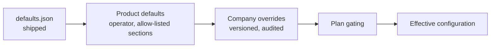

# Configuration

Defaults are in each service's `application.yml` and `platform-common/src/main/resources/common.yml`. Environment variables override them. Never commit values.

## Environment variables

| Variable | Default | Purpose |
| --- | --- | --- |
| `PORT` | per service | HTTP port |
| `PGHOST`, `PGPORT`, `PGUSER`, `PGPASSWORD`, `PGDATABASE` | local Postgres | Database |
| `JWT_SECRET` | dev value | Token signing key. Set 48+ random characters outside local development |
| `INTERNAL_TOKEN` | dev value | Service-to-service token for `/internal/**` |
| `ALLOWED_ORIGINS` | localhost | CORS origins |
| `DEMO_MODE` | `false` | Seeds sample data and shows the persona picker |
| `API_DOCS_ENABLED` | `true` | OpenAPI JSON and Swagger UI |
| `AI_PROVIDER` | none | `openai`, `bedrock` or none |
| `OPENAI_API_KEY`, `OPENAI_MODEL`, `OPENAI_REASONING_EFFORT` | | OpenAI |
| `AWS_REGION`, `AWS_BEARER_TOKEN_BEDROCK` or `AWS_ACCESS_KEY_ID` + `AWS_SECRET_ACCESS_KEY` | | Bedrock credentials |
| `BEDROCK_MODEL_ID`, `BEDROCK_VISION_MODEL_ID` | | Bedrock text and vision models |
| `IDENTITY_URL`, `LEASING_URL`, `BILLING_URL`, `MAINTENANCE_URL`, `WORKFLOW_URL`, `AI_URL`, `DOCUMENTS_URL` | localhost ports | Where the gateway and services find each other |
| `PUBLIC_API_URL` | | Public base URL used in emailed links |
| `APP_URL` | `http://localhost:4173` | Where the web app lives, for the Sign in and Open buttons in emails (set from the CloudFront address on AWS) |
| `EMAIL_PROVIDER`, `EMAIL_FROM`, `EMAIL_REGION` | `none` | `ses` sends through Amazon SES (the sender must be verified there, in this region); `none` only logs |
| `EMAIL_OVERRIDE_TO` | the test address | While set, every email goes to this one address instead of its real recipient |
| `SERVICE`, `SERVICE_HEAP` | | Container: run one service; heap per service in all-in-one mode |
| `VITE_API_URL` | | Frontend build: gateway URL |

Settings added with ratings, reports, invoices and platform fees. Spring reads each from the environment variable shown, or from the property of the same meaning.

| Variable | Default | Purpose |
| --- | --- | --- |
| `PROPERTYOS_PLATFORM_BILLING_AUTO` | on in demo, **off otherwise** | Whether the nightly timer bills companies their PropertyOS subscription by itself. Leave it off in production until the operator has checked plan prices, then set `true`. "Run billing now" on the Subscription payments page works either way |
| `PROPERTYOS_PLATFORM_BILLING_CRON` | `0 30 2 * * *` | When the platform billing timer runs (America/Chicago) |
| `PROPERTYOS_BILLING_CYCLE_CRON` | `0 0 2 * * *` | When each company's rent cycle runs (rent invoices, late fees, autopay), America/Chicago. Only one instance runs a company's cycle at a time |
| `PROPERTYOS_LINKS_TTL_DAYS` | `14` | How long an applicant's document-upload link works |
| `DEMO_MODE` | `false` in production | Also allows running the rent cycle for a chosen date, and turns platform auto-billing on |

Settings for protection, storage and logging.

| Variable | Default | Purpose |
| --- | --- | --- |
| `RATE_LIMIT_USER_PER_MINUTE` | `600` | Gateway limit per signed-in user |
| `RATE_LIMIT_PUBLIC_PER_MINUTE` | `120` | Gateway limit per client on public endpoints |
| `STORAGE_TYPE`, `STORAGE_BUCKET` | `db` | Where uploaded files live: `db` (in the row) or `s3` ([ADR 4](adr/0004-file-storage-in-s3.md)) |
| `DB_POOL_SIZE` | per service | Database connections per service instance |
| `LOGGING_STRUCTURED_FORMAT_CONSOLE` | plain text | `ecs` or `logstash` for one JSON object per log line |
| `PROPERTYOS_EVENTS_POLL_MS` | `1500` | How often each service polls for events |

## How settings resolve

A company changes its settings in *Admin, Configuration*. Every save is validated, stored as a new version (with rollback), audited, and announced so every service refreshes its cache within seconds ([ADR 7](adr/0007-configuration-as-data.md)). The admin screen is generated from the same structure, so a new key appears with no new form once it has a label.

## Per-company settings

Sections of `platform-common/src/main/resources/config/defaults.json`. Services read them through `ConfigClient`.

| Section | Controls | Examples |
| --- | --- | --- |
| `features` | Which modules are on, subject to the plan | `LEASING`, `PAYMENTS`, `MAINTENANCE`, `AUTOMATIONS`, `AI_ASSISTANT`, `BROKER_COCKPIT`, `OPPORTUNITIES`, `OWNER_PORTAL`, `VENDOR_PORTAL`, `RENEWALS`, `RECURRING_MAINTENANCE`, `MESSAGING`, `DOCUMENTS`, `ESIGN`, `BOOST` (listing boosts), `REVIEWS` (public review replies and the show or hide decision), `CAMPAIGNS` (marketing campaigns), `WEBHOOKS` (webhooks) |
| `fees` | What the company charges | `lateFee`, `applicationFee`, `nsfFee`, `managementFeePercent`, `leasingCommissionPercent`, `renewalFee` |
| `invoicing` | The rent cycle | `dueDay`, `invoiceDaysBeforeDue`, `reminderDaysBefore`, `reminderDaysAfter`, `allocation` |
| `approvals` | Who must approve what | `maintenanceOwnerLimit`, `ownerApprovesApplications`, `vendorInvoiceApprovalLimit` |
| `screening` | Application rules | `incomeMultiple`, `minScore`, `minMonthsEmployed`, `requiredDocuments` |
| `sla` | Response and completion targets | per priority (`EMERGENCY`, `URGENT`, `ROUTINE`), `enquiryResponseMinutes` |
| `renewals` | Renewal behaviour | `offerDaysBeforeEnd`, `maxIncreasePercent` |
| `ai` | Which AI features are on | `LISTING_WRITER`, `RENT_SUGGESTION`, `LISTING_INTEGRITY`, `SCREENING`, `LEASE_SUMMARY`, `PAYMENT_RISK`, `MAINTENANCE_TRIAGE`, `ASSISTANT` |
| `moderation` | Photo review | `autoApproveConfidence`, `autoRejectEnabled`, `maxImageMb`, `maxPhotosPerProperty`, `allowedExtensions` |
| `webhooks` | Webhook delivery. The operator's alone: a company cannot override it | `maxAttempts` (6), `backoffSeconds` (60, 300, 1800, 7200, 21600), `timeoutSeconds` (5), `maxEndpoints` (10), `autoDisableAfterFailures` (20), `retentionDays` (30) |
| `campaigns` | Marketing campaigns. The operator's alone: a company cannot override it | `inboundPerMinute` (120: posts a minute one campaign accepts), `maxPerCompany` (100) |
| `boost` | Paid listing boosts. The operator's alone: a company cannot override it | `onSale` (false stops every company buying), `prices` (days to dollars: 7 is 49, 14 is 89, 30 is 149), `planDiscountPercent` (a percentage off per plan, 0 to start), `bonusPoints` (15), `maxSharePercent` (30: the share of a page that boosted homes may lift), `unpaidExpiryDays` (14) |
| `reviewModeration` | Resident comments on the public listing page. The operator's alone: a company cannot override it | `minPublicScore` (default 70): comments the AI scores lower are hidden from visitors; the star rating still counts |
| `ranking` | How public search orders homes under Recommended. The operator's alone: a company cannot override it | `weights` (`plan`, `rating`, `freshness`, `quality`), `rating` (`priorMean`, `priorWeight`, `unitShare`), `freshness.halfLifeDays`, `quality` (`photosTarget`, `descriptionChars`) |
| `notifications` | Channels and quiet hours | `channels`, `quietHours` |
| `branding` | The company's look and public identity | `companyName`, `primaryColor`, `accentColor`, `logoDataUrl`, `portalDomain`, `emailSender`, `contactPhone`, `contactEmail`, `website` |
| `payments` | How rent is paid | `methods`, `autopayEnabled`, `allowPartialPayments`, `minimumPayment`, `maximumPayment`, `chargeNsfFee`, `enforceStateFeeCaps`, `convenienceFees`, `invoice` (number prefix, legal name, remit-to, tax id, terms, footer) |
| `alerts` | Deadline alerts | `leaseExpiry`, `depositRefund`, `vendorInsurance`, `taxFiling`, `form1099`, `w9Missing`, `documentExpiry`, `signatureReminder` |
| `documents` | The library | `storage`, `categories`, `requirements`, `uploads`, `esign` |
| `chat` | Messaging rules | `who` can message whom, `allowStaffToStaff`, `maxMessageLength`, `aiAssist`, `guardrails` |
| `stateRules` | State law | per state (`DEFAULT`, `CA`, `TX`, `NY`, `FL`, `WA`): fee caps, deposit deadlines, convenience-fee limits |
| `plans` | Plan prices and features | `STARTER`, `GROWTH`, `ENTERPRISE` (operator-managed) |

### Branding keys and what they do

| Key | Where it shows | Validation on save |
| --- | --- | --- |
| `companyName` | Menu header, invoices, the public *Listed by* box | |
| `primaryColor` | Menu, top bar, buttons, links (CSS variables); the default is left unapplied | Six-digit hex such as `#0F3D3E` |
| `accentColor` | The invoice PDF highlights | Six-digit hex |
| `logoDataUrl` | Menu header and invoices | PNG or JPEG data URL under 100 KB |
| `contactPhone` | Public listing page | Digits, spaces and `+ ( ) - .`, 7 to 30 characters |
| `contactEmail` | Public listing page | A valid email address |
| `website` | Public listing page | Must start with `http://` or `https://`, at most 200 characters |
