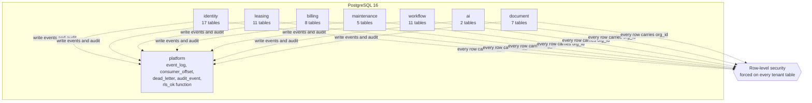
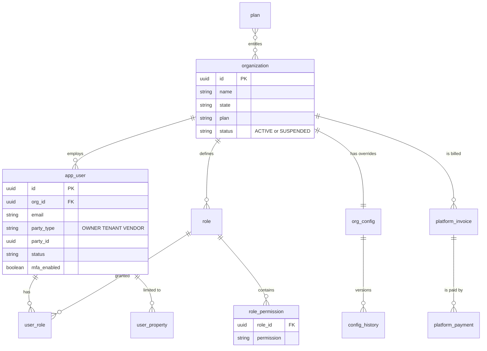
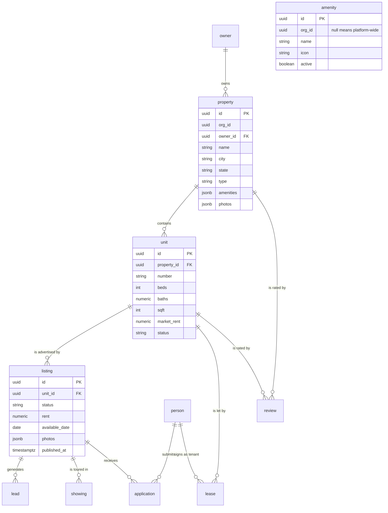
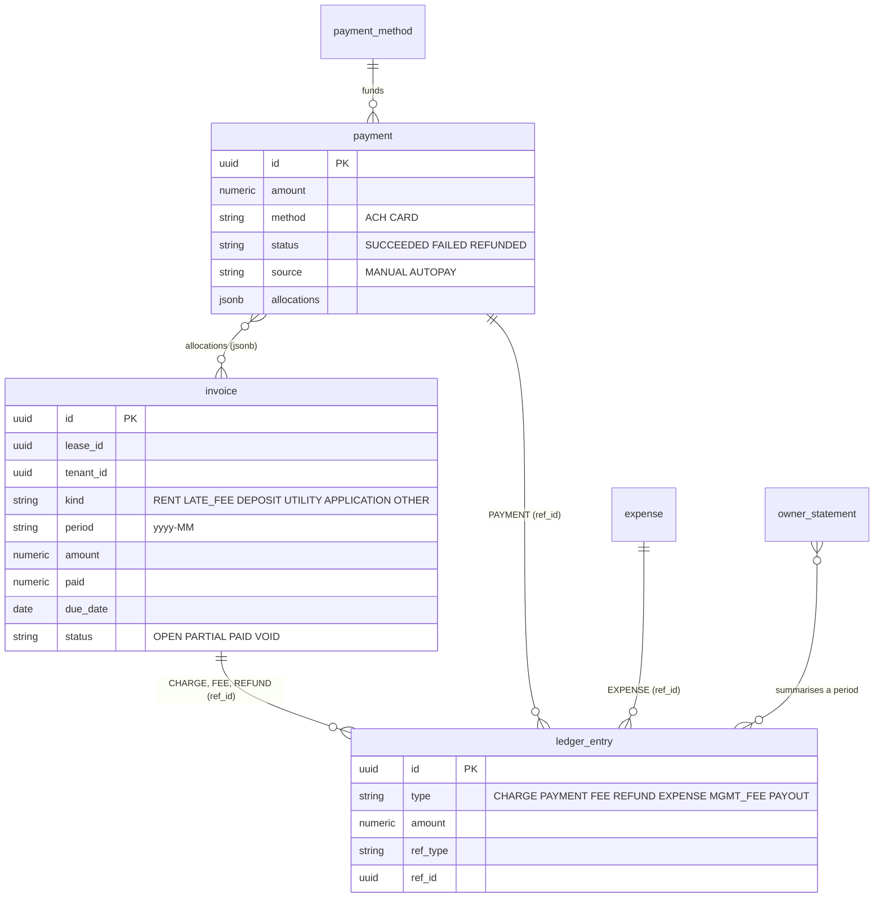
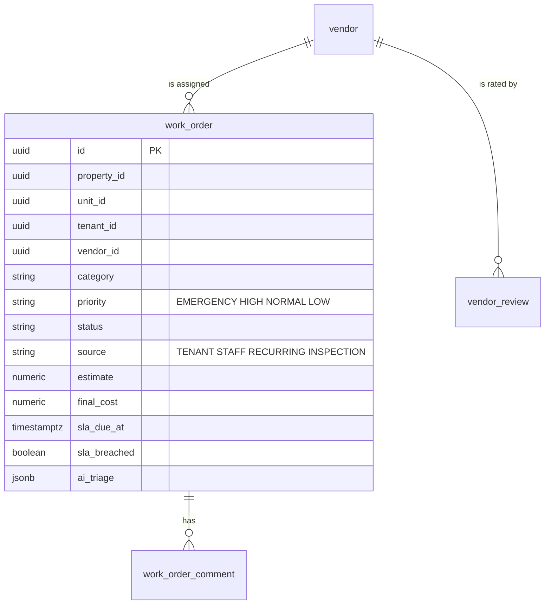
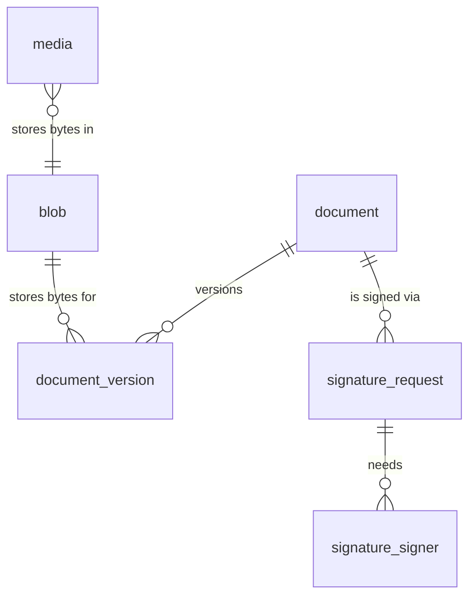
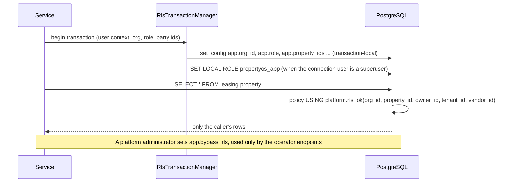

# Data model

One PostgreSQL 16 database. Each service owns **its own schema** and nobody reads another service's tables: a service that needs a fact owned by another asks over REST (`/internal/**`) or reacts to an event. A shared `platform` schema holds the cross-cutting plumbing. Every schema is created and evolved by that service's own forward-only [Flyway migrations](DATABASE-MIGRATIONS.md).



## Conventions

| Convention | Detail |
| --- | --- |
| Keys | `uuid` primary keys generated by the application. Foreign keys exist **inside** a schema only; across schemas a column holds the other service's id without a constraint. |
| Tenant column | Every tenant table has `org_id uuid not null`. Policies compare it with the caller's company through `platform.rls_ok(...)`. |
| Money | `numeric` with two decimals, in USD. No floating point for money. |
| Time | `timestamptz` in UTC; dates that are business dates (`available_date`, `due_date`) are `date`. |
| Flexible shape | `jsonb` for lists and settings that are read whole: `property.amenities`, `listing.photos`, `org_config.config`. Never for anything queried by value without an index. |
| Deletion | Soft: `archived_at` on owners, properties, units; vendors are deactivated; invoices are `VOID`ed. Only draft listings are hard-deleted. |
| Audit | Security-relevant changes write `platform.audit_event` (who, what, before, after) in the same transaction. |

## Identity (`identity`)

Companies, people who sign in, what they may do, and how the product is configured and sold.



| Table | Purpose |
| --- | --- |
| `organization` | A company: name, home state, plan, status, and (since V10) the reason, actor and time of a suspension |
| `app_user`, `user_role`, `user_property` | People who sign in; their roles; the properties a property-scoped user may see. `party_type` and `party_id` link an owner, resident or vendor login to its record in another service |
| `role`, `role_permission` | Role templates copied per company; each permission is a `FEATURE:ACTION` string |
| `org_config`, `config_history` | A company's setting overrides as JSON, with every version kept so a change can be rolled back |
| `plan`, `product_default` | Plan definitions and operator-set defaults applied to every company |
| `platform_invoice`, `platform_payment` | What companies pay PropertyOS (invoice numbers come from a sequence) |
| `login_otp` | One-time sign-in codes with an attempt counter |
| `site_plan`, `site_feature`, `contact_request` | Public website content and enquiries |
| `catalog_sync` | Markers so a new permission reaches existing roles exactly once |

## Leasing (`leasing`)



`amenity` is deliberately **not** linked by a foreign key from `property`. A property stores amenity *names* in `property.amenities`, so removing or renaming a catalogue entry never alters a property that already has it, and a property can keep a name typed before the catalogue existed. Uniqueness is one name per company and one platform-wide, ignoring case (`ux_amenity_name`). Its row-level policies let everyone read the platform entries and their own company's, let a company write only its own, and let the platform administrator (who bypasses row-level security) write the shared ones.

| Table | Purpose |
| --- | --- |
| `owner`, `property`, `unit` | The portfolio. `unit.status` is `VACANT`, `OCCUPIED` or similar; archived rows keep history |
| `person` | Applicants and residents (name, contact, income, employer), shared by applications and leases |
| `listing` | A unit advertised: rent, deposit, photos, highlights, AI review, rent suggestion, status, view and enquiry counters |
| `lead`, `showing` | Enquiries and tour requests, from the public site or entered by staff |
| `application` | An application to a listing, with screening results and status |
| `lease` | A lease between a unit and a tenant: terms, status, signature progress, renewal offer |
| `review` | A resident's 1 to 5 star rating of their property or unit, with a comment |
| `amenity` | The amenity catalogue (see above) |

## Billing (`billing`)

Billing holds no foreign keys at all: it refers to leases, tenants, properties and owners by id, because those live in other services. Within billing, a payment records the invoices it settled in a JSON `allocations` list, and the ledger records what happened as typed entries that point at their source with `ref_type` and `ref_id`.



A partial unique index (`ux_invoice_rent_period`) allows exactly one live `RENT` or `LATE_FEE` invoice per lease and period. That index, not application code, is what stops the nightly rent cycle from ever billing a period twice.

| Table | Purpose |
| --- | --- |
| `invoice` | What is owed: kind, period, amount, amount paid, due date, status, void reason |
| `payment`, `payment_method` | What was paid (method, last four digits, outcome, which invoices it settled) and the saved methods. Only the last four digits are stored |
| `ledger_entry` | An append-only journal of charges, payments, fees, refunds, expenses, management fees and payouts. Owner statements and balances are computed from it |
| `deposit` | A security deposit per lease: `PENDING, HELD, REFUND_DUE, SETTLED`, with deductions, refund and the state's refund deadline |
| `expense` | Money spent on a property (repairs, vendor invoices) |
| `owner_statement` | A period summary for an owner (rent collected, fees, management fee, expenses, net payout, lines): `DRAFT, PUBLISHED, PAID` |
| `owner_tax_profile` | W-9 and 1099 data per owner |

## Maintenance (`maintenance`)



`recurring_task` holds a preventive-maintenance plan; when one falls due it creates a work order with `source = RECURRING`. A work order carries its own service-level clock (`sla_due_at`, `sla_breached`) and the AI triage result.

`work_order.status` starts `SUBMITTED` and moves through `TRIAGED`, optional `AWAITING_APPROVAL`, `ASSIGNED`, `SCHEDULED`, `IN_PROGRESS`, `COMPLETED` and `CLOSED` (or `REJECTED`). The allowed moves are data, not code: see the [state machines](architecture/LLD.md#4-state-machines).

## Workflow (`workflow`)

| Table | Purpose |
| --- | --- |
| `automation_rule`, `automation_run` | A rule (trigger event, conditions, actions, minutes saved) and each time it ran |
| `workflow_def`, `workflow_def_history` | Configurable workflow definitions, with history |
| `notification`, `delivery` | What a person is told in the product, and each email or SMS actually sent with its outcome (the operator delivery log reads `delivery`) |
| `notification_pref`, `notification_dedupe` | Per-user channel preferences; a de-duplication key so a reminder is sent once |
| `conversation`, `conversation_member`, `message` | Messages between parties, limited by company policy ("who can message whom") |

## AI (`ai`)

`ai_audit` records every model interaction (who, `CHAT`, `CAPABILITY` or `ACTION`, which tool, provider, token counts, whether a guardrail blocked it and why, whether the offline fallback answered). `pending_action` holds a change the assistant proposed (`PENDING, CONFIRMED, CANCELLED, EXPIRED`): the assistant never writes without a person confirming it.

## Document (`document`)



`blob` is a content-addressed file (hash, size, content type, storage key); bytes live in S3 (or the database in local mode). `media` is the photo gallery with its moderation state. `seed_state` marks one-time demo seeding.

## Platform (`platform`)

| Object | Purpose |
| --- | --- |
| `event_log` | The transactional outbox: every domain event, written in the same transaction as the change |
| `consumer_offset` | Per subscriber, the last event delivered, so delivery resumes after a restart |
| `dead_letter` | An event a handler failed on, kept for inspection while the stream moves on |
| `audit_event` | Who did what to which entity, with before and after |
| `rls_ok(org, property, owner, tenant, vendor)` | The function every row-level-security policy calls |

## Row-level security

Application code filters by company, but **the database enforces it independently**, so a missing `where org_id = ?` cannot leak data.



| Caller | `rls_ok` lets them see |
| --- | --- |
| Staff | Every row of their company, or only their assigned properties when scoped to properties |
| Owner | Rows whose `owner_id` is theirs |
| Resident | Rows whose `tenant_id` is theirs |
| Vendor | Rows whose `vendor_id` is theirs |
| System job | The company it was started for (`UserContextHolder.runAsSystem(orgId, ...)`), or all companies for operator jobs that say so explicitly |
| Anyone else | Nothing: policies are `FORCE`d, so even the table owner is subject to them |

Tables are protected with `ENABLE` and `FORCE ROW LEVEL SECURITY`. After each migration a service grants the application role `propertyos_app` access to its schema (`CommonConfig`), which is why a new table needs no manual grant. Details and tests: [Security](SECURITY.md).

## Counting what exists

Table and migration inventories change with every release. To re-derive them:

```sql
select table_schema, count(*) from information_schema.tables
where table_schema in ('identity','leasing','billing','maintenance','workflow','ai','document','platform') and table_type = 'BASE TABLE'
group by 1 order by 1;
```

`node scripts/check-migrations.js` prints the migration inventory per service.
