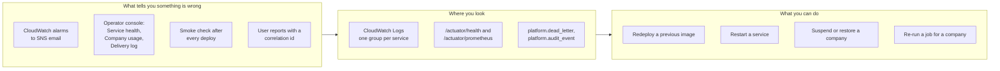
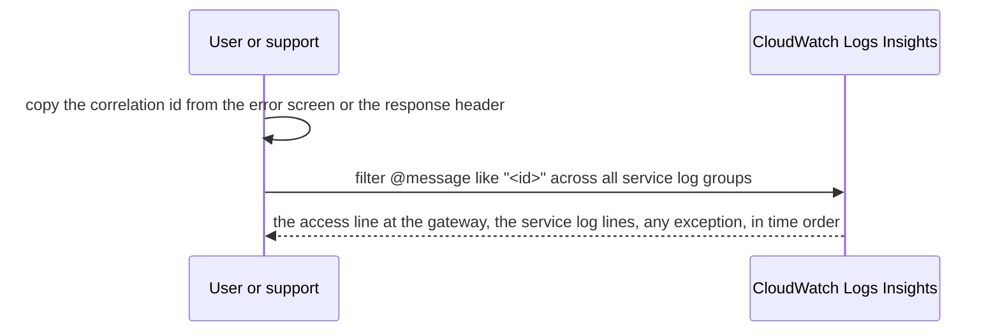
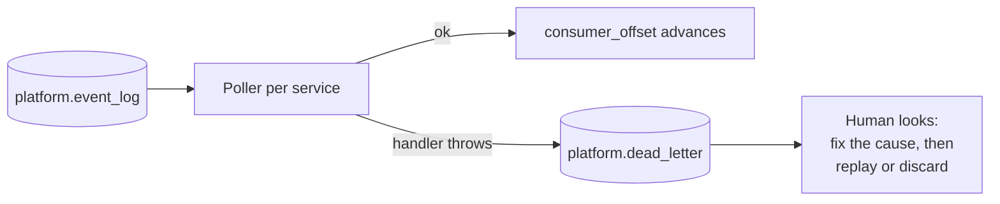
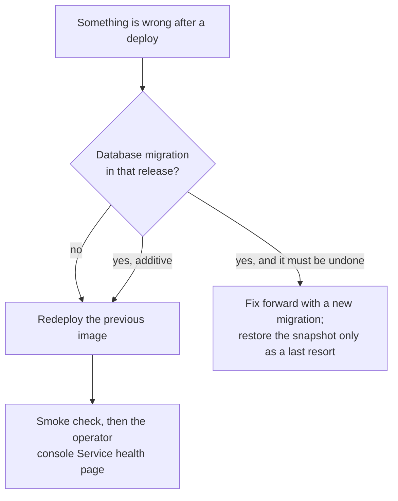

# Operations runbook

For the people who keep PropertyOS running: what to watch, what runs by itself, and what to do when something is wrong. Each section ends with the concrete command or page to use. Architecture is in [Deployment](architecture/DEPLOYMENT.md); how a release ships is in [CI/CD](CI-CD.md).

## 1. The operating picture



## 2. What is monitored

| Signal | Alarm or page | Meaning | First action |
| --- | --- | --- | --- |
| Load balancer 5xx | `alb_5xx` alarm to SNS | Errors reaching users | Open the gateway log group, search the correlation id from a failing request, find the failing service |
| Gateway healthy hosts | `gateway_unhealthy` alarm | The gateway cannot take traffic | Check the ECS service events; redeploy the last good image |
| Service memory over 85% | `<service>-memory` alarms | A service is near its limit | Look for a leak or a traffic spike; raise `task_memory` or restart the task |
| Database CPU | `rds-cpu` alarm | Queries are heavy | Look for a long report or a missing index; scale the instance class |
| Database storage | `rds-storage` alarm | Disk filling | Storage autoscaling is on up to a cap; check what grows (see section 6) |
| Service health | Operator console, *Service health* | Each service's liveness, readiness and dependencies at a glance | Follow the red one |
| Delivery failures | Operator console, *Delivery log* | An email or SMS did not go out | Filter to failed; check the provider and the recipient |
| Overdue subscriptions | Operator console, *Subscription payments* | A company is behind on its PropertyOS bill | Follow up; the console raises overdue and failed-payment alerts |

Health endpoints on every service: `/actuator/health/liveness` (the process is alive), `/actuator/health/readiness` (it can reach **its own** database), `/actuator/health/downstream` (neighbours; informational, never part of readiness, so one outage cannot pull every instance out of rotation). Metrics: `/actuator/prometheus`. See [ADR 2](adr/0002-liveness-and-readiness.md).

## 3. Following one request through the system

Every request gets an `X-Correlation-Id` at the gateway (a caller's own id is kept only if it is 8 to 64 safe characters). It is returned in the response, on every log line of every service the request touches, and forwarded on every internal call. Error responses quote it.



A typical Logs Insights query: `fields @timestamp, @logStream, @message | filter @message like /3f2a9c1e-.../ | sort @timestamp asc`. Structured JSON logging can be switched on with `LOGGING_STRUCTURED_FORMAT_CONSOLE=ecs`.

## 4. Scheduled jobs and what to do when one misses

| Job | Time (America/Chicago) | Where | If it did not run |
| --- | --- | --- | --- |
| Rent cycle | 02:00 | billing | Check the billing log for the company; the job is safe to re-run, a unique index prevents a second invoice for the same lease and period |
| Subscription billing | 02:30 | identity | Only runs when `PROPERTYOS_PLATFORM_BILLING_AUTO` is on; otherwise raise invoices from the console |
| Billing, lease, vendor and document alerts | 07:05, 07:15, 07:25, 07:35 | billing, leasing, maintenance, document | Alerts are de-duplicated (`notification_dedupe`), so a re-run does not send twice |
| Event poller | every 1.5 s | every service | See section 5 |
| Suspended-company refresh | every 10 s | every service | A suspension takes about 10 s to reach a service that missed a refresh |

A suspended company's billing and alert jobs are skipped on purpose (event-driven automations still evaluate; see the [SAD](SAD.md#9-known-gaps-and-next-steps)). A job runs on **every instance** of its service, so each guards itself with a per-company lock; running several tasks is safe.

## 5. Events: dead letters and lag



```sql
-- events a handler failed on, newest first
select * from platform.dead_letter limit 50;

-- how far behind is each subscriber? (a large gap means a stuck or slow handler)
select c.subscriber, c.last_id, (select max(id) from platform.event_log) - c.last_id as behind
from platform.consumer_offset c order by behind desc;
```

Handlers are idempotent, so replaying an event is safe. Fix the cause first, then re-publish or re-run the handler's effect by hand.

## 6. The database

| Topic | Today (demo footprint) | For production |
| --- | --- | --- |
| Engine | RDS PostgreSQL 16, one instance, private subnets, storage 20 GiB autoscaling to 50 | Larger instance class; review autoscaling cap |
| Availability | Single AZ (`multi_az = false`) | Set `multi_az = true` for automatic failover |
| Backups | Automated backups, **retention 1 day**; no final snapshot on destroy; no deletion protection | Raise `backup_retention_period` (7 to 35 days), set `deletion_protection = true` and `skip_final_snapshot = false` |
| Point-in-time restore | Within the retention window | Test a restore quarterly |
| Migrations | Applied by each service at start-up, forward-only, additive | Take an RDS snapshot before a release that carries a migration ([DATABASE-MIGRATIONS](DATABASE-MIGRATIONS.md)) |

**Before a risky release**, take a manual snapshot: `aws rds create-db-snapshot --db-instance-identifier <id> --db-snapshot-identifier pre-<release>`.

Growth to watch: `platform.event_log` and `platform.audit_event` grow with activity; add a retention job when they become large. `delivery` (every email and SMS) grows with notifications.

## 7. Deploying and rolling back

A merge to `develop` deploys only what changed ([CI/CD](CI-CD.md)). If the smoke check fails or ECS's circuit breaker trips, the old tasks keep serving and the pipeline stops.



* Redeploy a previous image: `infra/aws/deploy-service.sh <cluster> <service> <registry>/<repo>:<service>-<older-commit>` (Windows: `infra/aws/redeploy.ps1`). The last 8 images of each service are kept.
* Because every migration is additive, the previous application version runs fine on the new schema, so an application rollback is safe; the new tables are simply unused.
* Rerun a full deploy: *Actions, Deploy to AWS, Run workflow, Rebuild and deploy every service and app*.

## 8. Incident playbooks

### Users cannot sign in

1. Is it one company? *Platform, Companies*: a suspended company shows the reason and time. Restore it if suspended in error.
2. Is it everyone? Check *Service health* (identity, gateway). Check the gateway log for 5xx and the identity log for exceptions.
3. Is the token the problem? A changed `JWT_SECRET` invalidates every token: users sign in again.

### Emails or SMS are not arriving

1. *Delivery log*, filter to failed. Read the outcome (provider error, invalid recipient, quiet hours).
2. Open the full recipient only if needed; you will be asked for a reason and it is written to that company's audit log.
3. Check the person's notification preferences and the company's quiet hours; a notification may have been deferred rather than lost.

### Rent was not invoiced

1. Look at the billing log around 02:00 Chicago for the company.
2. Confirm the company is active (not suspended) and the lease is `ACTIVE`.
3. Re-run the cycle (safe: one live invoice per lease and period). Staff with `INVOICE:CREATE` can run it with `POST /api/billing/run-cycle`; choosing a date is allowed in demo mode only.

### A page says "This part of PropertyOS couldn't load"

That is the front end's error boundary. Open the browser console; the failing request shows its correlation id. If it follows a deploy, check whether the front-end bundle and the API are the same release, and redeploy the front end if its CloudFront invalidation did not finish.

### The AI features are slow or wrong

Check `AI_PROVIDER` and the provider status. With no provider the features answer from rules (the response says so). Per-user AI rate limits are in `ai.ai_audit` (`blocked` with a reason).

### A suspected data leak

1. Treat it as severe. Preserve logs and `platform.audit_event`.
2. Identify the correlation ids involved; the access log line names the user, company and path.
3. Suspend the company or the affected user if needed.
4. Run `TenantIsolationIT` against the deployed commit's code to check isolation still holds.
5. Notify according to your contractual and legal obligations.

## 9. Routine tasks

| Task | How | How often |
| --- | --- | --- |
| Onboard a company | Console, *Platform*, create a company (name, state, plan, admin email); pass on the one-time password | As needed |
| Suspend or restore a company | Console, *Platform*; a reason is required | As needed |
| Change a plan or its price | Console, *Plans* | As needed |
| Raise subscription invoices | Automatic when `PROPERTYOS_PLATFORM_BILLING_AUTO` is on; otherwise the console | Monthly |
| Review subscription arrears | Console, *Subscription payments* | Weekly |
| Curate the shared amenity list | Console, *Amenities* | As needed |
| Review operator reveals | Each company's audit log (action is recorded with the reason) | Monthly |
| Restore test | Restore a snapshot to a scratch instance and run the SQL checks in [DATABASE-MIGRATIONS](DATABASE-MIGRATIONS.md) | Quarterly |
| Rotate secrets | Update Secrets Manager, redeploy services (a changed `JWT_SECRET` signs everyone out) | Per policy |

## 10. Capacity and cost levers

| Lever | Where | Effect |
| --- | --- | --- |
| `desired_count` | `infra/aws/variables.tf` | Tasks per service (more for availability) |
| `task_cpu`, `task_memory`, `service_cpu` | variables | Per-task size |
| `db_instance_class`, `multi_az` | variables | Database size and failover |
| `log_retention_days` | variables | Log cost |
| Rate limits | `RATE_LIMIT_USER_PER_MINUTE`, `RATE_LIMIT_PUBLIC_PER_MINUTE` | Protection versus headroom |

The [performance suite](../performance/README.md) gives the service levels to hold when you change any of these.
