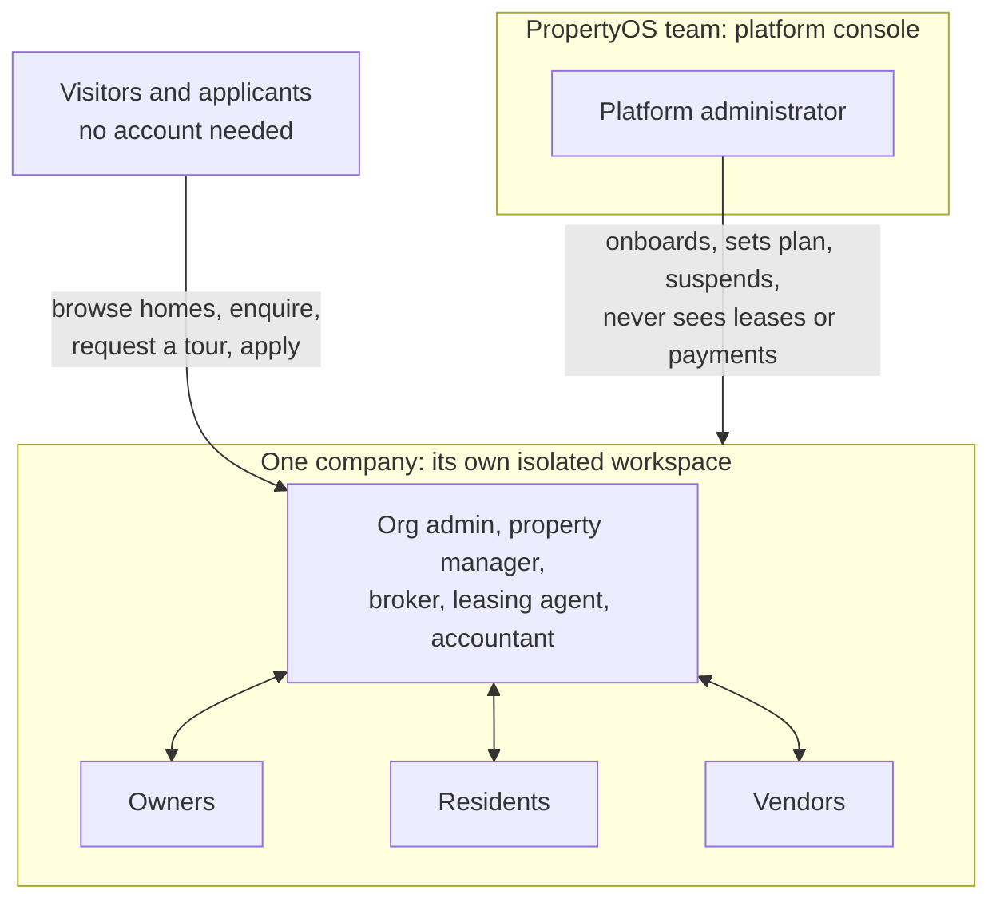
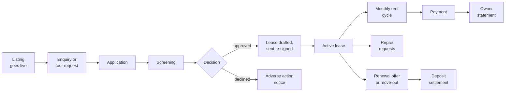
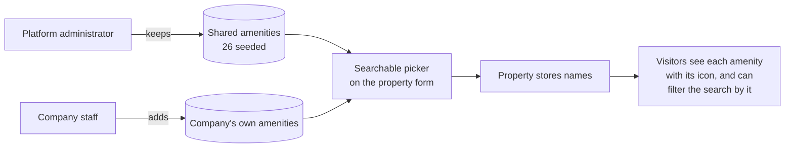
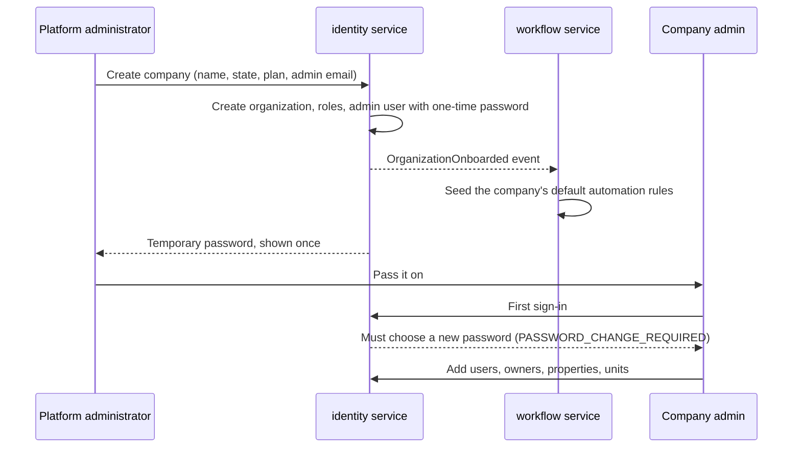
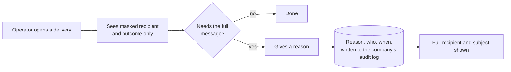

# Product guide

What PropertyOS does, for whom, and how the pieces fit together. This is the document to read before any technical one.

## 1. The product in one picture

A **company** (a property management business) signs up. Its team runs the whole business inside one workspace. Its **owners**, **residents** and **vendors** each get their own narrow view. Anyone on the internet can browse its available homes. The **PropertyOS team** governs all companies from a separate console and can never open a company's business data.

## 2. Who uses it

| Persona | Signs in as | Sees | Typical day |
| --- | --- | --- | --- |
| **Platform administrator** | PropertyOS operator | Companies, plans, product defaults, subscription payments, company usage, service health, delivery log, website enquiries, the shared amenity list | Onboard a company, check service health, follow up an overdue subscription, answer a demo request |
| **Org admin** | Company administrator | Everything in the company, plus users and roles, configuration, branding and the company's PropertyOS subscription | Add a teammate, change the late-fee rule, set the company colour and logo |
| **Property manager** | Operations lead | The whole portfolio, approves repairs up to a higher limit | Work the daily queue, approve a repair, review a lease |
| **Broker** | Portfolio manager | An assigned set of properties, the broker cockpit and opportunities | Triage the cockpit, respond to a lead, offer a renewal |
| **Leasing agent** | Leasing team | Listings, leads, showings, applications; cannot approve | Publish a listing, schedule a tour, screen an application |
| **Accountant** | Finance | Receivables, payments, deposits, owner statements, tax and compliance | Chase an overdue invoice, publish owner statements, prepare 1099 data |
| **Owner** | Property owner | Only their own properties, leases, statements and reports | Approve a large repair, read a statement |
| **Resident** | Tenant | Only their own lease, balance, requests and messages | Pay rent, report a repair with a photo, read the lease, rate their home |
| **Vendor** | Contractor | Only jobs assigned to their company | Schedule and complete a job |
| **Visitor** | Nobody | The public homes site and marketing site | Search homes, ask a question, request a tour, apply and upload documents |

The seven company roles are templates (`DefaultRoles`): a company admin can adjust any permission per feature and action. See [Security](SECURITY.md) for how permissions are enforced.

## 3. What each area does

### Portfolio

Owners, properties, units. Each property has a photo gallery (moderated by AI for relevance and quality), a type, year built and **amenities**.

**Amenities are picked, not typed.** PropertyOS keeps a catalogue of amenities, each with an icon: 26 shared ones the platform administrator maintains (Covered parking, Swimming pool, Pets welcome, EV charging...), plus any a company adds for itself ("Dog wash", "Business centre"). On the property form a searchable list shows each with its icon, and anyone who can edit properties can add a missing one on the spot. A property stores amenity *names*, so renaming or removing a catalogue entry never changes an existing property.

### Leasing

* **Listings** are drafted with AI help, screened for fair-housing wording, reviewed, approved and published. A listing moves *Draft, AI review, Live* (or *Flagged* when the review finds a problem, until a person with approval rights overrides it), can be *Paused* and resumed, and ends *Leased*.
* **The public homes site** (`/homes`) is open to anyone. It shows every available home, grouped **by property** (each building once, with its available units inside) or **home by home**, with a photo carousel on every card, the company that lists it, and the resident rating. Visitors filter by words, city, property type, bedrooms, bathrooms, rent range, size range, available-by date and amenities, sort, and page through results. The choices are kept in the address, so a search can be shared. A home's page shows the facts with icons, amenities with icons, costs, the other homes in the same building, and a **Listed by** box with the company's logo, phone, email and website (set under Branding).
* **Leads and showings** come from enquiries and tour requests, answered automatically within the company's service level and followed up by a person.
* **Applications** move *Submitted, (Docs pending), Screened, Owner review, Approved*, or end *Rejected* (with an adverse-action notice) or *Withdrawn*. Applicants upload documents through a private, expiring link.
* **Leases** move *Draft, Sent, Tenant signed, Active* (after the company countersigns), then *Renewal offered* or *Notice given*, *Ended* and *Closed* once the deposit is settled.

### Payments

* A **nightly rent cycle** creates each period's invoices, applies late fees under the state's cap, and takes autopay. It runs with a per-company lock, so an overlapping run can never bill twice.
* **Invoices** have a professional PDF: logo, colour band, amount due, itemised table, tax line, payments and how to pay.
* **Collections**, **payments received**, **deposits** (held, refund due, settled), **owner statements** (draft, published, paid) and **tax and compliance** (1099 data, W-9 tracking).

### Maintenance

A resident reports a repair, with photos. AI triages it (category, urgency). If the cost is above the approver's limit it waits for approval (the owner's limit, then the manager's). It is assigned to a vendor, scheduled, worked and completed; a person then verifies it and it is closed (or reopened and sent back to the vendor), with a service-level clock on every step. Vendors are rated by staff, owners and residents; vendors can see only their own jobs. **Preventive maintenance** plans create work orders on a schedule.

### Documents and e-signature

A library with versions, requirement checklists (what a lease file should contain, what is missing), a photo review queue, and signature requests with reminders.

### Insights and automation

* **Reports**: rent roll, occupancy and vacancy, vacant units, lease expirations, leasing funnel, ratings, who owes what, income and expenses, transactions, payments, fees, repair costs, jobs, vendor scorecard. Every line drills down to the records behind it.
* **Broker cockpit**: a short daily queue ranked by what needs a decision.
* **AI tools**: lease abstract, anomaly scan, owner-statement narrative, resident outlook, photo triage, fair-housing check. See [AI](AI.md).
* **Automation rules**: a library of ready-made rules (acknowledge an enquiry, remind before rent is due, escalate a breached repair deadline) that a company can switch on, edit or extend, each counted toward *time saved*.
* **Deadlines and alerts**: lease expiry, deposit refunds, vendor insurance, tax filing, 1099, missing W-9, document expiry, signature reminders.

### Every company is its own brand

Under *Configuration, Branding* a company sets its name, **primary colour**, **logo**, accent colour and public contact details. The colour reaches the menu, top bar, buttons and links through CSS variables; the logo shows in the menu and on every invoice; the contact details appear on the public listing page.

## 4. Onboarding a company

A company's plan (Starter, Growth, Enterprise) decides which features it has; a feature that is off simply does not appear, and the API refuses it with a clear message.

## 5. The platform console

Only platform administrators see these pages, and the system refuses them every company page (`PLATFORM_NO_COMPANY_DATA`).

| Page | Purpose |
| --- | --- |
| **Platform** | Companies: create, change plan, suspend (a reason is required and audited) and restore |
| **Product defaults** | Settings that apply to every company unless it overrides them |
| **Plans** | Plans, prices, minimums and the features each includes |
| **Subscription payments** | What each company pays PropertyOS: monthly invoices (units times plan price, never below the plan minimum), payments, credits, one-off charges, overdue and failed-payment alerts |
| **Company usage** | Units, users and activity per company |
| **Service health** | Every service's health and dependencies at a glance |
| **Delivery log** | Every email and SMS the platform sent, masked by default; opening the full recipient and subject needs a reason that is written to that company's own audit log |
| **Enquiries** | Demo requests and website contact messages |
| **Features** | How each feature is described on the public website, and whether it is shown |
| **Amenities** | The shared amenity list every company starts from |

## 6. Plans and entitlements

| Plan | Price per unit per month | Monthly minimum | Features |
| --- | --- | --- | --- |
| Starter | $1.25 | $125 | Leasing, payments, maintenance, owner portal, documents |
| Growth | $1.75 | $300 | Starter plus vendor portal, automations, AI assistant, renewals, recurring maintenance, messaging, e-signature |
| Enterprise | $2.50 | $1,500 | Everything, including the broker cockpit and opportunities |

A company is billed monthly: units times the plan price, never less than the plan minimum.

These are the shipped defaults (`defaults.json`). Plans and prices are data managed on the Plans page, so the Plans page and the public Plans page are authoritative.

## 7. Where to go next

* How it is built: [HLD](architecture/HLD.md), [LLD](architecture/LLD.md), [Data model](DATA-MODEL.md).
* Every screen exercised end to end: [Browser journeys](../e2e/JOURNEYS.md).
* What changed recently: [Changelog](CHANGELOG.md).

## Boosting a listing

A company administrator can pay to boost a live listing for 7, 14 or 30 days (prices are the operator's `boost` setting). Choosing a period raises an invoice on the company's PropertyOS account; the company pays it from Subscription like any other (a test card ending 4242 is approved, 0002 is declined). The boost starts the moment the invoice is paid in full, and a declined payment starts nothing. A boosted listing is labelled Sponsored on its card and its page, and earns a ranking bonus, but only up to the configured share of a results page, so paid homes cannot fill it. The company is told when the boost starts and 24 hours before it ends; an unpaid boost is cancelled, and its invoice voided, after 14 days. The operator sees boost revenue for the month and the number of active boosts on the Payments page.

### Boosts: what the operator controls

- **Whether a company can buy boosts.** Boosting is a plan feature (`BOOST`). It is on every existing plan; the operator can take it off a plan on Plans, switch it for one company on that company's Features tab, or stop all sales with `boost.onSale`. Boosts already paid for keep running.
- **Price.** Standard prices per length are the `boost` product default. A percentage discount can be set per plan. A price can also be agreed with one company for one length, and that price is final (the plan discount is not applied on top). A promo code (a percentage or a dollar amount, for any company or one, with an end date and a use limit) comes off last. A purchased boost never costs less than $1; free boosts are granted instead.
- **Listing boosts page** (Administration > Listing boosts): every company's boosts with status, price and how it was reached; end a boost (an unpaid one has its invoice voided, a paid one is not refunded automatically); grant a free boost with a reason; agreed prices; promo codes.
- **Money.** Boost invoices are ordinary platform invoices of kind BOOST, so they appear on Subscription payments (as "Listing boost"), and boost revenue for the month is on that page.

## Marketing campaigns

A company makes a campaign for each ad, listing-site push or email (Facebook ads, Google ads, Zillow, Apartments.com, email, other), with an optional budget and dates. Two things tie leads and applications to it:

- **A tracking link** (`/homes?cmp=CODE`). A visitor who arrives through it and later enquires, asks for a tour or applies on the public site is counted for the campaign. An enquiry makes a lead; a tour request makes a showing and an application makes an application, and each of those also makes a lead for that person and home (unless they already have one), so every prospect shows on the Leads page and in the campaign's lead count.
- **A signed inbound address** (`POST /api/leasing/public/inbound/{key}`) for ad platforms and form tools. The sender signs the exact JSON body with the campaign's secret (HMAC-SHA256, hex, in the `X-Signature` header). A missing or wrong signature is refused (401), an unknown key is 404, and a paused or ended campaign accepts nothing. A post names a live home of the company (`listingId` or `unitId`), so a campaign can never create leads for another company. The same person asking about the same home again is reported as a duplicate, not entered twice. Leasing agents are notified; an application is high priority.

The campaigns list shows leads, tours, applications and cost per lead for each, and a campaign's recent activity lists its leads, tours and applications. A secret is shown once, when it is made or rotated. Rotating it stops the old one at once (rotating the address as well stops the old address); the tracking link never changes.

Who can do what: `CAMPAIGN:VIEW` to see them, `CAMPAIGN:CREATE` and `CAMPAIGN:EDIT` to make, edit, pause and rotate. Brokers, managers and administrators run campaigns; leasing agents and accountants can look. Campaigns are the `CAMPAIGNS` plan feature (on Growth and Enterprise; the operator can add it to Starter or switch it per company), and the per-minute limit is the operator's `campaigns` setting.

## What the roles and plans control (boosts, review replies, campaigns)

| Capability | Permission | Plan feature | Default roles |
| --- | --- | --- | --- |
| See boosts, prices and status | `BOOST:VIEW` | `BOOST` | Administrator, manager, broker, accountant |
| Buy a boost | `BOOST:CREATE` | `BOOST` | Administrator (paying the invoice still needs `SETTINGS:CONFIGURE`) |
| Reply publicly to a review | `REVIEW:EDIT` | `REVIEWS` | Administrator, manager, broker, leasing agent |
| Show or hide a review comment | `REVIEW:APPROVE` | `REVIEWS` | Administrator, manager, broker |
| See campaigns | `CAMPAIGN:VIEW` | `CAMPAIGNS` | Administrator, manager, broker, leasing agent, accountant |
| Make, edit, pause, rotate | `CAMPAIGN:CREATE`, `CAMPAIGN:EDIT` | `CAMPAIGNS` | Administrator, manager, broker |

A company's administrator can change which roles hold these permissions in Roles. The platform operator controls the plan features on Plans (per plan) and on a company's Features tab (per company), and the platform-wide settings (`ranking`, `reviewModeration`, `boost`, `campaigns`) under Product defaults. Existing companies get the new permissions on their built-in roles the next time the identity service starts.

## Webhooks

A company can send events to other systems (a CRM, Slack through a relay, Zapier) as signed JSON. In Administration > Webhooks an administrator adds an endpoint (name, an https address, and which events), can switch it off and on, rotate its secret, and send a test event that is shaped and signed like a real one. The delivery log shows every event with its status, the receiver's response code, the number of attempts and the exact JSON sent, and a failed delivery can be tried again by hand.

**Events:** `application.submitted`, `lease.sent`, `lease.signed` (fires when the tenant signs and again when the company countersigns; check `signedBy` and `fullySigned`), `payment.received`, `work_order.created`.

**What a receiver gets:** a POST with `{"id":"evt_123","type":"lease.signed","text":"Maya Patel signed the lease for Unit 4B","created_at":"…","data":{…}}` (`text` is a headline followed by one bullet for each group of facts the event carries (the applicant's contact details, rent, income and move-in date, or how a payment was made; only what is known), which is what Slack's incoming webhooks show as they are, and it reads well in any request viewer; the full facts are always in `data`; test events start with "[Test]") and these headers: `X-PropertyOS-Event`, `X-PropertyOS-Event-Id` (the same on every retry, so it can be used to ignore repeats), `X-PropertyOS-Delivery`, `X-PropertyOS-Timestamp` and `X-PropertyOS-Signature` (`sha256=` and the hex HMAC-SHA256, with the endpoint's secret, of the timestamp, a full stop and the exact body). The page shows a verification example.

**Reliability:** a 2xx answer within a few seconds is a success. A dropped connection or a 502, 503 or 504 is retried straight away a few times (Resilience4j, exponential backoff); anything else that is temporary (no answer, 408, 429, 5xx) is scheduled again after 1 minute, 5 minutes, 30 minutes, 2 hours and 6 hours, six tries in all. A 4xx the receiver chose to send (for example 401 or 404) is not retried. After 20 failed deliveries in a row an endpoint is switched off, with the reason shown. These numbers are the operator's `webhooks` setting.

**Safety:** an address must be https in production (http is allowed only in demo mode). Addresses that point at a private or internal network (localhost, 10/8, 172.16/12, 192.168/16, link-local including cloud metadata, carrier-grade NAT, IPv6 equivalents and addresses that wrap them) are refused when the endpoint is saved and checked again before every delivery, and redirects are never followed. Roles: `WEBHOOK:VIEW`, `CREATE`, `EDIT`, `DELETE`, held by administrators by default. Plan feature: `WEBHOOKS` (Growth and Enterprise).
