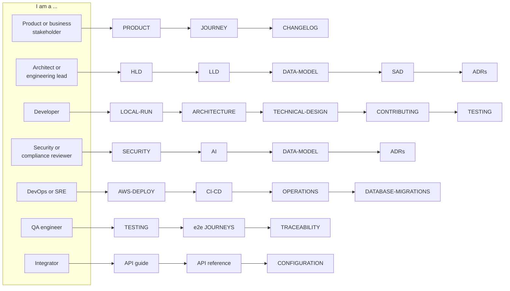
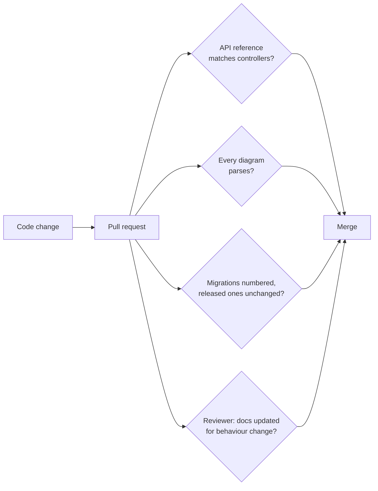

# PropertyOS documentation

This is the map. Every document below is kept in step with the code: the API reference is generated from the controllers, every diagram is parsed by CI, and the numbers in these pages come from the repository, not from memory.

## Start with your role

| Role | Read in this order |
| --- | --- |
| **Product or business stakeholder** | [Product guide](PRODUCT.md) for who uses what, then [The engineering journey](JOURNEY.md) for proof of every claim, then the [Changelog](CHANGELOG.md) |
| **Architect or engineering lead** | [HLD](architecture/HLD.md), [LLD](architecture/LLD.md), [Data model](DATA-MODEL.md), [SAD](SAD.md), [Microservice standards](MICROSERVICES.md), [ADRs](adr/README.md) |
| **Developer** | [Run it locally](LOCAL-RUN.md), [Architecture](ARCHITECTURE.md), [Technical design](TECHNICAL-DESIGN.md), [CONTRIBUTING](../CONTRIBUTING.md), [Testing](TESTING.md) |
| **Security or compliance reviewer** | [Security](SECURITY.md), [AI](AI.md), [Data model](DATA-MODEL.md) (row-level security), [ADRs](adr/README.md) |
| **DevOps or SRE** | [AWS deployment](AWS-DEPLOY.md), [CI/CD](CI-CD.md), [Operations runbook](OPERATIONS.md), [Database migrations](DATABASE-MIGRATIONS.md), [Deployment architecture](architecture/DEPLOYMENT.md) |
| **QA engineer** | [Testing](TESTING.md), [Browser journeys](../e2e/JOURNEYS.md), [Requirement traceability](../e2e/requirements/TRACEABILITY.md), [Performance](../performance/README.md) |
| **Integrator** | [API guide](API.md), [API reference](api/README.md), [Configuration](CONFIGURATION.md) |

## All documents

### Product

| Document | What it answers |
| --- | --- |
| [PRODUCT](PRODUCT.md) | Who uses PropertyOS, what each role can do, how a company is onboarded, the public site, the platform console |
| [JOURNEY](JOURNEY.md) | The end-to-end engineering story and the evidence behind each claim |
| [CHANGELOG](CHANGELOG.md) | What shipped, in plain language, with the database changes each release carries |
| [GLOSSARY](GLOSSARY.md) | The words this product and these documents use |

### Architecture and design

| Document | What it answers |
| --- | --- |
| [HLD](architecture/HLD.md) | The system on one page: context, containers, decisions, quality attributes |
| [LLD](architecture/LLD.md) | How a request, an event and a configuration lookup really flow; state machines for the main business objects |
| [DATA-MODEL](DATA-MODEL.md) | Every schema and table, the entity relationships, and how row-level security protects them |
| [SAD](SAD.md) | The solution architecture document: quality scenarios, constraints, risks and the honest gap list |
| [ARCHITECTURE](ARCHITECTURE.md) | Service boundaries, layering and the design principles mapped to code |
| [TECHNICAL-DESIGN](TECHNICAL-DESIGN.md) | How each interesting mechanism works and where to read it |
| [MICROSERVICES](MICROSERVICES.md) | Resilience, observability, health, security and HA standards, with where each lives |
| [ADRs](adr/README.md) | Why the important decisions were made, and what was given up |
| [DEPLOYMENT architecture](architecture/DEPLOYMENT.md) | The AWS runtime, network, pipeline and environments |

### Engineering

| Document | What it answers |
| --- | --- |
| [LOCAL-RUN](LOCAL-RUN.md) | Build, start, test and debug everything on a laptop |
| [CONTRIBUTING](../CONTRIBUTING.md) | Branching, the definition of done, review, documentation policy |
| [TESTING](TESTING.md) | The test strategy, every layer, how to run and extend each |
| [API](API.md) and [API reference](api/README.md) | Conventions, errors, paging, plus every endpoint with its permission |
| [CONFIGURATION](CONFIGURATION.md) | Every environment variable and every per-company setting |
| [AI](AI.md) | Providers, tools, guardrails, audit |
| [SECURITY](SECURITY.md) | Authentication, authorisation, tenant isolation, threats and controls |

### Delivery and operations

| Document | What it answers |
| --- | --- |
| [CI-CD](CI-CD.md) | What runs on a pull request and on a push to `develop` |
| [AWS-DEPLOY](AWS-DEPLOY.md) | Standing up and running the AWS environment with Terraform |
| [DATABASE-MIGRATIONS](DATABASE-MIGRATIONS.md) | How schema changes reach AWS, and what each release changes |
| [OPERATIONS](OPERATIONS.md) | Monitoring, scheduled jobs, backup, incident playbooks, rollback |
| [DEPLOY](DEPLOY.md) | The lightweight Railway and Vercel alternative |
| [Performance](../performance/README.md) | Load, stress, spike and soak tests and the service levels |

## How these documents are kept honest

* The [API reference](api/README.md) is **generated** (`node scripts/generate-api-docs.js`) and CI fails if it is out of date.
* Every relative link between documents, and every `#section` anchor, is resolved by `scripts/check-doc-links.js` in CI, so a renamed heading cannot silently break a reference.
* Every `mermaid` diagram is parsed by the real Mermaid parser in CI (`npm run docs:check` in `e2e/`), so GitHub never shows "Unable to render".
* `scripts/check-migrations.js` guards the migration history that [DATABASE-MIGRATIONS](DATABASE-MIGRATIONS.md) describes.
* The pull request template asks whether behaviour, configuration or a database change needs a document updated. A change that alters what a document says is not finished until that document says it.

## Conventions

* Diagrams are [Mermaid](https://mermaid.js.org/), so they live in the repository and diff like code. A semicolon inside a sequence-diagram message ends the statement in Mermaid; use a comma.
* "Company" is a tenant (a property management business). "Operator" or "platform" is the PropertyOS team. See the [glossary](GLOSSARY.md).
* Times are UTC in storage; scheduled jobs state the time zone they run in.
* Where a document states a number (endpoints, tests, migrations) it says how to re-derive it, or it is generated.
