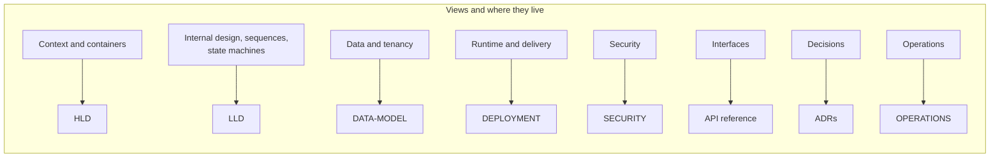

# Solution architecture document (SAD)

The architecture of PropertyOS stated as an architect, an auditor or a buyer's technical team would want it: purpose, constraints, views, quality scenarios with their evidence, risks, and an honest list of what is not done yet.

## 1. Purpose and scope

PropertyOS lets property management companies run portfolio, leasing, rent and expenses, maintenance, approvals, documents and AI assistance on **one multi-tenant platform**, operated by a platform team that onboards companies, sets plans and product defaults, bills them, watches service health and can suspend a company.

**Personas:** platform operator, org admin, property manager, broker, leasing agent, accountant, owner, resident, vendor, and the public visitor or applicant ([Product guide](PRODUCT.md)).

**In scope:** the web application, the eight backend processes, the database, the AWS runtime and the delivery pipeline. **Out of scope:** payment processor and messaging provider internals, the customers' own accounting systems.

## 2. Architecture views

| View | Document |
| --- | --- |
| Context and containers | [HLD](architecture/HLD.md) |
| Internal design, sequences and state machines | [LLD](architecture/LLD.md) |
| Data and tenancy | [Data model](DATA-MODEL.md) |
| Runtime and delivery | [Deployment](architecture/DEPLOYMENT.md), [CI/CD](CI-CD.md) |
| Security | [Security](SECURITY.md) |
| Interfaces | [API guide](API.md), [API reference](api/README.md), Swagger UI |
| Decisions | [ADRs](adr/README.md) |
| Operation | [Operations runbook](OPERATIONS.md) |

## 3. Constraints and assumptions

* Java 21, Spring Boot 3.4, PostgreSQL 16, React 18 with Vite Module Federation.
* The delivered AWS footprint is **demo-grade** (single-AZ database, one-day backups, no NAT gateway, tasks in public subnets with locked-down security groups). Every production-hardening step is a Terraform variable or a small change, listed in section 9.
* The AI layer is optional: with no provider configured, features fall back to deterministic rules.
* One PostgreSQL database holds every company, separated by row-level security rather than by database.
* US residential focus: state rules (late-fee caps, deposit deadlines), fair-housing and consumer-report notices are modelled.

## 4. Building blocks

| Block | Responsibility | Owns |
| --- | --- | --- |
| api-gateway | Single entry; JWT check, rate limit, CORS, headers, routing, Swagger UI | Nothing persistent |
| identity | Users, companies, roles, plans, configuration, audit, operator console, platform billing, public website content | `identity` schema |
| leasing | Owners, properties, units, amenities, listings, leads, showings, applications, leases, reviews, reports, public search | `leasing` schema |
| billing | Invoices, payments, deposits, expenses, ledger, owner statements, tax | `billing` schema |
| maintenance | Work orders, vendors, ratings, preventive plans | `maintenance` schema |
| workflow | Automation rules, notifications and delivery, messages, operator delivery log | `workflow` schema |
| ai | Assistant, studio tools, guardrails, audit | `ai` schema |
| document | Library, versions, photo moderation, e-signature, requirements | `document` schema, S3 |
| platform-common | Shared kernel: security, RLS, errors, events, configuration client, resilience, OpenAPI | `platform` schema objects |
| frontend | Shell plus seven micro-frontends and a shared design system | S3 and CloudFront |

## 5. Quality-attribute scenarios

| Scenario | Response | Evidence |
| --- | --- | --- |
| A bug in a controller queries without a company filter | The database returns only the caller's company rows | `TenantIsolationIT`, forced RLS policies ([ADR 5](adr/0005-row-level-security-for-tenancy.md)) |
| A user without `PROPERTY:DELETE` calls delete | 403 before the method runs | `PermissionInterceptor`, role tests, browser `RBAC-11` |
| A platform administrator requests a company's lease | 403 `PLATFORM_NO_COMPANY_DATA` | `PlatformGovernanceIT` ([ADR 8](adr/0008-platform-operators-cannot-see-company-data.md)) |
| A company is suspended | Its users are refused within about 10 seconds; public listings vanish; its scheduled jobs stop | `PlatformGovernanceIT`, `NewCompanyJourneyIT` |
| A visitor tries to read a draft listing or another company's data through the public API | Only live listings of unsuspended companies, with no internal ids | `PublicCatalogIT` ([ADR 9](adr/0009-public-catalogue-reads-as-system.md)) |
| A downstream service is slow | The circuit-breaking client fails fast and the caller degrades gracefully | [ADR 1](adr/0001-resilience-for-service-calls.md), `ResilienceTest` |
| A handler throws on an event | The event goes to `dead_letter`; the stream keeps moving | `EventPoller`, [ADR 6](adr/0006-transactional-outbox.md) |
| The nightly rent cycle runs twice | A unique index refuses a second invoice for the same lease and period | `ux_invoice_rent_period`, billing scenario tests |
| A bad release is pushed | The smoke check or ECS circuit breaker fails the pipeline and the old tasks keep serving; redeploy the previous image | `deploy.yml`, `deploy-service.sh` |
| A migration is edited after release | The pipeline stops before anything ships | `check-migrations.js` |
| A service runs hot | CloudWatch alarm to SNS to email | `monitoring.tf` |
| An LLM is unavailable or abused | Rules fallback; prompt-injection screening, PII redaction, rate limits, audit | [AI](AI.md) |
| An operator needs to see a customer's email | Masked by default; full detail needs a reason that lands in the customer's audit log | `PlatformConsoleIT` |

## 6. Data

One PostgreSQL database, **a schema per service**, forward-only Flyway migrations per service (31 at the time of writing, all additive), and a shared `platform` schema for events, audit and the row-level-security function. Documents live in S3 with content hashes. Records are soft-archived (`archived_at`) or voided, never silently deleted; only draft listings are hard-deleted. Full model: [DATA-MODEL](DATA-MODEL.md).

## 7. Integration

* **Synchronous:** REST through the gateway for clients; service-to-service through `ServiceClient` on `/internal/**` with `X-Internal-Token`, with a breaker, retry on reads only and a bulkhead.
* **Asynchronous:** a transactional outbox (`platform.event_log`) and a poller per service, at-least-once with idempotent handlers.
* **External:** optional OpenAI or Bedrock, email and SMS providers, card and bank processing, S3.

## 8. Operations

Liveness and readiness probes, Actuator metrics, a correlation id on every log line, CloudWatch logs and alarms to SNS, an operator console for service health, usage and the delivery log, Gatling performance suites, and a GitHub Actions pipeline with a smoke check. See [Operations](OPERATIONS.md).

## 9. Known gaps and next steps

An honest list. Each item says what is true today and the step that closes it.

| Area | Today | Next step | Effort |
| --- | --- | --- | --- |
| Network | Fargate tasks in public subnets (security groups admit only the load balancer and each other); no NAT | Private subnets with VPC endpoints for ECR, S3, Secrets Manager and logs | Small, Terraform |
| Database availability and backup | Single AZ; one-day backup retention; no deletion protection or final snapshot | `multi_az = true`, 7 to 35 days retention, `deletion_protection = true`, `skip_final_snapshot = false`; test a restore | Variable changes |
| Request typing | Many request bodies are `Map<String,Object>`, so Swagger shows generic objects and validation is hand-written | Typed records with bean validation per endpoint | Medium, incremental |
| Tracing | The correlation id gives log-level tracing | OpenTelemetry spans exported to a tracing backend | Medium |
| Idempotency | Writes are never retried automatically | Idempotency keys on payment and create endpoints so clients can retry safely | Medium |
| Service mesh | Internal token plus network policy | Mutual TLS between services | Larger |
| Secrets | Secrets Manager, injected at start | Automatic rotation | Small to medium |
| Automation for suspended companies | Event-driven automations still evaluate for a suspended company | Pause automations when a company is suspended | Small |
| Bedrock | Implemented, not wired in the AWS demo | Provide the task role and model ids | Small |
| Archived record restore | An API exists, no screen yet | Add the screen | Small |
| Event retention | `event_log` and `audit_event` grow without a prune | A retention job | Small |
| Browser suite in CI | The 360-test Playwright suite is a manual workflow, not a pull-request gate (the backend suites are) | Run a smoke subset on every pull request | Medium |
| Contract tests | Services are tested together, not by consumer-driven contracts | Add pact-style tests if services are owned by separate teams | Medium |

## 10. Risks

| Risk | Likelihood | Impact | Treatment |
| --- | --- | --- | --- |
| A new table is added without row-level security | Low | Severe | Tests drive every endpoint as a second company; a migration review item in [CONTRIBUTING](../CONTRIBUTING.md) |
| An operator feature leaks company data | Low | Severe | Allow-list of operator paths with a governance test; audited reveal |
| A shared-kernel change breaks every service | Medium | High | A change to `platform-common` rebuilds and tests every service before any image is pushed |
| Single-AZ database failure | Low | High | Documented hardening step; backups and a restore drill |
| Model provider outage or cost spike | Medium | Low | Offline fallback; per-user limits; audit of token use |
