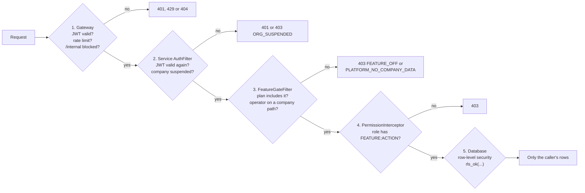
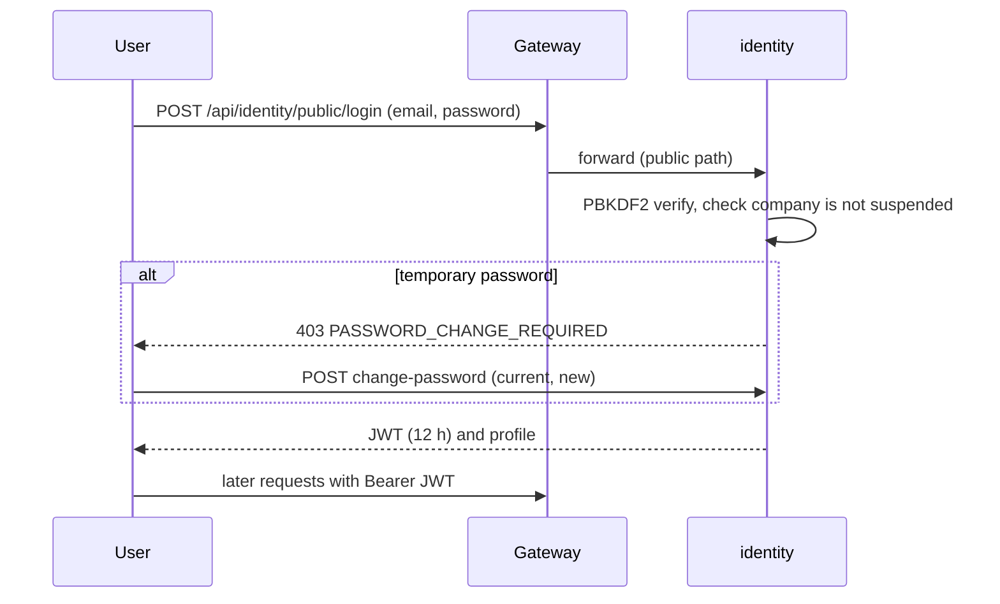
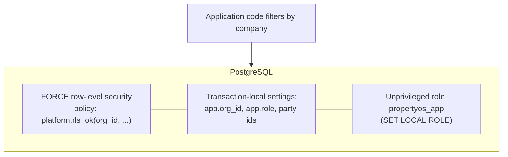
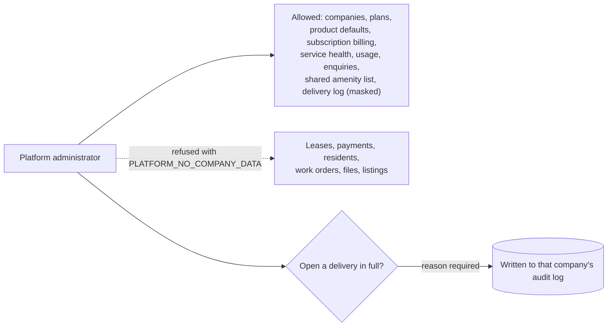

# Security

PropertyOS holds leases, payments and personal data for many companies in one system. Security is therefore not a feature but the shape of the architecture: **every control exists at more than one layer, and each layer fails closed.** This document is for security reviewers, auditors and engineers. It states what is enforced, where, and which test proves it.

## 1. Principles

| Principle | In practice |
| --- | --- |
| **Defence in depth** | Four independent checks between a request and a row: gateway, service token check, permission and plan gate, database policy. |
| **Zero trust between services** | Every service re-verifies the JWT itself; being behind the gateway grants nothing. |
| **Fail closed** | An unknown path needs a token; a query outside a transaction is refused; a missing permission denies; an unconfigured secret stops production from starting. |
| **Least privilege** | Roles get named `FEATURE:ACTION` permissions; the application connects as an unprivileged database role; the platform team is refused company data. |
| **Secure by default** | New tables are protected by row-level security and granted automatically; new endpoints without a permission are `signed-in` only and still pass row-level security. |
| **Auditable** | Security-relevant changes write an audit event in the same transaction; AI interactions and operator reveals are recorded. |

## 2. The path of a request

Paths containing `/public/` are open (the rental site, applicant upload links with signed tokens, OpenAPI JSON). Everything under `/internal/**` needs `X-Internal-Token` and is never routed from outside.

## 3. Authentication

| Item | Detail |
| --- | --- |
| Token | JWT signed with `JWT_SECRET`, valid **12 hours**. Carries the user, company, roles, data scope, party link and per-role money limits, so authorisation needs no extra lookup. |
| Passwords | PBKDF2-HMAC-SHA256, 120,000 iterations, random salt per password. |
| New users | A company administrator creates a user and receives a **one-time temporary password**, shown once and stored hashed. The first sign-in is refused with `PASSWORD_CHANGE_REQUIRED` until a new password is chosen. A reset issues a new temporary password. |
| One-time codes | A code expires after 10 minutes and locks after **5** wrong attempts. The attempts are counted even though the request fails (a rollback used to erase the count; `IdentityScenarioIT` guards the fix). |
| Applicant links | Applicants have no account. Upload links are signed, expire, and are limited to one application (`SignedLinks`). |
| Sign-in responses | The same message for an unknown email and a wrong password, so accounts cannot be enumerated. |
| Rate limits | Gateway token bucket: **600 requests a minute per user**, **120 per client** on public endpoints (both configurable); `429` with `Retry-After`. |
| Suspension | A suspended company's users are refused everywhere within about 10 seconds. |

## 4. Authorisation

### Permissions

A permission is `FEATURE:ACTION`, declared on the endpoint with `@RequiresPermission` and checked before the method runs. The catalogue (`FeatureCatalog`):

| Feature | Actions |
| --- | --- |
| `PROPERTY`, `LISTING`, `OWNER`, `USER` | `VIEW`, `CREATE`, `EDIT`, `DELETE` |
| `APPLICATION`, `SHOWING`, `INVOICE`, `VENDOR` | `VIEW`, `EDIT` (and `CREATE` where relevant) |
| `LEASE` | `VIEW`, `CREATE`, `EDIT`, `APPROVE`, `SIGN` |
| `PAYMENT`, `WORK_ORDER`, `OWNER_STATEMENT` | `VIEW`, `CREATE`, `APPROVE` (work orders also `EDIT`, `UPDATE`, `VERIFY`) |
| `DOCUMENT`, `ESIGN`, `MEDIA` | `VIEW`, `CREATE`, `EDIT`, `DELETE`, `CONFIGURE`, `EXPORT`, `SIGN`, `UPLOAD`, `REVIEW` |
| `ALERT`, `AUTOMATION`, `WORKFLOW`, `ROLE`, `SETTINGS` | `VIEW`, `CONFIGURE` |
| `REPORT`, `DASHBOARD`, `AUDIT`, `OPPORTUNITY`, `AI_ASSISTANT`, `TAX_REPORT`, `CONVERSATION` | `VIEW` (and `EDIT` or `CREATE` where relevant) |
| `PLATFORM` | `VIEW`, `CONFIGURE` (platform administrators only) |

### Roles

Eight company role templates (`DefaultRoles`) plus the platform administrator. A company administrator can adjust any permission of any role in the Roles screen; a change is audited and reaches existing users when their token refreshes.

| Role | Intent |
| --- | --- |
| Org Admin | Full control of the company: users, roles, configuration |
| Property Manager | Runs operations across the portfolio; approves repairs up to $5,000 |
| Broker | An assigned portfolio end to end; repairs up to $1,000 |
| Leasing Agent | Listings, showings, applications; cannot approve |
| Accountant | Receivables, payables, statements, reconciliation |
| Owner | Only their own properties; approves repairs over their limit |
| Resident | Only their own lease, balance and requests |
| Vendor | Only jobs assigned to their company |
| Platform Admin | Companies, plans and operator pages only |

### Data scope

Beyond *what* a user may do is *which rows*: staff see their company, or only assigned properties when scoped to properties; an owner's `owner_id`, a resident's `tenant_id` and a vendor's `vendor_id` narrow every query inside the database ([Data model](DATA-MODEL.md#row-level-security)).

### The plan gate

`FeatureGateFilter` turns a feature off for companies whose plan lacks it (`FEATURE_OFF`) at the API, not just in the menu, so removing a menu item is never the only protection.

## 5. Tenant isolation

Even if the application filter is missing, the policy returns nothing for another company. `Db.requireTransaction()` refuses queries outside a transaction (a read outside one would bypass the policies on a superuser connection). A second company gets **404** for the first company's records so existence is not revealed. Decision record: [ADR 5](adr/0005-row-level-security-for-tenancy.md).

**Proof:** `TenantIsolationIT` (a second company cannot read or change the first company's data), `PhotoReviewIT`, the browser suite's two-company isolation journeys, and `PlatformGovernanceIT`.

## 6. The platform operator boundary

The people who run PropertyOS are a risk too. Their access is deliberately narrow ([ADR 8](adr/0008-platform-operators-cannot-see-company-data.md)):

* The delivery log masks recipients (`r***@example.com`, `*******42`) and never shows subjects.
* Suspending a company needs a reason, which is stored with the actor and time and shown to that company's audit trail.

## 7. The public surface

The rental site is the one place anonymous people reach company data. It is built to expose the least possible ([ADR 9](adr/0009-public-catalogue-reads-as-system.md)):

| Control | Detail |
| --- | --- |
| Visibility rule in one class | `PublicCatalog` shows only `LIVE` listings of companies that are not suspended |
| No internal ids | Company, owner and property references are stripped from every row; a test asserts it |
| Bound parameters | Every filter value is bound, never concatenated; `%` and `_` in a keyword are escaped; sort columns are checked against the columns the query returns |
| Validation with reasons | A bad filter returns 400 with a sentence, not a stack trace |
| Rate limiting | Per client at the gateway |
| Contact details | A company's phone, email and website are validated when saved (a `javascript:` link is refused) and rendered as plain links with `rel="noopener noreferrer"` |
| Applications | Consent is required; one application per email and home; documents go through a private expiring link |

## 8. Input handling and output

| Control | Where |
| --- | --- |
| Typed errors, no stack traces to callers | `GlobalExceptionHandler` returns RFC 7807 problem JSON with a correlation id to quote |
| Request size limits | Header and upload limits at the edge and in the services |
| File checks | Type and size are checked, bytes are stored with a content hash, and served with `X-Content-Type-Options: nosniff`, a restrictive `Content-Security-Policy` and `Cache-Control: private, no-store` |
| SQL | Parameterised everywhere through `Db`; dynamic fragments (sort column, table filters) are whitelisted against known column names |
| Security headers | `X-Content-Type-Options`, `X-Frame-Options: DENY`, `Referrer-Policy`, `Strict-Transport-Security` at the edge; `no-store` on API responses |
| Cross-origin | CORS limited to configured origins (`ALLOWED_ORIGINS`) |
| Logos | A company logo must be a PNG or JPEG under 100 KB (checked by type and size) |

## 9. Secrets and configuration

* No secret is in the repository. `JWT_SECRET`, `INTERNAL_TOKEN`, database and AI keys are environment variables; on AWS they come from Secrets Manager and are injected into the tasks. `.env.local` is git-ignored.
* `SecretsGuard` **refuses to start production** if it still has the built-in development secrets.
* AWS access from GitHub uses OIDC with a short-lived role; there are no AWS keys in GitHub.
* Terraform state and `terraform.tfvars` are git-ignored.

## 10. Audit and privacy

| Record | Contents |
| --- | --- |
| `platform.audit_event` | Who, what, which entity, before and after, in the same transaction as the change; shown per record as a timeline |
| `identity.config_history` | Every configuration version, with who changed it |
| `ai.ai_audit` | Each AI interaction: user, tool, provider, token counts, whether a guardrail blocked it |
| Operator reveals | The reason and the operator, in the company's audit log |
| Logs | Every line has a correlation id; the delivery log stores masked recipients for operators |

Personal data minimisation: SSNs are stored as the last four digits only, card data as the last four digits only (processing is by token), and AI prompts have PII redacted before they leave the system.

## 11. AI security

Described in full in [AI](AI.md): prompt-injection screening, PII redaction, fair-housing screening, per-user rate limits, tools that run **as the asking user**, and **confirm before write**. With no provider configured, AI features answer from deterministic rules and send nothing anywhere.

## 12. Product controls for legal risk

| Risk | Control |
| --- | --- |
| Fair-housing violations in a listing or message | A fair-housing screen on listings (a flagged listing cannot go live without an authorised override) and on staff messages (blocked until reworded) |
| Adverse decisions based on a consumer report | An adverse-action notice is generated when an application is rejected on one |
| State late-fee and convenience-fee limits | `stateRules` caps late fees and blocks convenience fees where the state forbids them (`enforceStateFeeCaps`) |
| Deposit return deadlines | The deposit's refund deadline comes from the state rule and raises an alert |
| Tax | W-9 tracking and 1099 data per owner |

## 13. Threat model

STRIDE applied to the main assets.

| Threat | Example | Mitigation | Evidence |
| --- | --- | --- | --- |
| **Spoofing** | Forged or stolen token; guessing a one-time code | Signed JWT verified at two layers, 12-hour expiry, code lock after 5 attempts, suspension kill-switch | `AuthFilter`, `IdentityScenarioIT` |
| **Tampering** | Changing another company's lease by id | 404 from row-level security; permission checks; audit | `TenantIsolationIT` |
| **Repudiation** | "I never changed that setting" | Audit events and config history with actor and time | Audit timeline |
| **Information disclosure** | A missing `where org_id`; a verbose error; a public query returning ids | Forced row-level security; problem JSON without internals; stripped public rows | `TenantIsolationIT`, `PublicCatalogIT` |
| **Denial of service** | A flood of requests; a slow dependency | Per-user and per-client rate limits, circuit breakers, bulkheads, timeouts | `EdgeSecurityFilterTest`, `ResilienceTest` |
| **Elevation of privilege** | A resident calling a manager endpoint; an operator opening a company's data | Permission per endpoint, role data scope, operator allow-list | Navigation and API refusal tests (`RBAC-11`), `PlatformGovernanceIT` |
| **Insider (vendor staff)** | An operator browsing customer data | Operator boundary, masked log, audited reveal | [ADR 8](adr/0008-platform-operators-cannot-see-company-data.md) |
| **Supply chain** | A compromised dependency or pipeline | Dependency lock files, OIDC with a scoped role, tests before any image is pushed, ECR image retention | [CI-CD](CI-CD.md) |

## 14. Known gaps

An honest list, tracked in the [SAD](SAD.md#9-known-gaps-and-next-steps):

* Fargate tasks run in public subnets in the demo footprint (security groups still allow only the load balancer and each other); private subnets with VPC endpoints are the production step.
* Many request bodies are untyped maps; typed DTOs would add bean validation everywhere.
* No distributed tracing, mutual TLS between services, or Secrets Manager rotation yet ([Microservice standards](MICROSERVICES.md#not-done-yet-recommended-next)).
* Presigned URLs for file downloads are deliberately not used, because they would bypass the service's per-read checks ([ADR 4](adr/0004-file-storage-in-s3.md)).
