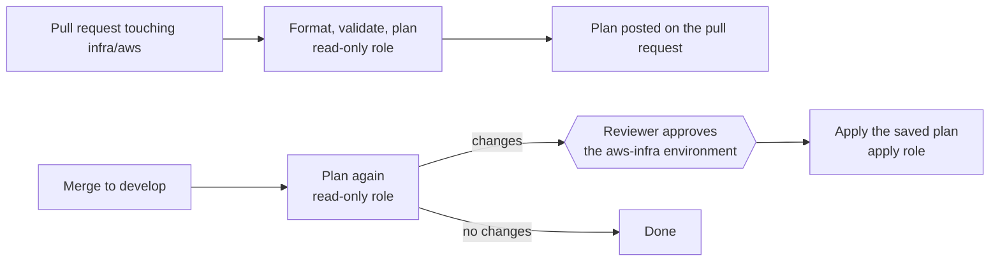
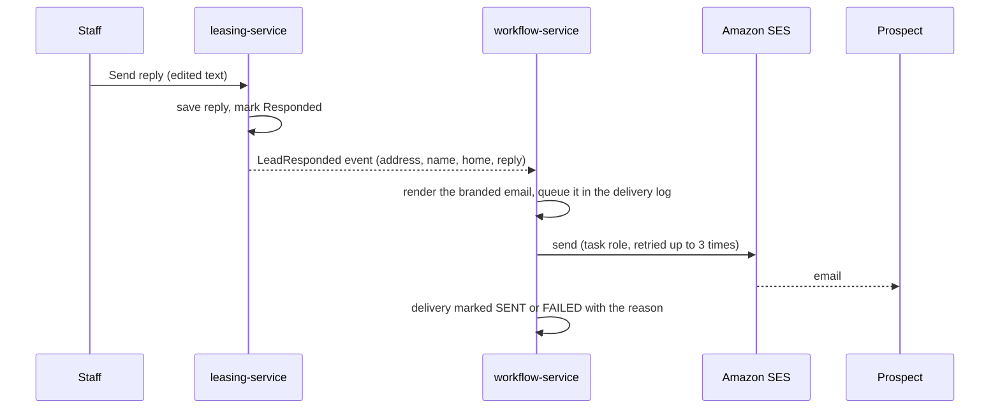

# Terraform pipeline and outbound email

Two things set up together: the GitHub pipeline that plans and applies the AWS infrastructure, and the Amazon SES email the platform now sends. Related: [CI/CD](CI-CD.md), [Deploy](DEPLOY.md), [AWS deploy](AWS-DEPLOY.md).

## 1. The pipeline (`.github/workflows/terraform.yml`)



* **Pull request:** `terraform fmt -check`, `validate` and a `plan`. The plan is posted (and updated) as a comment. The role used is read-only, so a pull request can never change infrastructure.
* **Merge to `develop`:** plans again, saves the plan, and stops at the **aws-infra** environment until a person approves. It then applies **that saved plan**; if the state changed in between, Terraform refuses it instead of doing something nobody reviewed.
* **By hand:** Actions, Terraform, Run workflow. Tick *apply* to apply after approval.
* One run at a time (`concurrency`), and state is locked in DynamoDB.
* Non-secret settings come from [ci.tfvars](../infra/aws/ci.tfvars). Secrets (database password, signing keys) are generated by Terraform and live in state and Secrets Manager, never in GitHub.

### Roles

| Role | Used by | Can |
| --- | --- | --- |
| `propertyos-terraform-plan` | pull requests, plans on develop | read everything, write the state lock |
| `propertyos-terraform-apply` | only the approved `aws-infra` environment | administrator (Terraform creates networks, databases, roles) |
| `propertyos-<env>-github-deploy` | `deploy.yml` | push images, update services, upload the front end (unchanged) |

No AWS keys are stored in GitHub: every run signs in with OIDC.

## 2. One-time setup

1. **Create the state bucket, lock table and roles** (once, from a laptop with admin credentials):
   ```
   cd infra/aws/bootstrap
   terraform init
   terraform apply
   terraform output -raw github_variables      # run these lines with the gh CLI
   ```
   This needs the GitHub OIDC provider to exist already (the main stack creates it).
2. **Move the existing state to S3.** The infrastructure was created with a local state file. If you skip this, the pipeline sees an empty state and tries to create everything again.
   ```
   cd infra/aws
   printf 'terraform {\n  backend "s3" {}\n}\n' > backend_ci.tf
   terraform init -migrate-state \
     -backend-config="bucket=<state_bucket>" -backend-config="key=propertyos/aws.tfstate" \
     -backend-config="region=ap-south-1" -backend-config="dynamodb_table=<lock_table>" -backend-config="encrypt=true"
   rm backend_ci.tf
   ```
   (`backend_ci.tf` is what the pipeline writes on every run; locally you keep the file only for the migration.) Then run `terraform plan -var-file=ci.tfvars` and expect no unexpected changes.
3. **GitHub environment:** Settings, Environments, New environment `aws-infra`. Add yourself as a **required reviewer** and restrict it to the `develop` branch.
4. **Branch protection:** keep `develop` protected so only reviewed changes reach the apply step.

## 3. Outbound email (Amazon SES)

When staff click **Send reply** on a lead, the reply is emailed to the prospect's address.



* **Branded template:** [EmailTemplates.java](../backend/workflow-service/src/main/java/com/propertyos/workflow/email/EmailTemplates.java): PropertyOS header, the company's name, the message with its paragraphs, and a footer. Everything typed by a person is escaped. A plain-text version is sent with it.
* **Nothing blocks the click:** the email is queued and sent a few seconds later by [EmailDispatcher.java](../backend/workflow-service/src/main/java/com/propertyos/workflow/email/EmailDispatcher.java). A failed send is retried and, after three tries, marked FAILED with the reason. **Delivery log** (operator) shows each one.
* **Test mode (now):** while `EMAIL_OVERRIDE_TO` is set (default `ravindra.nalawade56@gmail.com`), every email goes to that one address, and the message says who it was meant for. To send to real prospects, set `email_override_to = ""` in Terraform.

### Settings

| Setting | Terraform variable | Default | Meaning |
| --- | --- | --- | --- |
| `EMAIL_PROVIDER` | `email_provider` | `ses` on AWS, `none` locally | `none` only logs |
| `EMAIL_FROM` | `email_from` | `ravindra.nalawade56@gmail.com` | sender; created as an SES identity |
| `EMAIL_OVERRIDE_TO` | `email_override_to` | `ravindra.nalawade56@gmail.com` | redirect everything here; empty = real recipients |

Without `EMAIL_PROVIDER` nothing is sent: the email is logged, and the delivery shows as sent with the note "Simulated delivery". `.env.local` on the development machine already sets `EMAIL_PROVIDER=ses`, `EMAIL_FROM`, `EMAIL_OVERRIDE_TO` and `EMAIL_REGION=ap-south-1` (the region where Terraform verifies the sender), and the AWS profile on the machine signs the requests, so local sending works once the sender has been verified there (section below). Remove those lines to go back to logging only.

### Before the first email goes out (SES sandbox)

1. `terraform apply` creates the sender identity. **AWS emails a verification link to that address: open it once.** Until then SES refuses to send.
2. A new SES account is in the **sandbox**: it only delivers to verified addresses, which is why test mode redirects to the one verified address. To email real prospects, request production access (SES console, Account dashboard), verify a domain, then change `email_from` to an address on it and clear `email_override_to`.
3. SES is regional: the identity is created in the same region as the rest of the stack.
