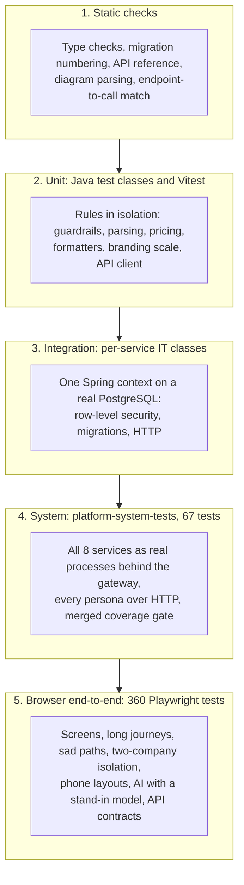
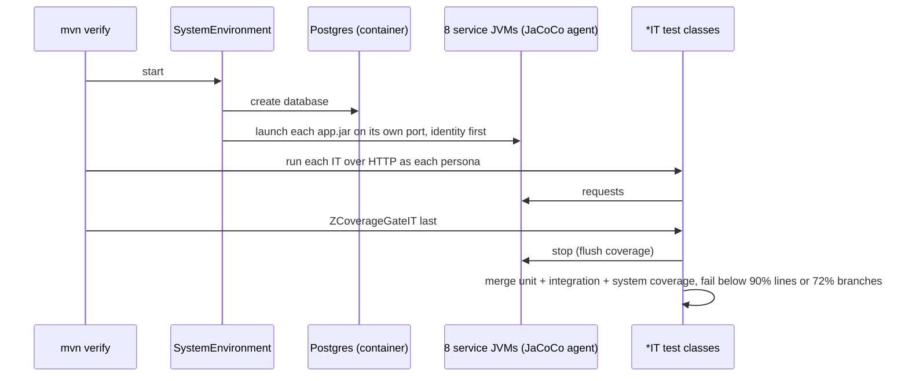

# Testing

PropertyOS is tested at five levels, from a single class to a real browser clicking through a company's whole life. Each level exists because the one below cannot catch what it catches. The gates are enforced in CI; nothing reaches AWS without passing them.

## 1. The strategy at a glance

| Level | Tool | What it catches | Runs on |
| --- | --- | --- | --- |
| Static checks | `tsc`, `scripts/check-migrations.js`, `scripts/check-endpoints.js`, `scripts/generate-api-docs.js --check`, `scripts/check-doc-links.js`, `npm run docs:check` | A frontend call to an endpoint that does not exist; a gap or edit in the migration history; an out-of-date API page; a diagram that will not draw | Every pull request |
| Unit | JUnit 5 (`*Test`), Vitest | Logic in isolation | Every pull request, no Docker |
| Integration | JUnit 5 with Testcontainers (`*IT` in each service) | SQL, row-level security, migrations, serialisation | Every pull request, needs Docker or an external Postgres |
| System | `backend/platform-system-tests` | Services working together; permissions per persona; coverage | Every pull request |
| Browser end-to-end | Playwright (`e2e/`) | What a person actually sees and does | Before a release, locally and against a live environment |
| Performance | Gatling (`performance/`) | Latency and error rate under load | On demand and on a schedule |

## 2. Quality gates

| Gate | Threshold | Where it fails |
| --- | --- | --- |
| Backend merged coverage | **90% lines and 72% branches**, across unit, integration and system layers | `ZCoverageGateIT` fails `mvn verify` |
| All tests | zero failures | Pull request CI (`CI result` check) |
| Migrations | no gaps, no repeats, no edit of a released file | `check-migrations.js` in CI and on every deploy |
| API reference | matches the controllers | `generate-api-docs.js --check` in CI |
| Diagrams | every Mermaid block parses | `docs:check` in CI |
| Frontend | type checks, 18 unit tests, build of every changed app | Pull request CI |

## 3. Backend

| Layer | Naming | Command | Needs Docker |
| --- | --- | --- | --- |
| Unit | `*Test` | `mvn test` | no |
| Integration | `*IT` | `mvn verify` | yes, or `IT_JDBC_URL` |
| System | `platform-system-tests` | `mvn verify` | yes |

**Unit and per-service integration** cover, among others: JWT and signed links, request parsing, error mapping, resilience (breaker, retry, bulkhead), rate limiting, AI guardrails and each studio tool (with a fake `ModelRunner`), document classification and requirement gaps, tenant isolation between companies, platform governance, photo review end to end.

**System tests** start **all eight services as real processes** on a fresh database, behind the real gateway, with the JaCoCo agent in each JVM, and drive them over HTTP as every persona. They prove behaviour no single service can:

| Test class | Proves |
| --- | --- |
| `NewCompanyJourneyIT` | A company from nothing: onboarding, first sign-in, users, portfolio, listing, applying, leasing, paying, repairs, suspension |
| `LeasingScenarioIT`, `BillingScenarioIT`, `MaintenanceScenarioIT`, `DocumentScenarioIT`, `WorkflowScenarioIT`, `AiScenarioIT`, `IdentityScenarioIT` | Each service's whole API surface, with permissions per role and the sad paths |
| `FeesRatingsAndReportsIT` | Platform subscription fees, ratings, the report centre and drill-downs |
| `PlatformConsoleIT` | Service health, usage, the masked delivery log and the audited reveal |
| `PublicCatalogIT` | The amenity catalogue rules, the public search (filters, paging, by-property grouping, facets), and that no internal id leaks |
| `EndpointSweepIT`, `WorkflowWalkIT`, `PagingAndGuidanceIT`, `BranchGapsIT` | Every endpoint answers sensibly for every role; each lifecycle walked through all its transitions; server paging and the guided help; the branches ordinary journeys do not reach |
| `OperationsIT` | Probes, metrics, correlation ids, security headers, `/internal` not reachable from outside |
| `ZCoverageGateIT` | Runs last; merges all coverage and fails below the gate |

A system test launches the **prebuilt jars**: after changing a service, `mvn clean package -DskipTests` it (a plain `package` can re-use a stale shared-kernel jar inside the service jar) before re-running.

## 4. Frontend

`npm test` in `frontend` runs Vitest for the shared package: formatters, the API client's error wording, and the branding colour scale (including that the default colour is left alone). Every app type-checks and builds in CI. `scripts/check-endpoints.js` compares every API call in the front end with the endpoints the backend serves, so a renamed endpoint fails the build.

## 5. Browser end-to-end (Playwright)

360 tests in 40 spec files, in `e2e/`, driving the real screens and the real API role by role. Every test title starts with the requirement it proves (`[AMEN-01]`), and `requirements/requirements.json` and the generated [TRACEABILITY](../e2e/requirements/TRACEABILITY.md) show what is covered.

| Folder | What it covers |
| --- | --- |
| `tests/api` | Every service through the gateway: sign-in, roles, isolation, platform console, portfolio, leasing, billing, maintenance, workflow, AI, reports, ratings |
| `tests/ui` | Every screen: public site and homes search, sign-in, menus for every persona, every page per role, leasing, payments, maintenance, admin, platform, amenities, AI, files |
| `tests/journeys` | Whole stories in a browser, including **a company's whole life**, hardship, and a resident on a phone ([JOURNEYS](../e2e/JOURNEYS.md)) |

Properties of the suite worth knowing:

* **Self-contained.** Tests that write create their own company (`onboardCompany`) so they never depend on or disturb shared data, and assertions are per company or relative, so tests can run in parallel.
* **Sad paths and isolation.** Refusals, validation messages, a second company seeing nothing, a resident refused a manager page.
* **Phone layouts.** Pages are checked for sideways scroll and cut-off content at phone width.
* **AI with a stand-in model.** `E2E_FAKE_AI=1` points the AI service at `e2e/tools/fake-openai.mjs`, so AI features are tested with real answers and no key.
* **Local or live.** `E2E_MODE=live` runs only read-only checks against a deployed environment.

Run it: build the jars and the front end, start PostgreSQL, `npm run stack:start` in `e2e/`, then `npm test` (details in [e2e/README](../e2e/README.md)).

## 6. Performance

Gatling simulations (smoke, load, stress, spike, soak) with pass or fail service levels on error rate and p95, in [performance/README.md](../performance/README.md).

## 7. Writing tests

* Name unit tests `*Test` and integration tests `*IT`; Playwright titles begin with `[REQ-ID]`.
* Depend on constructors and small collaborators so a unit test needs no Spring context.
* Assert behaviour (status codes, results, what a person sees), not implementation.
* When a bug is found, add the failing test first. Tests that guard a past defect say so in a comment (masked recipients, double billing, a leak found by isolation tests).
* Do not double-encode query strings: the test HTTP client encodes for you, so pass `a b`, not `a%20b`.
* Parallel tests share a database: never assert on global totals that another test can change.

## 8. Test data and environments

| Environment | Data |
| --- | --- |
| Unit | Built in the test |
| Integration and system | A fresh PostgreSQL container per run, demo data seeded by the services in demo mode |
| Browser, local | A throwaway database (`e2e`), the same demo seed, new companies per test |
| Browser, live | Read-only: the live demo company is never written to |

Without Docker, set `IT_JDBC_URL` (and `IT_DB_USER`, `IT_DB_PASSWORD`) to use an existing PostgreSQL. A full backend `mvn verify` takes about ten minutes, mostly the system tests; `mvn test` is the fast loop.
