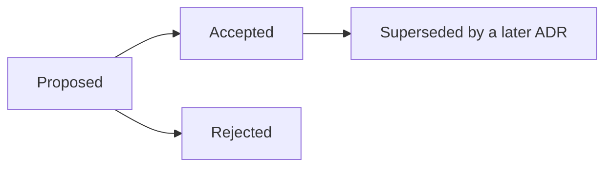

# Architecture decision records

An ADR records **one decision that is expensive to reverse**: what we faced, what we chose, what else we considered, and what we accepted by choosing it. They are short on purpose and are not edited after acceptance except to change the status; a later decision supersedes an earlier one by saying so.

| ADR | Decision | Status |
| --- | --- | --- |
| [1](0001-resilience-for-service-calls.md) | Protect every service-to-service call (breaker, bulkhead, read-only retry) | Accepted |
| [2](0002-liveness-and-readiness.md) | Separate liveness from readiness; neighbours never affect readiness | Accepted |
| [3](0003-correlation-id.md) | One correlation id from the edge through every hop and log line | Accepted |
| [4](0004-file-storage-in-s3.md) | Keep uploaded files in S3 behind a storage interface | Accepted |
| [5](0005-row-level-security-for-tenancy.md) | Enforce tenant isolation in the database with forced row-level security | Accepted |
| [6](0006-transactional-outbox.md) | Integrate services with a transactional outbox, not a broker | Accepted |
| [7](0007-configuration-as-data.md) | Behaviour and lifecycles are data, layered and versioned | Accepted |
| [8](0008-platform-operators-cannot-see-company-data.md) | Platform operators are refused company business data; detail needs an audited reason | Accepted |
| [9](0009-public-catalogue-reads-as-system.md) | The public catalogue reads as the system with explicit filters | Accepted |
| [10](0010-amenity-catalogue-referenced-by-name.md) | Amenities are a catalogue that properties reference by name | Accepted |

## Writing one

Copy the shape of any record above: **Context** (the forces), **Decision** (what we do, in the present tense), **Alternatives considered**, **Consequences** (good and bad). Number it next, add it to this table, and link it from the document it affects.
