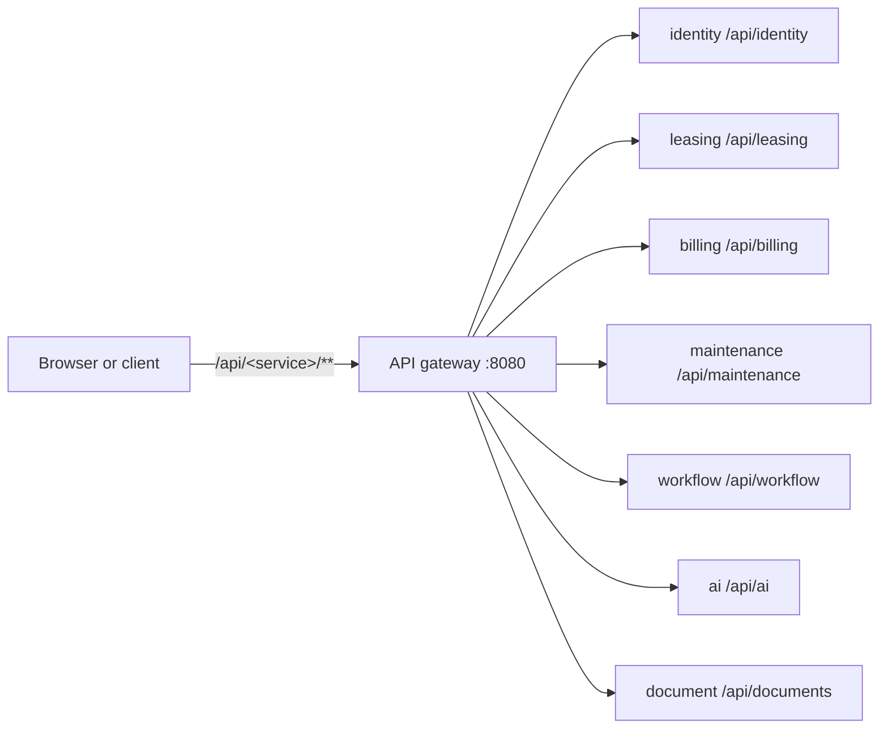

# API reference

Every capability of PropertyOS is a REST endpoint behind one gateway. This section lists them all.

| Service | What it serves | Endpoints | Page |
| --- | --- | --- | --- |
| identity | Sign-in, users, roles and permissions, companies, plans, configuration, audit, the public website content and the platform operator console. | 66 | [identity.md](identity.md) |
| leasing | Owners, properties, units, amenities, listings, leads, showings, applications, leases, reviews, reports and the public homes search. | 71 | [leasing.md](leasing.md) |
| billing | Invoices, payments, deposits, expenses, ledger, owner statements, tax forms, and what companies pay PropertyOS. | 33 | [billing.md](billing.md) |
| maintenance | Work orders, vendors, vendor ratings, preventive maintenance and repair reports. | 20 | [maintenance.md](maintenance.md) |
| workflow | Automation rules, workflow definitions, notifications and preferences, conversations, and the operator delivery log. | 28 | [workflow.md](workflow.md) |
| ai | The assistant, the AI studio tools, guardrails and the AI audit. | 12 | [ai.md](ai.md) |
| document | The document library, versions, photos and moderation, e-signature and document requirements. | 36 | [document.md](document.md) |
| **Total** | | **266** | |

## How to use it

1. Sign in: `POST /api/identity/public/login` with an email and password returns a JWT.
2. Send it as `Authorization: Bearer <token>`.
3. Browse and try every endpoint in Swagger UI at `/swagger-ui.html` on the gateway (click **Authorize**).

Conventions (errors, paging, filtering, idempotency, rate limits) are in the [API guide](../API.md). These pages are generated by `scripts/generate-api-docs.js`.
