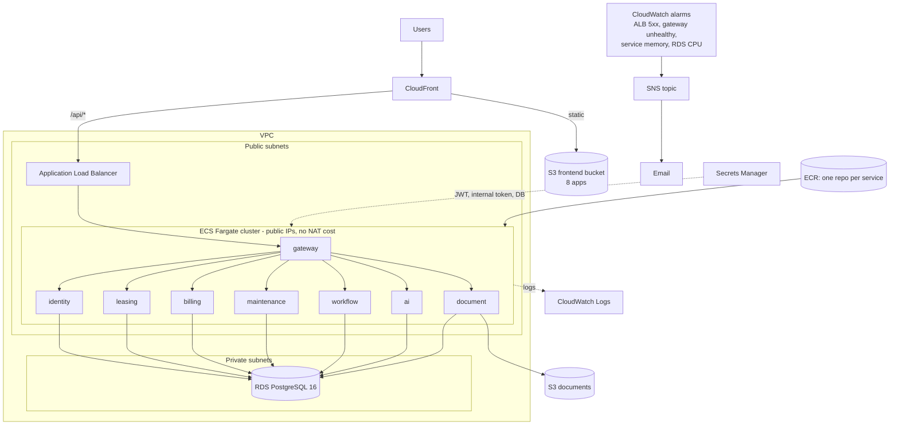
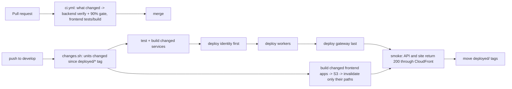

# Deployment architecture

Region ap-south-1 (Mumbai). Everything below is Terraform in `infra/aws/*.tf`; the pipeline is `.github/workflows/deploy.yml`.

## Delivery pipeline

* **Network**: ALB and Fargate tasks sit in public subnets (cost-driven demo choice, no NAT gateway); task security groups accept traffic only from the ALB and from each other; the database is in private subnets. Production hardening: move tasks to private subnets behind NAT/VPC endpoints.
* **Auth to AWS: GitHub OIDC**, short-lived role session; there are no AWS keys in GitHub.
* **Changed-units-only**: the `deployed/<unit>` git tag records the last successful deploy of each service/app; a change to shared code rebuilds its dependents.
* **One deploy at a time** (`concurrency: deploy-aws`); queued pushes compute their diff from the last successful deploy, so nothing is skipped.
* **Flyway** runs at service start-up, so a new migration is applied by the rollout that needs it.
* **Rollback**: redeploy a previous image tag (`infra/aws/deploy-service.sh`, `redeploy.ps1`); migrations are forward-only and written additive.
* Also in the repo: `infra/docker` and `docker-compose*.yml` for local/all-in-one, and `infra/k8s` manifests.

## Environments

| | Local | Demo (AWS) |
| --- | --- | --- |
| Run | `docker compose` or `mvn` + Vite | ECS Fargate + CloudFront |
| DB | Postgres container | RDS PostgreSQL 16 (single-AZ for the demo; `multi_az` is one variable away) |
| Secrets | `.env.local` (git-ignored) | Secrets Manager |
