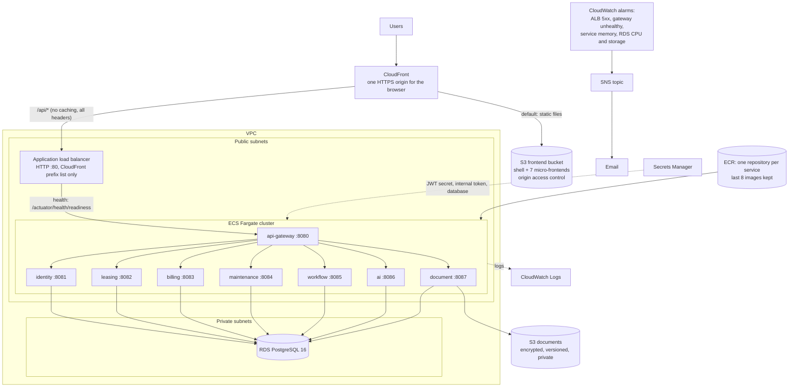
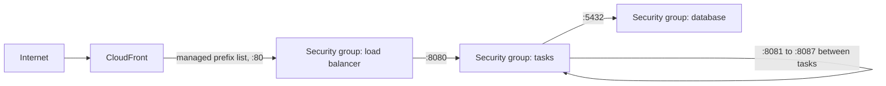
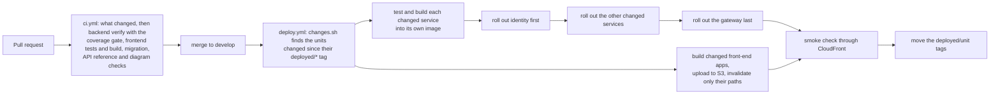
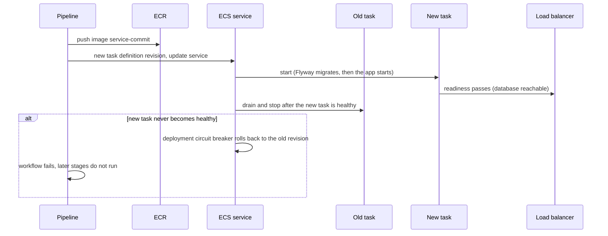

# Deployment architecture

Region **ap-south-1 (Mumbai)**. Everything below is Terraform in `infra/aws/*.tf`; the release pipeline is `.github/workflows/deploy.yml`. To stand it up, see [AWS-DEPLOY](../AWS-DEPLOY.md); to run it, see [Operations](../OPERATIONS.md).

## 1. Runtime

* **One origin for the browser.** CloudFront serves the static front end and forwards `/api/*` to the load balancer, so the browser sees a single HTTPS origin: no CORS, no mixed content, no certificate to manage. A small CloudFront function rewrites unknown paths to `index.html` so deep links into the single-page app work.
* **Services find each other by name.** ECS service discovery gives each service a private DNS name in one namespace.
* **Everything is a Fargate task.** No servers to patch. Task size and count are Terraform variables.

## 2. Network and who may talk to whom

| Security group | Accepts | From |
| --- | --- | --- |
| Load balancer | HTTP 80 | CloudFront's managed prefix list |
| Tasks | 8080 (gateway) | The load balancer |
| Tasks | 8081 to 8087 | Other tasks (service to service) |
| Database | 5432 | The tasks only |

The demo footprint puts the load balancer and the tasks in public subnets with no NAT gateway (a cost choice); the database is in private subnets. The production step is private subnets for the tasks with VPC endpoints ([SAD gaps](../SAD.md#9-known-gaps-and-next-steps)).

## 3. Delivery pipeline

* **Auth to AWS: GitHub OIDC.** A short-lived role session per run; there are no AWS keys in GitHub.
* **Changed-units-only.** The `deployed/<unit>` git tag records the last successful deploy of each service and app; a change to shared code rebuilds its dependents.
* **One deploy at a time** (`concurrency: deploy-aws`); queued pushes compute their diff from the last successful deploy, so nothing is skipped.
* **Flyway** runs at service start-up, so a new migration is applied by the rollout that needs it, identity first.

## 4. One service's rollout

A new task must pass **readiness** (its own database reachable) before the old one stops, so a bad release never takes the service out of rotation. Neighbour health is deliberately not part of readiness ([ADR 2](../adr/0002-liveness-and-readiness.md)).

## 5. Secrets and identity

| Secret or identity | Where it lives | Who can read it |
| --- | --- | --- |
| `JWT_SECRET`, `INTERNAL_TOKEN`, database password | Secrets Manager (generated by Terraform) | The task execution role, injected as environment variables at start |
| Deploy credentials | None stored: OIDC assumes `github_deploy` | GitHub Actions for this repository only |
| Task role | IAM role per task | Its S3 documents bucket, and Bedrock when enabled |

## 6. Environments

| | Local | Demo (AWS) |
| --- | --- | --- |
| Run | `docker compose`, the start script, or `mvn` plus Vite ([LOCAL-RUN](../LOCAL-RUN.md)) | ECS Fargate plus CloudFront |
| Database | A Postgres container | RDS PostgreSQL 16, single AZ for the demo (`multi_az` is one variable away) |
| Files | The database (`STORAGE_TYPE=db`) | S3 (`STORAGE_TYPE=s3`) |
| Secrets | `.env.local` (git-ignored) | Secrets Manager |
| Demo data | On (`DEMO_MODE=true`) | On for the demo; off for a real tenant |
| AI | Rules, or a key you provide | Rules, or OpenAI; Bedrock is implemented but not wired |

Also in the repository: `infra/docker` and the `docker-compose*.yml` files for all-in-one local runs, and `infra/k8s` manifests (kustomize, with network policies that deny by default) for a Kubernetes deployment that has not been run on a real cluster from this environment.

## 7. Cost and scale levers

| Lever | Variable | Notes |
| --- | --- | --- |
| Tasks per service | `desired_count` | More for availability |
| Task size | `task_cpu`, `task_memory`, `service_cpu` | Spring Boot needs about 1 GiB |
| Spot capacity | opt-in Fargate Spot | Cheaper, interruptible |
| Database | `db_instance_class`, `multi_az` | Size and failover |
| Logs | `log_retention_days` | Cost |

See [AWS-DEPLOY](../AWS-DEPLOY.md#what-it-costs) for current figures.
