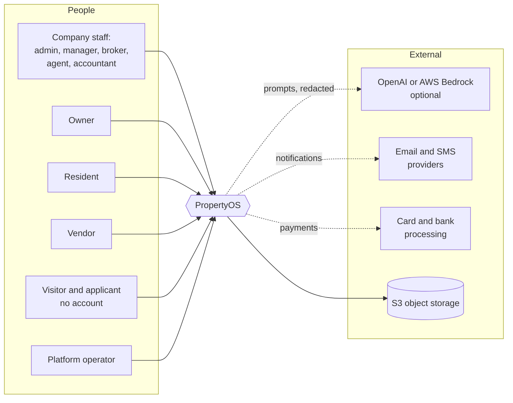
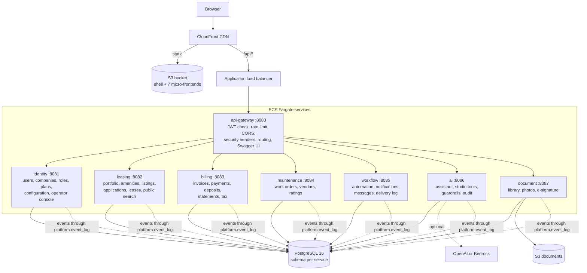
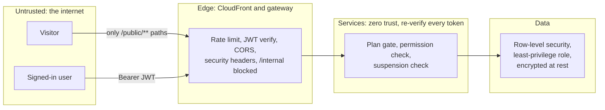
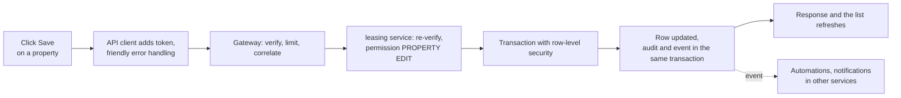

# High-level design (HLD)

PropertyOS is a multi-tenant property management platform: portfolio and leasing, billing, maintenance, workflow, documents and an AI layer, sold per company with plans and feature entitlements, and governed by a platform operator console. This page is the system on one screen. [LLD](LLD.md) explains each mechanism, the [data model](../DATA-MODEL.md) the tables, and [Deployment](DEPLOYMENT.md) the AWS runtime.

## 1. System context

Who and what the system talks to.

## 2. Containers

The deployable pieces and how they talk.

Services read each other only through `/internal/**`. The calls that exist today:

| Caller | Asks | For |
| --- | --- | --- |
| every service | identity | Company configuration, the suspended-company list, the user directory, company names |
| billing | leasing | Active leases, properties, tenants and owners, to invoice and to build statements |
| identity | leasing | Unit counts per company, for subscription billing |
| maintenance | leasing | Property, tenant lease and owner details for a work order |
| document | leasing, ai | Lease and application documents, properties; photo moderation |
| ai | leasing, billing, maintenance | The facts the assistant and studio tools reason about |

Two integration styles, used deliberately:

| Style | Use it for | Mechanism |
| --- | --- | --- |
| **Ask** (synchronous) | A fact another service owns, needed to answer now (a company's name, a lease's terms) | REST on `/internal/**` with an internal token; circuit breaker, retry on reads, never on writes |
| **Tell** (asynchronous) | Something happened that others may care about | A row in `platform.event_log` written in the same transaction as the change; each service's poller delivers it at least once to idempotent handlers |

## 3. Key decisions

| Decision | Choice | Why | Record |
| --- | --- | --- | --- |
| Service boundaries | Seven business services plus a gateway, each owning a Postgres schema | Independent deploys and unambiguous data ownership; no cross-schema reads | [ARCHITECTURE](../ARCHITECTURE.md) |
| Tenancy | One database, `org_id` on every tenant row, **forced** PostgreSQL row-level security | The database is the last line of defence even if application code is wrong | [ADR 5](../adr/0005-row-level-security-for-tenancy.md) |
| Integration | Transactional outbox plus a poller per service, with a dead-letter table | At-least-once delivery with no message broker to run or lose | [ADR 6](../adr/0006-transactional-outbox.md) |
| Configuration | Layered JSON: shipped defaults, operator defaults, company overrides, plan gating | Behaviour is data, so operators and companies tune it without a release | [ADR 7](../adr/0007-configuration-as-data.md) |
| Lifecycles | State machines as data (`workflows/*.json`), actions guarded by permissions | A company can adapt a lifecycle; the UI can only offer moves the server allows | [LLD](LLD.md#4-state-machines) |
| Operator boundary | Platform administrators manage companies but are refused every company's business data | Least privilege for the vendor's own staff; full detail of a delivery needs an audited reason | [ADR 8](../adr/0008-platform-operators-cannot-see-company-data.md) |
| Public data | Visitors read through a catalogue service that runs as the system with explicit filters (live, not suspended) and strips internal ids | The public site needs no account and must never widen access | [ADR 9](../adr/0009-public-catalogue-reads-as-system.md) |
| Amenities | A catalogue (shared plus per company) that properties reference by **name** | Renaming or removing an entry never changes a property | [ADR 10](../adr/0010-amenity-catalogue-referenced-by-name.md) |
| Front end | Shell plus seven federated micro-frontends sharing one design system | Each business area builds and ships independently | [ARCHITECTURE](../ARCHITECTURE.md) |
| AI | Provider-agnostic interface, guardrails, full audit, offline rules fallback, confirm-before-write | The product works with no model and the model never acts alone | [AI](../AI.md) |
| Delivery | GitHub Actions, OIDC to AWS, changed-units-only deploy, Terraform | No stored cloud keys; small blast radius per push | [CI-CD](../CI-CD.md) |

## 4. Trust boundaries

Four independent checks stand between a request and a row: the gateway, the service's own token check, the permission and plan gate, and the database policy. Any one of them failing closed is enough to stop a leak. Detail: [Security](../SECURITY.md).

## 5. Quality attributes

| Attribute | How it is met | Evidence |
| --- | --- | --- |
| **Security** | Zero-trust JWT check in every service, permission per endpoint, forced row-level security, PBKDF2 passwords, suspension kill-switch, operator boundary | [SECURITY](../SECURITY.md), `TenantIsolationIT`, `PlatformGovernanceIT` |
| **Reliability** | Liveness and readiness probes, circuit breaker, retry on reads only, outbox with dead letter, ECS rolling deploy with automatic rollback and a smoke check | [ADR 1](../adr/0001-resilience-for-service-calls.md), [ADR 2](../adr/0002-liveness-and-readiness.md) |
| **Observability** | A correlation id on every request and log line, Actuator metrics, CloudWatch alarms to SNS, an operator service-health page and delivery log | [ADR 3](../adr/0003-correlation-id.md), [OPERATIONS](../OPERATIONS.md) |
| **Data integrity** | Forward-only additive migrations, unique indexes that make double-billing impossible, audit in the same transaction | [DATABASE-MIGRATIONS](../DATABASE-MIGRATIONS.md) |
| **Testability** | Unit, per-service integration on real PostgreSQL, an eight-process system test, 360 browser tests, a 90% line and 72% branch gate | [TESTING](../TESTING.md) |
| **Changeability** | Layered services, one class per responsibility, configuration and lifecycles as data, ADRs | [ARCHITECTURE](../ARCHITECTURE.md) |
| **Performance** | Server-side paging and filtering everywhere, indexes on every filter path, Gatling service levels | [performance](../../performance/README.md) |
| **Cost** | Fargate with no NAT gateway, one small RDS instance, S3 and CloudFront for the front end (a demo-grade footprint; hardening is a variable away) | [AWS-DEPLOY](../AWS-DEPLOY.md) |

## 6. A request, end to end

## 7. Where to look next

| Question | Document |
| --- | --- |
| How does a lease move from draft to active? | [LLD state machines](LLD.md#4-state-machines) |
| Which tables exist and how is each protected? | [Data model](../DATA-MODEL.md) |
| How do I run it? | [Local run](../LOCAL-RUN.md) |
| How is it deployed and watched? | [Deployment](DEPLOYMENT.md), [Operations](../OPERATIONS.md) |
| What are the known gaps? | [SAD section 9](../SAD.md) |
