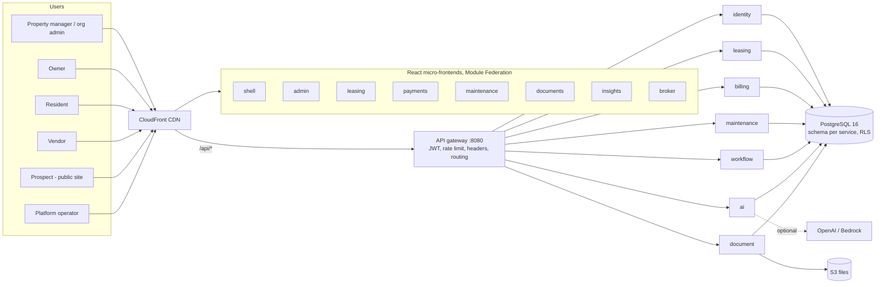

# High-level design (HLD)

PropertyOS is a multi-tenant property-management platform: portfolio and leasing, billing, maintenance, workflow, documents and an AI layer, sold per company with plans and feature entitlements.

## Context

## Key decisions

| Decision | Choice | Why |
| --- | --- | --- |
| Service boundaries | 7 business services + gateway, each owning a Postgres schema | Independent deploys and clear data ownership; no cross-schema reads |
| Tenancy | One database, `org_id` on every tenant row, PostgreSQL row-level security (forced) | The database is the last line of defence even if application code is wrong |
| Integration | Transactional outbox (`platform.event_log`) + poller per service, dead-letter table | At-least-once, idempotent handlers, no broker to run |
| Config | Layered JSON: shipped defaults, operator product defaults, company overrides, plan gating | Behaviour is data, not code; operators and companies tune without a release |
| Frontend | Shell plus seven federated remotes | Each business area builds and deploys independently |
| AI | Provider-agnostic `Llm` interface, guardrails, full audit, offline rules fallback | The product works with no model at all and never writes without user confirmation |
| Delivery | GitHub Actions, OIDC to AWS, changed-units-only deploy, Terraform infra | No stored cloud keys, small blast radius per push |

## Quality attributes

| Attribute | How it is met |
| --- | --- |
| Security | Zero-trust JWT check in every service, permission per endpoint, forced RLS, PBKDF2 passwords, suspension kill-switch ([SAD](../SAD.md)) |
| Reliability | Liveness/readiness probes, circuit-breaking service client, outbox with dead-letter, ECS rolling deploy with smoke check ([ADR 1](../adr/0001-resilience-for-service-calls.md), [2](../adr/0002-liveness-and-readiness.md)) |
| Observability | Correlation id on every request and log line, Actuator metrics, CloudWatch alarms to SNS ([ADR 3](../adr/0003-correlation-id.md)) |
| Testability | Unit, per-service integration (real Postgres), 8-process system tests, 90% merged-coverage gate |
| Changeability | Layered services, one class per responsibility, config-driven behaviour, ADRs |
