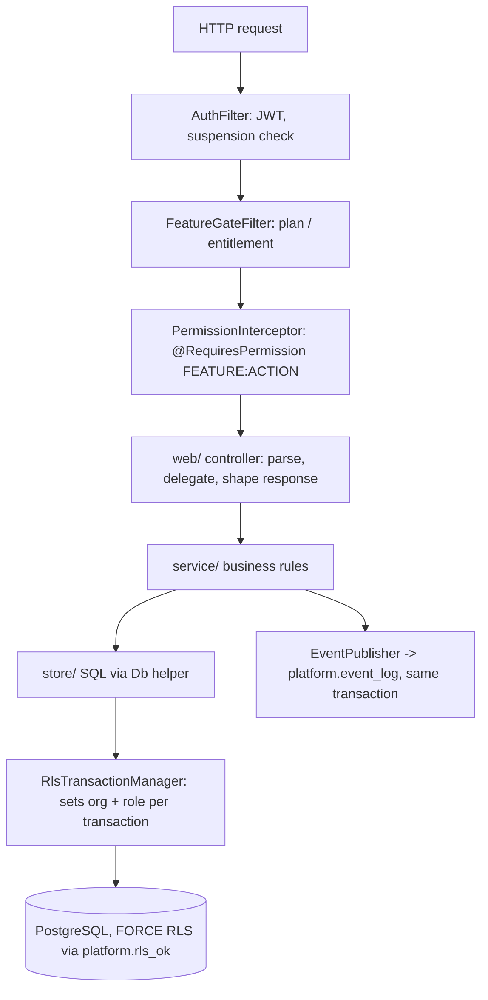
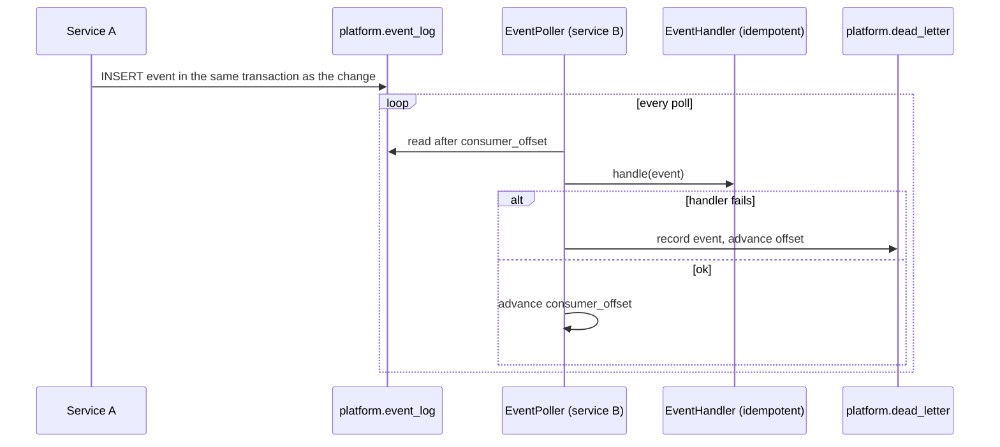
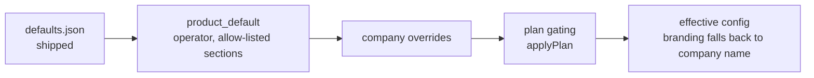
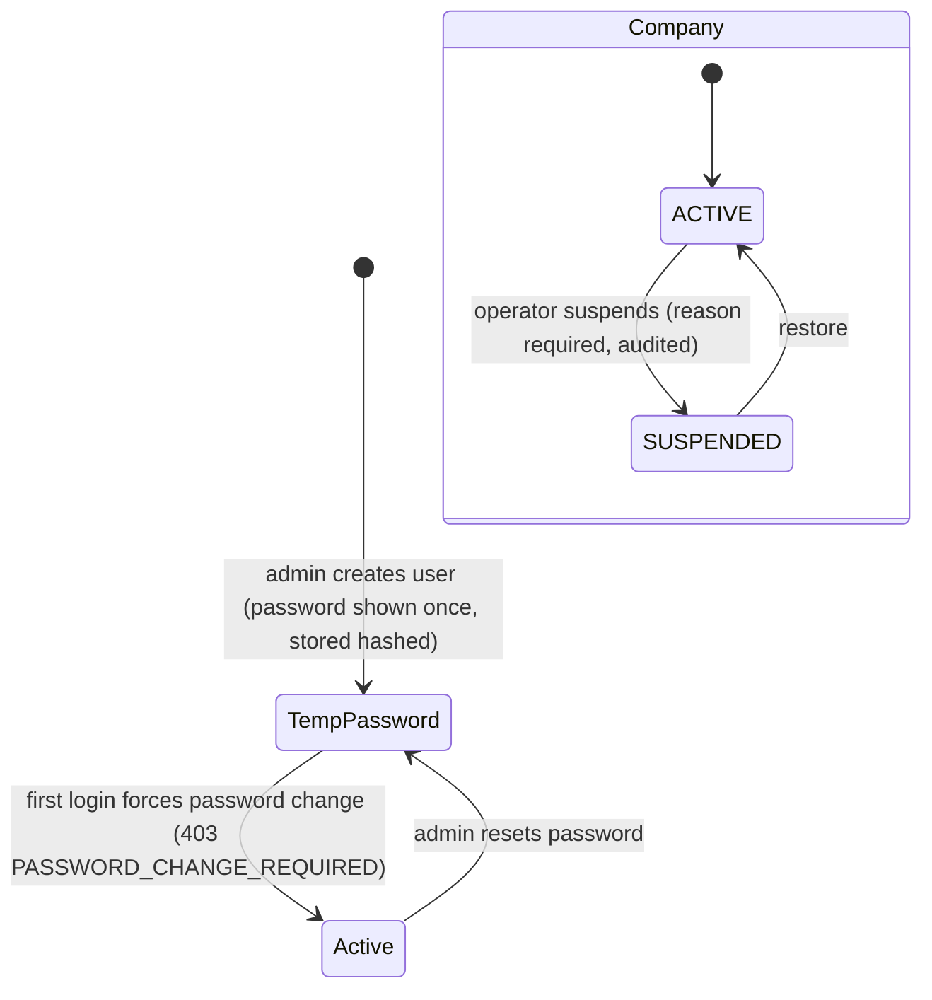

# Low-level design (LLD)

## Layering inside a service



## Request-time security sequence

```mermaid
sequenceDiagram
  participant B as Browser
  participant G as Gateway (EdgeSecurityFilter)
  participant S as Service
  participant D as PostgreSQL
  B->>G: POST /api/leasing/... Bearer JWT
  G->>G: verify JWT, rate-limit (user / IP), add X-Correlation-Id, security headers
  G->>S: forward (same JWT)
  S->>S: AuthFilter re-verifies JWT, rejects suspended company (403 ORG_SUSPENDED)
  S->>S: FeatureGateFilter, PermissionInterceptor
  S->>D: BEGIN; set org/role; SET LOCAL ROLE propertyos_app
  D-->>S: only rows passing rls_ok(org_id)
  S-->>B: JSON or application/problem+json
```

## Event flow (transactional outbox)



Example: `OrganizationOnboarded` (identity) -> `OnboardingHandler` (workflow) seeds the new company's default automation rules.

## Data model by service (Flyway-managed)

| Service | Schema | Migrations | Main tables |
| --- | --- | --- | --- |
| identity | `identity` | V1-V10 | organization, app_user, role, role_permission, plan, product_default, org_config, audit |
| leasing | `leasing` | V1-V3 | owner, property, unit, listing, showing, application, lease (soft-archive via `archived_at`) |
| billing | `billing` | V1-V3 | charge, invoice, payment, statement, tax form |
| maintenance | `maintenance` | V1 | work order, vendor, inspection, recurring task |
| workflow | `workflow` | V1-V2 | approval, task, notification, automation rule |
| ai | `ai` | V1 | ai_audit |
| document | `document` | V1-V4 | document, version, requirement, signature |
| shared | `platform` | - | event_log, consumer_offset, dead_letter, audit_event, `rls_ok()` |

## Configuration resolution



## Access model

Permissions are `FEATURE:ACTION` pairs from `FeatureCatalog` (e.g. `OWNER:CREATE`, `PROPERTY:DELETE`, `PLATFORM:CONFIGURE`). `DefaultRoles` holds role templates (Org admin, Broker, Leasing Agent, Accountant, Owner, ...). Company admins can edit roles; new catalog features are synced into existing system roles once (`catalog_sync` markers).

## Account lifecycle



Suspension blocks sign-in and every API call for the company's users within ~10 s (each service refreshes the suspended-org list), hides its public listings and pauses its scheduled alert jobs. Platform operators are never blocked.
