# Low-level design (LLD)

How the system really behaves, one mechanism at a time. Read the [HLD](HLD.md) first for the overall shape and the [data model](../DATA-MODEL.md) for the tables.

**Contents:** [layering](#1-layering-inside-a-service) · [request path](#2-the-life-of-a-request) · [events](#3-events-the-transactional-outbox) · [state machines](#4-state-machines) · [scheduled jobs](#5-scheduled-jobs) · [rent cycle](#6-the-nightly-rent-cycle) · [public search](#7-public-homes-search) · [amenities](#8-the-amenity-catalogue) · [configuration](#9-configuration-resolution-and-branding) · [AI](#10-an-ai-request) · [accounts](#11-account-and-company-lifecycle) · [errors](#12-errors) · [front end](#13-front-end-composition)

## 1. Layering inside a service

Every service has the same shape, so a developer can move between them without relearning anything.

```mermaid
flowchart TB
  REQ[HTTP request] --> AF[AuthFilter: verify JWT, refuse a suspended company]
  AF --> FG[FeatureGateFilter: plan and entitlement,<br/>operators limited to operator paths]
  FG --> PI[PermissionInterceptor:<br/>@RequiresPermission FEATURE:ACTION]
  PI --> C["web/ controller<br/>parse, delegate, shape the response"]
  C --> SV["service/ business rules<br/>one class per responsibility"]
  SV --> ST["Db helper: SQL, no rules"]
  SV --> EP[EventPublisher<br/>writes platform.event_log in the same transaction]
  ST --> TX[RlsTransactionManager<br/>org, role and party ids set per transaction]
  TX --> PG[(PostgreSQL<br/>FORCE row-level security)]
```

Rules the layering enforces: controllers contain no business rules and no SQL; services never touch HTTP types; SQL lives behind `Db`, which **refuses to run outside a transaction** so a query can never bypass row-level security. Dependencies are constructor-injected, so a service is unit-testable without Spring.

## 2. The life of a request

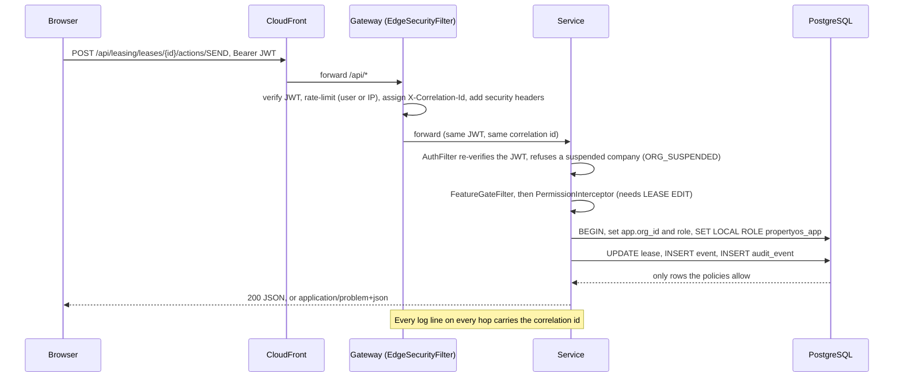

The JWT is checked **twice** (gateway and service) on purpose: a service never trusts that it sits behind the gateway (zero trust). Service-to-service calls use `/internal/**` with a separate `X-Internal-Token`, and the gateway never routes `/internal/**` from outside.

### How a service calls another

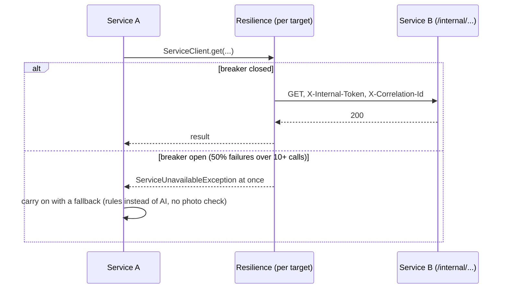

Reads retry three times with backoff; **writes are never retried**, so a payment cannot be taken twice. At most 50 concurrent calls per target (bulkhead). See [Microservice standards](../MICROSERVICES.md).

## 3. Events: the transactional outbox

A service that changes state publishes a fact in the **same transaction** as the change, so there is never a change without its event or an event without its change (no dual write).

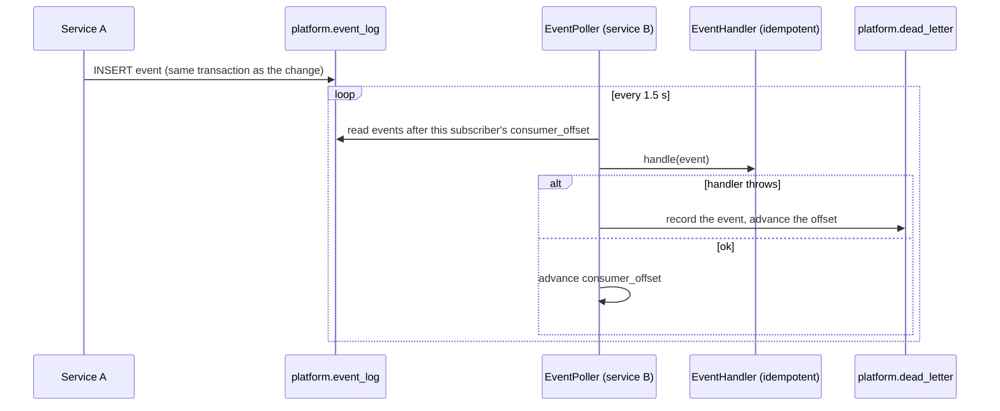

Delivery is **at least once**, so handlers are idempotent. A failing handler never blocks the stream: its event goes to `dead_letter` for inspection.

Who listens to what (the handlers in the code):

| Handler | Service | Listens for | Does |
| --- | --- | --- | --- |
| `AutomationService` | workflow | **every** event (`*`) | Evaluates the company's automation rules against the event and runs the matching actions, recording each run and the minutes it saved |
| `NotificationService` | workflow | `NotificationRequested` | Delivers a notification in the product, by email or by SMS, honouring each person's preferences, quiet hours and de-duplication, and records a `delivery` |
| `OnboardingHandler` | workflow | `OrganizationOnboarded` | Seeds the new company's default automation rules |
| `BillingEvents` | billing | `LeaseActivated`, `LeaseEnded`, `WorkOrderCompleted` | Opens the lease's deposit record; marks the deposit refund due by the state's deadline when a lease ends; turns a completed work order's vendor cost into an owner expense |
| `LeaseDocuments` | document | `LeaseSignatureUpdated`, `LeaseActivated`, `LeaseRenewed`, `LeaseEnded` | Files the lease agreement in the library and keeps its e-signature status in step with leasing (with a five-minute reconcile in case an event is delayed) |
| `ConfigCacheInvalidator` | every service | `ConfigurationChanged` | Drops that company's cached configuration so a setting change takes effect within seconds |
| `*Seeder` | every service | `DemoResetRequested` | Clears and reseeds the demo company (demo mode only) |

Events published, by service: identity (`OrganizationOnboarded`, `UserCreated`, `RolePermissionsChanged`, `ConfigurationChanged`, `DemoResetRequested`); leasing (`ListingCreated`, `ListingPublished`, `ListingLeased`, `LeadResponded`, `ApplicationDecided`, `LeaseActivated`, `LeaseRenewed`, `LeaseEnded`, `LeaseSignatureUpdated`); billing (`PaymentReceived`, `PaymentFailed`, `LateFeeCharged`, `DepositSettled`, `StatementPublished`); maintenance (`WorkOrderCreated`, `WorkOrderApproved`, `WorkOrderAssigned`, `WorkOrderCompleted`, `SlaBreached`); document (`DocumentUploaded`, `SignatureRequested`, `DocumentSigned`); any service (`NotificationRequested`, `ReminderSent`).

## 4. State machines

The lifecycle of each business object is **data**, not code: JSON definitions in `platform-common/src/main/resources/workflows/` (`LISTING`, `APPLICATION`, `LEASE`, `SHOWING`, `WORK_ORDER`), loaded into each company's `workflow_def` and editable per company in the workflow designer. Each transition names an *action* and the *permission* needed to take it; the API exposes the actions available *now* for a record, and the screens draw buttons from that list, so the UI can never offer a move the server would refuse.

### Listing

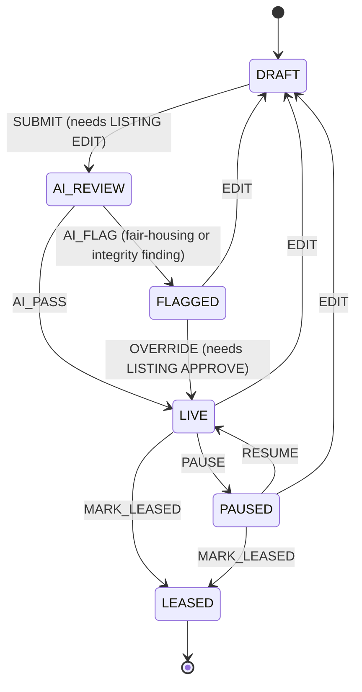

Only `LIVE` listings of companies that are not suspended appear on the public site.

### Application

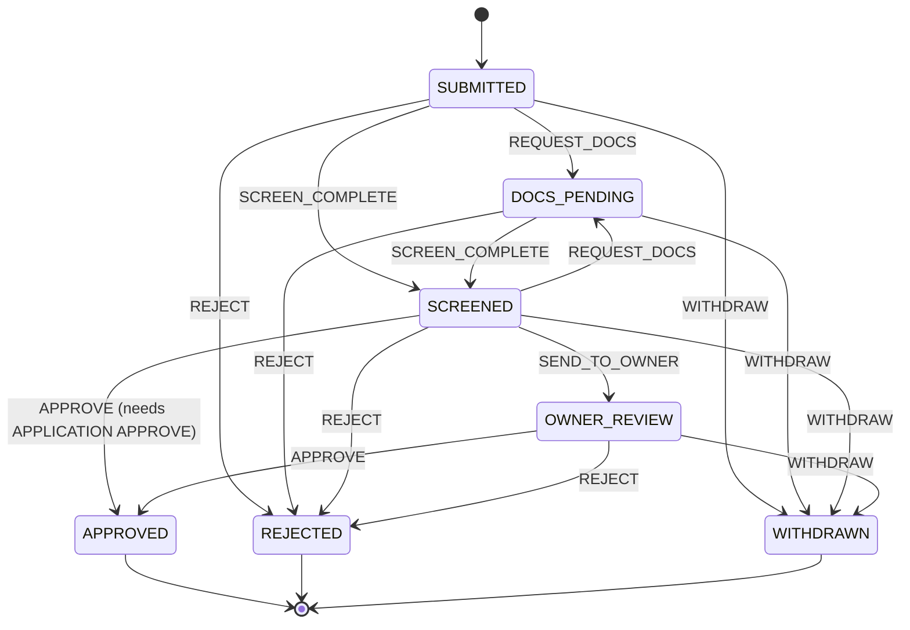

A rejection triggers an adverse-action notice when a decision relied on a consumer report. An approved application becomes a lease from `POST /api/leasing/applications/{id}/lease`.

### Lease

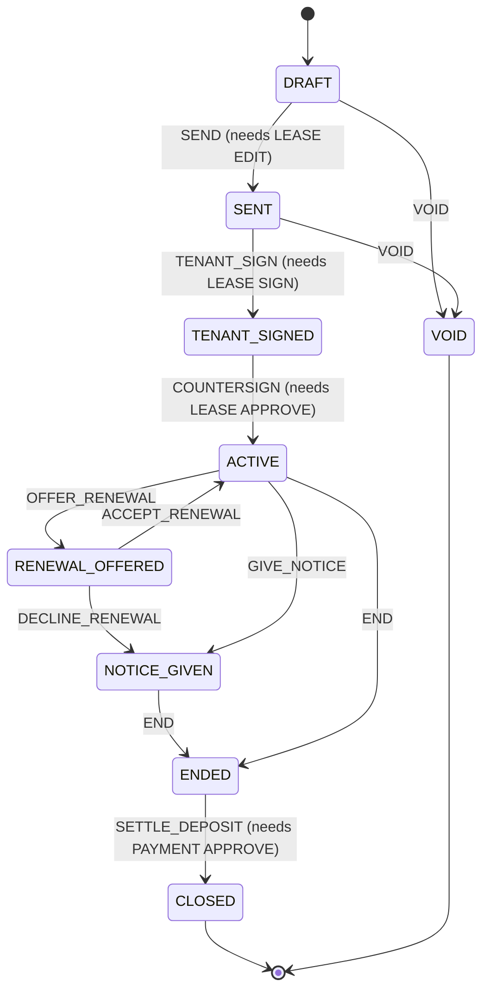

### Showing

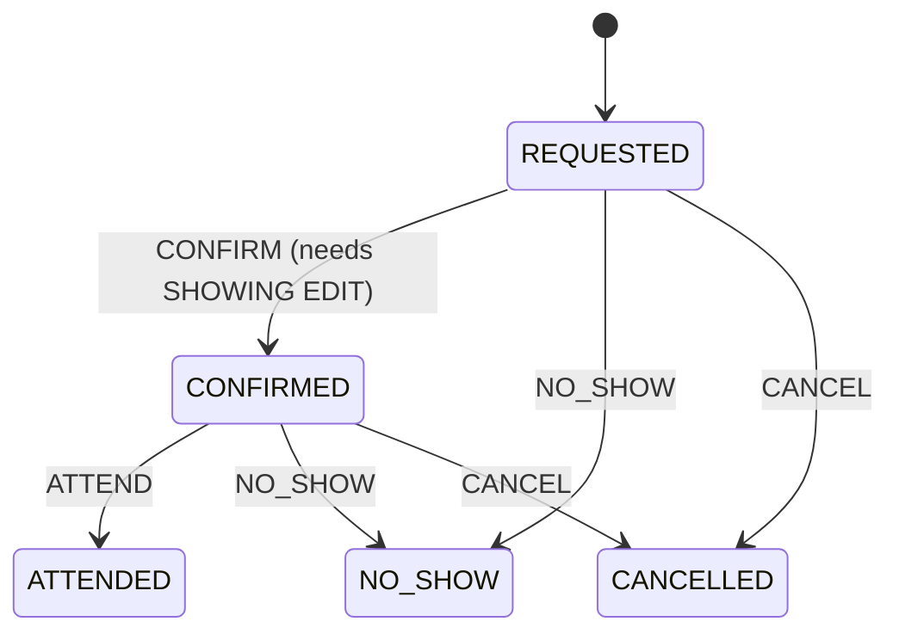

### Work order

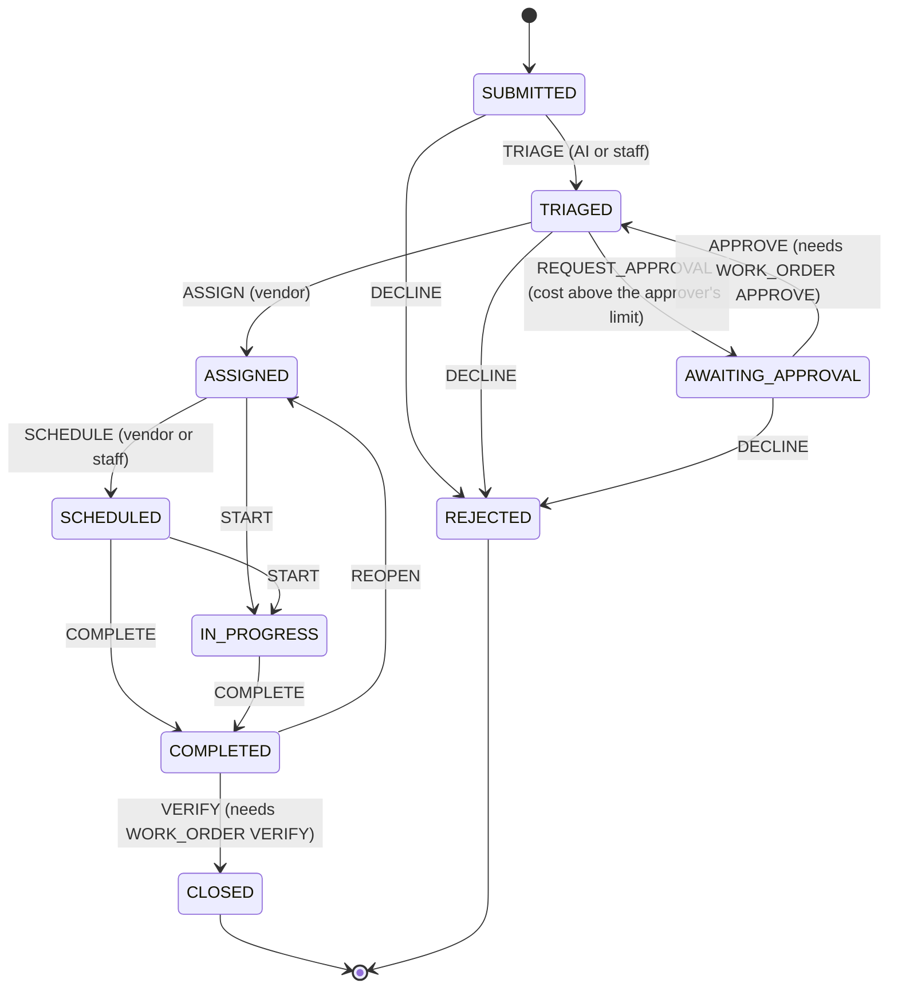

Approval limits are per role (broker $1,000, property manager $5,000, the owner's own limit) and configured under `approvals`.

### Money objects

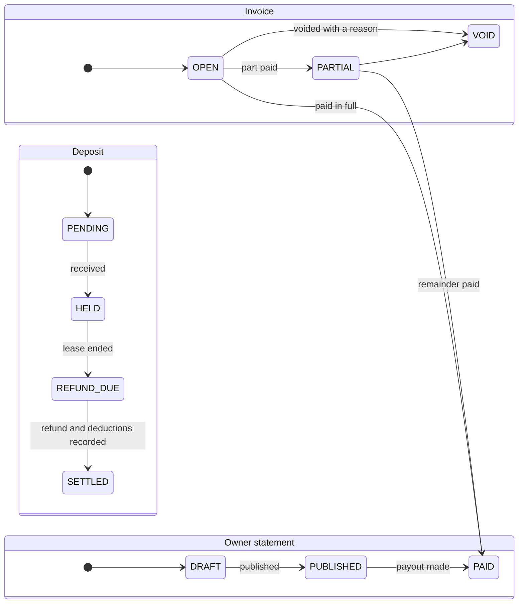

## 5. Scheduled jobs

Times are `America/Chicago`. Each job runs inside the service that owns its data, and a company-level lock stops two instances running the same job for the same company at once.

| Job | Service | When | What it does |
| --- | --- | --- | --- |
| Event poller | every service | every 1.5 s | Delivers new events to that service's handlers |
| Suspended-company refresh | every service | every 10 s | Reloads the suspended-company list, so a suspension reaches every service within about 10 s |
| **Rent cycle** (`BillingCycleJob`) | billing | 02:00 daily | Creates the period's invoices, applies late fees, takes autopay; one live invoice per lease and period is guaranteed by a unique index |
| **Subscription billing** (`PlatformBilling`) | identity | 02:30 daily | Raises each company's monthly PropertyOS invoice (units times plan price, never below the plan minimum) when automatic billing is on |
| Billing alerts | billing | 07:05 daily | Reminders before rent is due, overdue notices, failed-payment alerts |
| Lease alerts | leasing | 07:15 daily | Lease expiry, renewal offers, deposit refund deadlines |
| Vendor alerts | maintenance | 07:25 daily | Vendor insurance expiry, service-level breaches |
| Document alerts | document | 07:35 daily | Document expiry, signature reminders, missing W-9 |
| Lease document reconcile | document | every 5 min | Makes sure each lease has its documents and signature requests |
| Document seeder | document | every 30 s until ready | Demo-mode seeding |

Jobs for a **suspended** company are skipped. The rent-cycle and subscription-billing crons can be changed with `propertyos.billing.cycle-cron` and `propertyos.platform-billing.cron`; automatic subscription billing is switched by `PROPERTYOS_PLATFORM_BILLING_AUTO` (the AWS demo runs with it on).

## 6. The nightly rent cycle

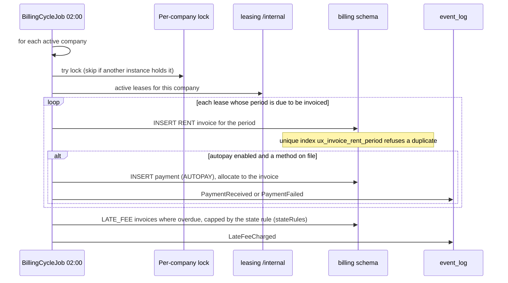

Late fees are capped by the property's state rule (`enforceStateFeeCaps`); convenience fees are blocked in states that forbid them. A payment records how it was split across invoices in `allocations`.

## 7. Public homes search

Visitors are not signed in, so the service runs the query **as the system** with explicit filters instead of relying on row-level security: only `LIVE` listings of companies that are **not suspended**.

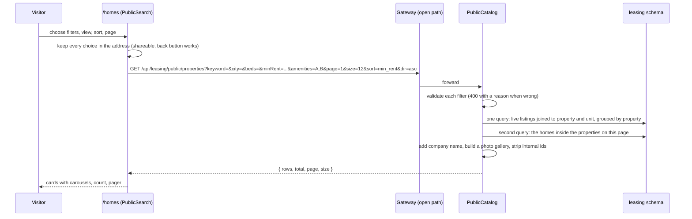

| Endpoint | Returns |
| --- | --- |
| `GET /public/properties` | One row per property with at least one matching available home: price range, bed and size ranges, next availability, rating, amenities, photos and the matching `units` inside it |
| `GET /public/listings` | One row per home, with the same filters |
| `GET /public/facets` | The choices worth offering: cities with counts, states, property types, bedroom counts, **amenities with their icon and how many homes have each**, rent and size ranges |
| `GET /public/listings/{id}` | One home in full, plus `company` (name, logo, phone, email, website), `other_homes` in the same building and `amenity_icons` |

Filters: `keyword` (property, street, city or ZIP), `city`, `state`, `type`, `beds`, `baths`, `minRent`, `maxRent`, `minSqft`, `maxSqft`, `availableBy`, `amenities` (comma separated, **a home must have all of them**). Without `page` the list is a plain array for older callers; with it, `{rows, total, page, size}`. Sort columns are validated against what the query returns, so a request cannot sort or filter on anything else. `%` and `_` in the keyword are searched literally. The internal company reference is removed from every public row.

## 8. The amenity catalogue

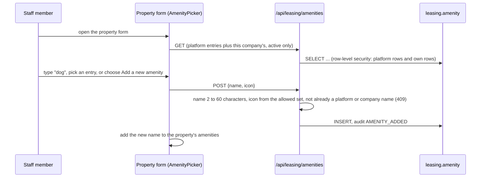

Rules: a company may not repeat a name the platform already offers (so the picker never shows two of the same); a company can change only its own entries (the platform's answer 403 *"That amenity belongs to the platform list"*); the platform administrator manages the shared list under `/api/leasing/platform/amenities`; switching an entry off hides it from the picker but leaves properties that have it untouched. Icons come from a fixed set of about fifty drawn by the front end, so a stored icon name always renders; a name typed before the catalogue existed gets an icon guessed from its words.

## 9. Configuration resolution and branding

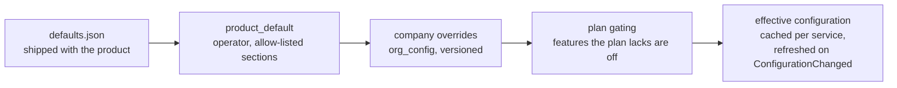

A setting change is validated on save (for example colours must be six-digit hex, a logo must be a PNG or JPEG under 100 KB, contact phone, email and website must look like what they claim to be), stored as a new version with the previous one kept, audited, and announced so every service refreshes within seconds.

**Branding** is the visible end of this chain:

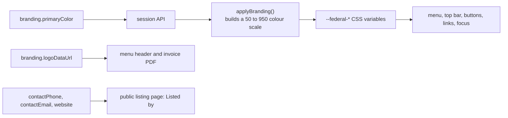

The default colour is not applied (the stylesheet already has it), so an untouched company looks exactly as shipped. Each micro-frontend has its own data cache, so saving a setting broadcasts a `pos:refresh-session` browser event and the session re-reads at once.

## 10. An AI request

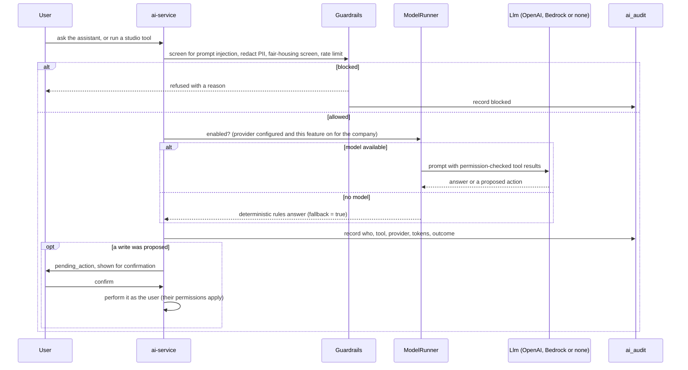

The assistant uses tools that run with **the asking user's permissions**, so it can never see or do more than they can. See [AI](../AI.md).

## 11. Account and company lifecycle

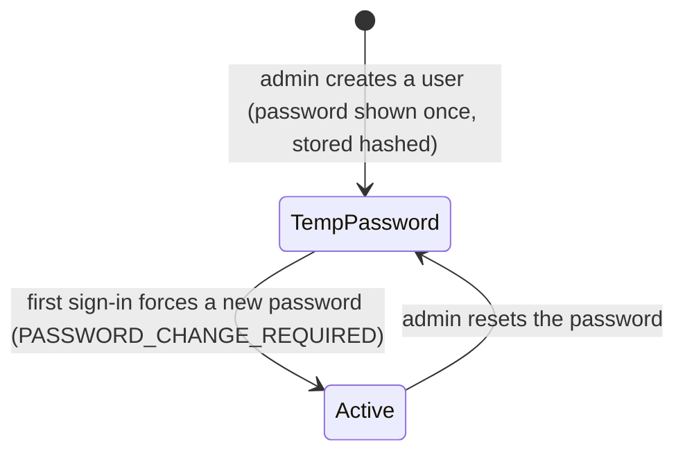

Five wrong one-time sign-in codes lock that code (the failed attempts are counted even though the request fails).

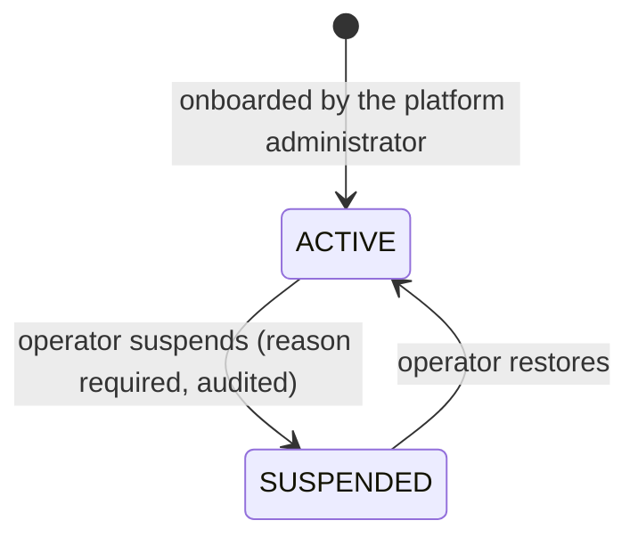

A suspension takes effect everywhere within about 10 seconds: sign-in and every API call are refused with `ORG_SUSPENDED`, the company's public listings disappear, and its scheduled jobs are skipped. Platform operators are never given a company's business data.

## 12. Errors

Every failure is `application/problem+json` (RFC 7807) with a stable `code`, built in one place (`GlobalExceptionHandler`) from typed `ApiException` factories.

| Status | Meaning | Example `code` |
| --- | --- | --- |
| 400 | The request is wrong; the `detail` says how | validation messages such as "The lowest rent is above the highest rent." |
| 401 | Not signed in or the token expired | |
| 403 | Signed in but not allowed | `FEATURE_OFF`, `ORG_SUSPENDED`, `PLATFORM_NO_COMPANY_DATA`, `PASSWORD_CHANGE_REQUIRED` |
| 404 | Not found, **also used for another company's record** so existence is never revealed | |
| 409 | Conflicts with the current state | duplicate amenity name, a second live invoice for a period |
| 429 | Rate limit, with `Retry-After` | |
| 503 | A downstream service is unavailable (breaker open), with `Retry-After` | `INTERNAL` for unexpected faults, with a correlation id to quote |

The front end turns these into sentences a person can act on (`friendlyMessage`), and a 403 `ORG_SUSPENDED` signs the person out with an explanation.

## 13. Front-end composition

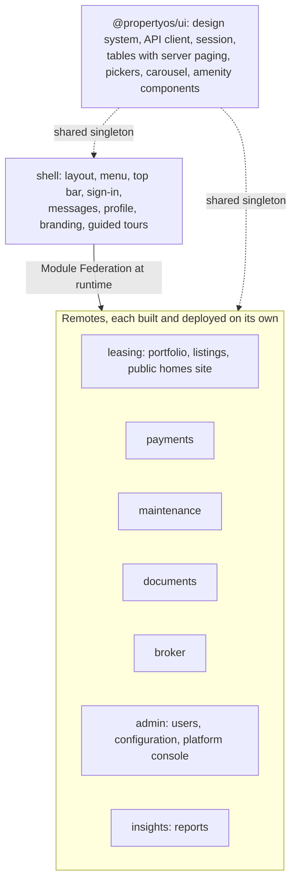

The menu is drawn once by the shell from one definition (`nav.ts`) filtered by persona, permission and plan feature; pages do not draw their own. List screens use server paging (`usePagedApi` and `DataTable`) so a list of thousands never loads at once; pickers search the server as you type (`EntityPicker`, `MultiEntityPicker`).
