# Journeys and workflows the end-to-end suite walks through

This is the map of what the Playwright suite proves, drawn as diagrams. Each diagram names the people ("personas") involved and the test id that covers it, so you can run it with `npx playwright test -g "JRNY-08"`. The diagrams are [Mermaid](https://mermaid.js.org); GitHub, VS Code (Markdown Preview Mermaid Support) and most documentation tools draw them.

How to read the suite:

| Layer | Folder | What it proves | Speed |
| --- | --- | --- | --- |
| API | `tests/api` | Each endpoint's rules, permissions, validation and error messages | seconds |
| Screens | `tests/ui` | What each person sees on each page, tables, filters, tours, phone layout | seconds |
| Journeys | `tests/journeys` | A whole story across several people and screens | minutes |

The journeys are deliberately few and long. The detail lives in the API and screen tests.

## The people

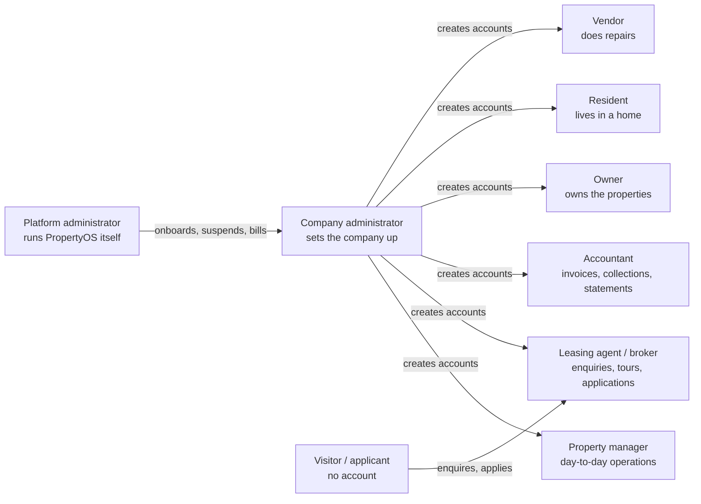

A platform administrator never opens a company's leases, payments, files or work orders. The operator pages show only company-level facts (see "The platform operator" below).

---

## 1. A company's whole life (JRNY-08, `lifecycle.spec.ts`)

The longest test. A brand-new company goes from sign-up to a resident moving out, with every person signing in with their own account.

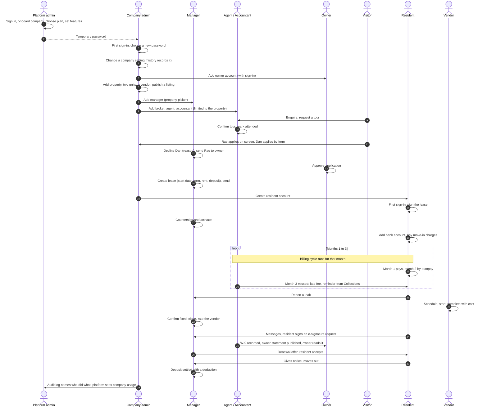

## 2. When things go wrong (JRNY-09 to JRNY-15, `hardship.spec.ts`)

Each starts from a home somebody already lives in.

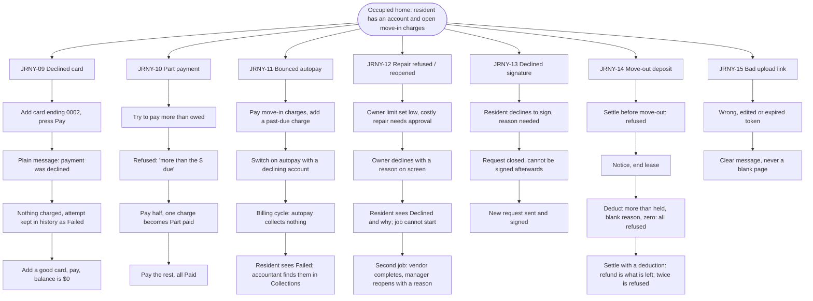

## 3. The smaller journeys (`journeys.spec.ts`)

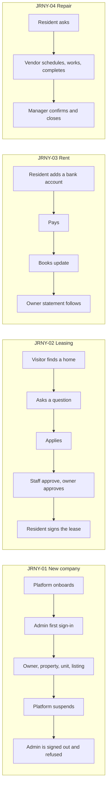

JRNY-05 (owner sees only their own portfolio and statements), JRNY-06 (resident: lease, balance, a request and a message) and JRNY-07 (vendor sees only their own jobs) check that each person sees exactly their own slice.

## 4. Rent, late fees and the billing cycle

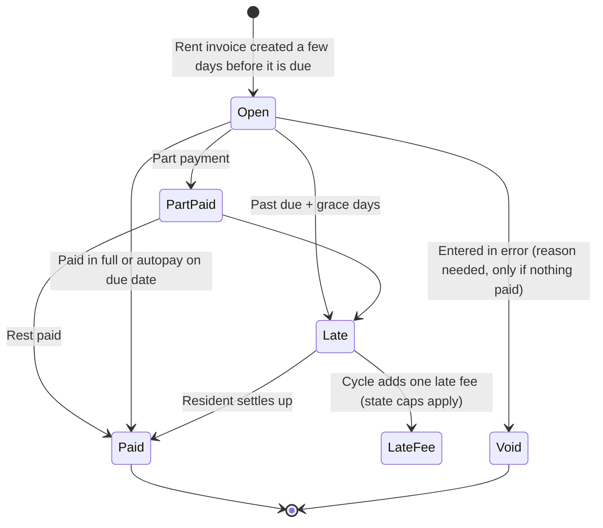

The cycle is a daily timer (2 a.m. Central). Tests move the clock with `POST /api/billing/run-cycle {"asOf": "YYYY-MM-DD"}` (demo environments only), and the integration test `theScheduleBillsRentWithoutAnyoneAskingTo` proves the timer itself works.

## 5. Application to lease

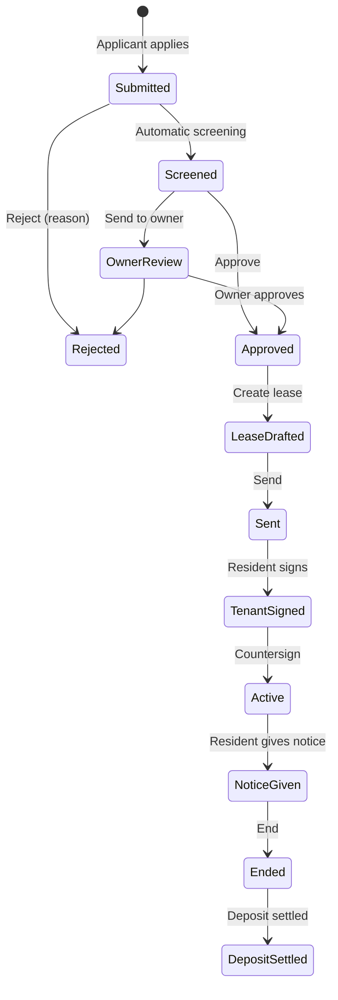

## 6. A repair

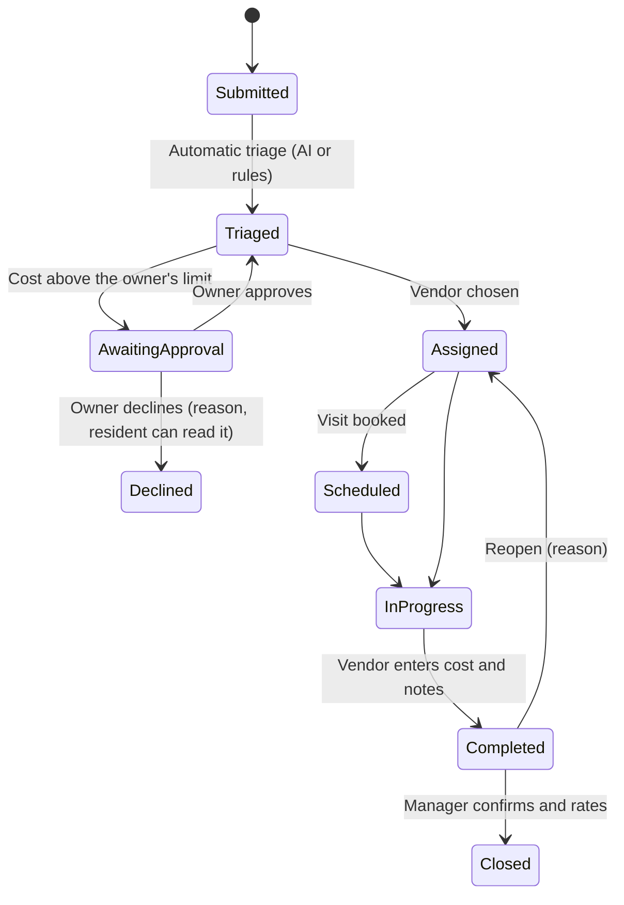

## 7. Website forms and who is told (NOTIFY-01 to 03, `notifications.api.spec.ts`)

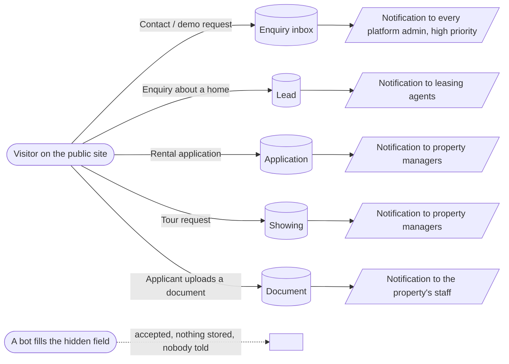

## 8. Two companies side by side (ISO-UI-01 to 03, `isolation.ui.spec.ts`)

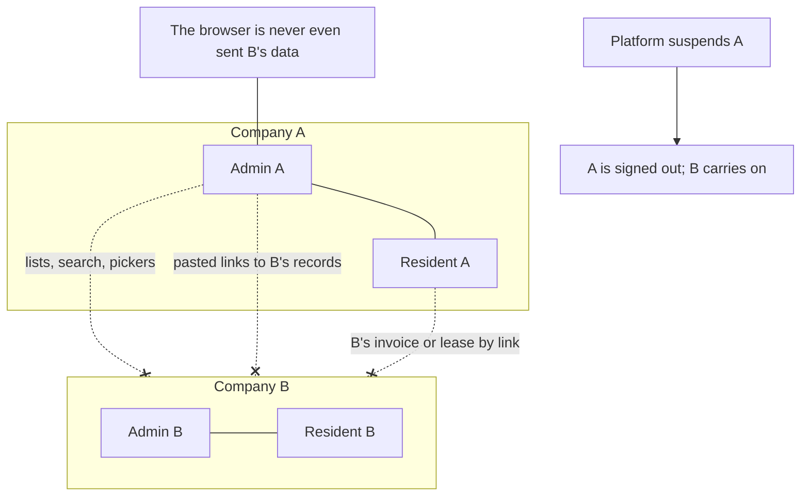

## 9. A resident on a phone (MOB-01 to 03, `resident-phone.spec.ts`)

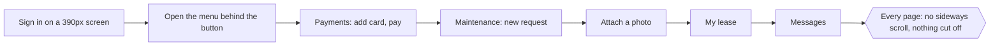

MOB-02 sweeps every resident page, MOB-03 sweeps every main staff page.

## 10. The AI features (AIM-01 to 08)

Run against a stand-in model (`E2E_FAKE_AI=1`) so the successful paths can be tested without a key.

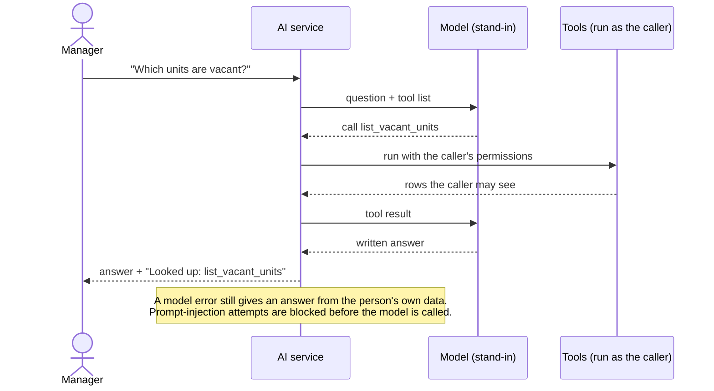

## 11. The platform operator (CONSOLE-01 to 08, PLAT-*)

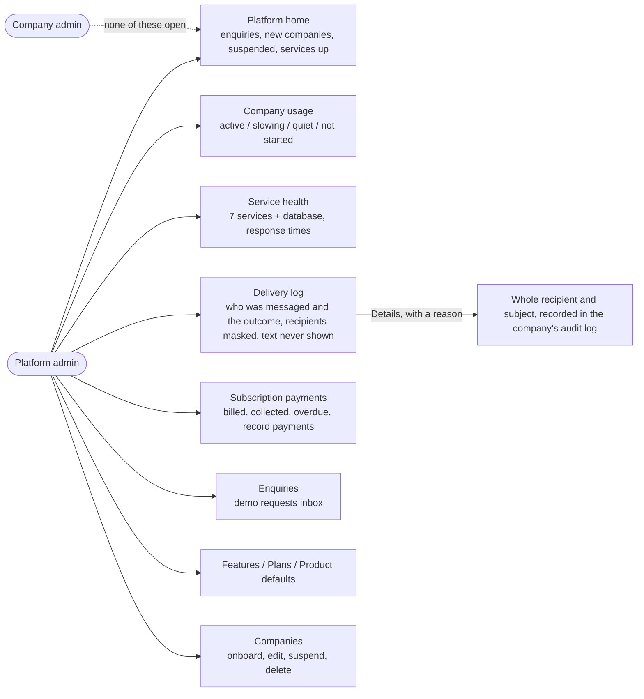

## 12. Guidance and everyday behaviour (GUIDE-*, PAGE-*, TOAST-01, ROW-01)

| Id | Story |
| --- | --- |
| GUIDE-01, 02 | First sign-in offers a welcome tour; finishing or declining is remembered; Esc leaves a tour |
| GUIDE-03, 04 | First visit to a page offers a short tour; the "?" opens help for that page |
| GUIDE-05 | Ctrl+K searches pages and records from the server |
| GUIDE-06, 07 | Getting-started list ticks itself off; a resident is shown where to start |
| PAGE-01 to 03 | 20 per page with total and size choice; pickers are searches; messages find people by typing |
| TOAST-01 | Messages appear at the top centre: green worked, yellow needs attention, red broke |
| ROW-01 | Row buttons say what they do (View, Edit, Delete) |

## 13. A company pays PropertyOS (FEES-01 to 04, FEES-UI-01)

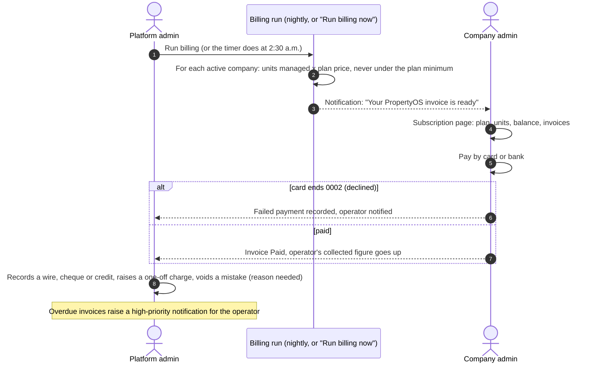

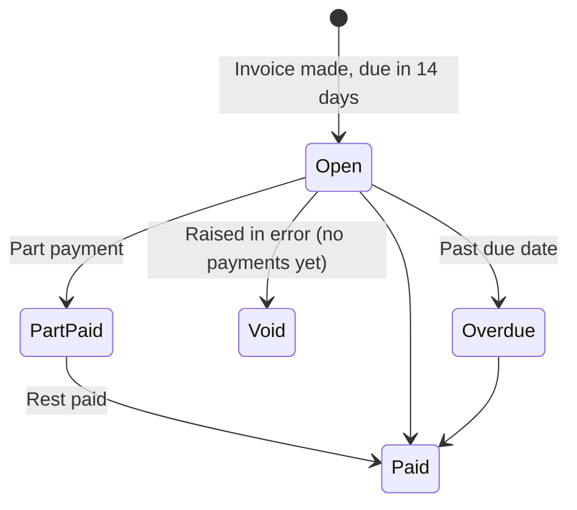

A company sees only its own invoices; another company's invoice is "not found". A platform administrator sees amounts, dates and statuses, never a company's business data.

## 14. Ratings (RATE-01 to 04, RATE-UI-01, 02)

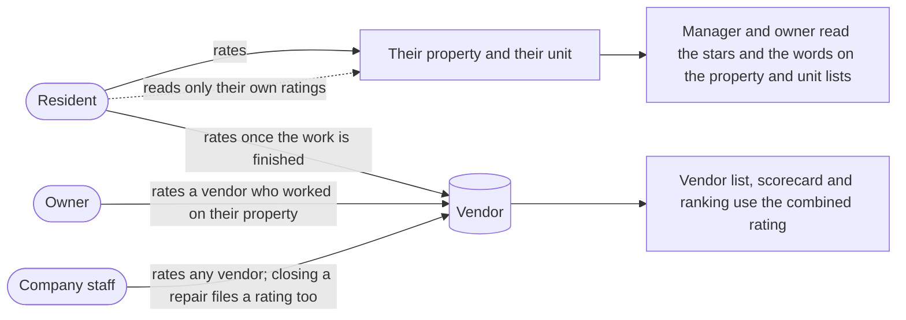

Staff do not rate the property they run, vendors do not rate themselves, and what staff wrote about a job is not shown to the resident whose job it was.

## 15. Reports (REP-01 to 06, REP-UI-01 to 03)

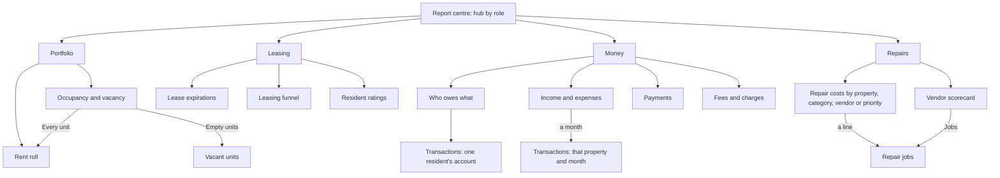

Every report has the same shape (headline figures, then a table that can be sorted, searched, filtered by column and downloaded), and what each person gets follows their role: an owner sees only their own properties, a resident and a vendor have no reports.

## 16. Company colours, logo and invoices (BRAND-01, INV-01, INV-02, LIST-01, LIST-02)

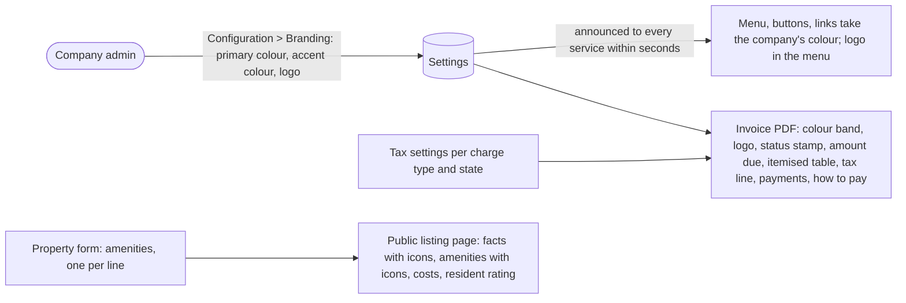

## 17. Amenities and the public homes search (AMEN-01 to AMEN-04)

A company adds an amenity with an icon, picks it on a property, and a visitor finds the home by it. The platform administrator keeps the shared list. Visitors browse by property or by home, filter, sort and page, and see who is renting the home out.

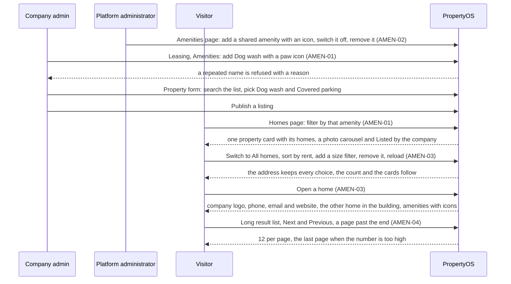

Spec: `tests/ui/amenities.ui.spec.ts`. The API rules behind it (names, icons, permissions, filters, paging, no internal ids) are in `PublicCatalogIT`.

## Where each test id lives

| Prefix | File |
| --- | --- |
| JRNY-01 to 07 | `tests/journeys/journeys.spec.ts` |
| JRNY-08 | `tests/journeys/lifecycle.spec.ts` |
| JRNY-09 to 15 | `tests/journeys/hardship.spec.ts` |
| MOB-01 to 03 | `tests/journeys/resident-phone.spec.ts` |
| ISO-UI-01 to 03 | `tests/ui/isolation.ui.spec.ts` |
| NOTIFY-01 to 03 | `tests/api/notifications.api.spec.ts` |
| AIM-01 to 06 / 07, 08 | `tests/api/ai.model.api.spec.ts` / `tests/ui/ai.model.ui.spec.ts` |
| CONSOLE-01 to 03, 09 / 04 to 08, 10 | `tests/api/platform-console.api.spec.ts` / `tests/ui/platform-console.ui.spec.ts` |
| FEES-01 to 04 | `tests/api/platform-billing.api.spec.ts` |
| RATE-01 to 04 | `tests/api/ratings.api.spec.ts` |
| REP-01 to 06 | `tests/api/reports-center.api.spec.ts` |
| BRAND, INV, RATE-UI, LIST, REP-UI, FEES-UI | `tests/ui/features.ui.spec.ts` |
| GUIDE, PAGE, TOAST, ROW | `tests/ui/guide.ui.spec.ts` |
| RBAC-08 | `tests/ui/navigation.ui.spec.ts` |
| AMEN-01 to 04 | `tests/ui/amenities.ui.spec.ts` |
